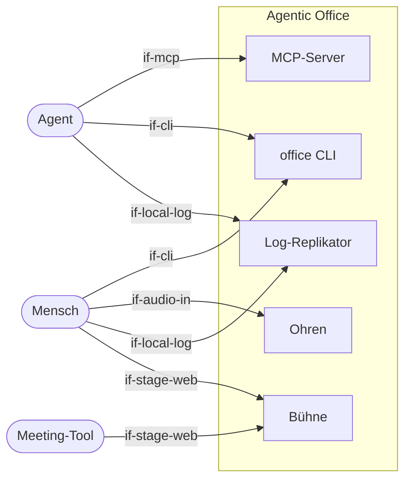

# Systemabgrenzung und Kontext

Das System besteht aus dem **Office-Server** und dem **Teilnehmer-Client** (CLI/MCP, Log-Replikator,
optional Ohren). Außerhalb liegen die Teilnehmer selbst (Menschen und Agenten) sowie das
Meeting-Tool, das nur als Transportweg für die geteilte Bühne dient.

## Kontextdiagramm

```arc42
:::diagram
id: context-overview
view: context
notation: mermaid
aliases: actor_human=actor-human, actor_agent=actor-agent, actor_meeting=actor-meeting-tool, bb_cli=bb-cli, bb_mcp=bb-mcp, bb_replicator=bb-replicator, bb_ears=bb-ears, bb_stage=bb-stage
:::
```



## Menschlicher Teilnehmer

Ein Teammitglied in einem Meeting. Es nutzt die CLI wie ein Agent (Artefakte zeigen, sich melden,
Minutes bearbeiten). Zusätzlich kann es mit `--mic` die Ohren einschalten. Dann wird lokal
transkribiert, und es sieht im Terminal, was erfasst und gesendet wurde. Eine Person öffnet die
Bühne im Browser und teilt sie im Meeting.

```arc42
:::actor
id: actor-human
title: Menschlicher Teilnehmer
type: person
description: Spricht (optional transkribiert), nutzt CLI, teilt die Bühne
requires: if-cli, if-audio-in, if-local-log, if-stage-web
:::
```

## Agent

Ein beliebiger Agent (z. B. Claude Code oder ein Agent auf Basis des Agent SDK). Er tritt einer
Session bei, liest das lokal replizierte Log als Datei (`tail -f`, `grep`) und handelt über
Tools (MCP oder CLI). Er bringt die gesamte Intelligenz mit.

```arc42
:::actor
id: actor-agent
title: Agent
type: system
description: Liest das Session-Log als Datei, schreibt über Tools; führt Minutes, meldet sich, erzeugt Artefakte
requires: if-mcp, if-cli, if-local-log
:::
```

## Meeting-Tool

Zoom, Teams, Meet, Jitsi oder ein anderes Tool. Es wird nicht integriert. Es transportiert nur
die Bildschirmfreigabe der Bühne zu allen Teilnehmern, auch zu denen ohne Client.

```arc42
:::actor
id: actor-meeting-tool
title: Meeting-Tool
type: system
description: Transportiert die per Screenshare geteilte Bühne; keine Integration
requires: if-stage-web
:::
```
