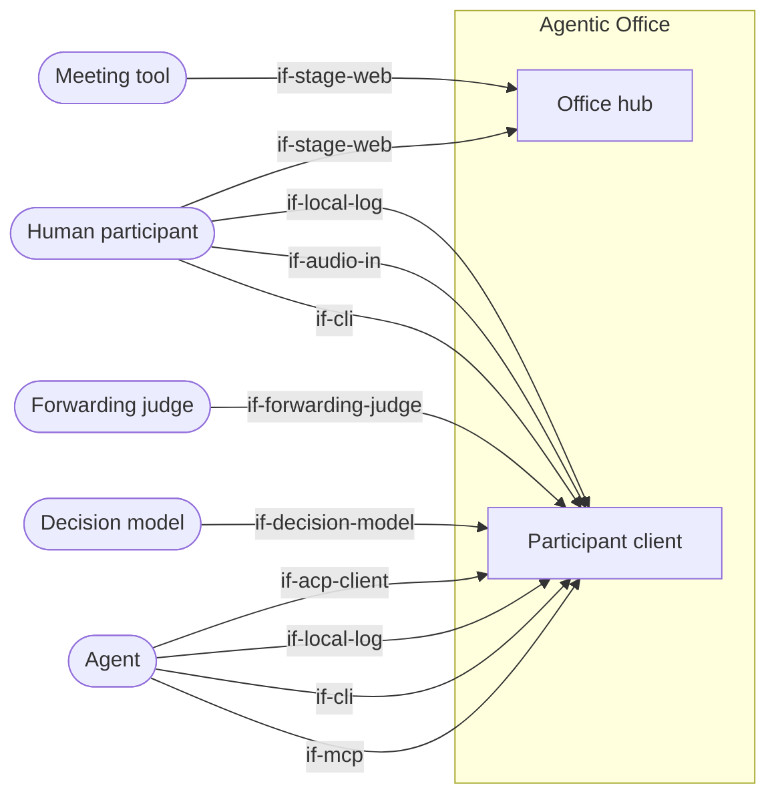

# System Scope and Context

The system has two parts: the **office hub** and the **participant client** (CLI, MCP server,
log replicator, agent runner and, optionally, the ears). The actors see both only as black boxes with their
interfaces. Outside the system are the participants themselves
(humans and agents), the meeting tool and, optionally, a forwarding judge or a decision model
that a user brings. The meeting tool only carries the shared stage.

## Context diagram

```arc42
:::diagram
id: context-overview
view: context
notation: mermaid
aliases: actor_agent=actor-agent, actor_decision_model=actor-decision-model, actor_forwarding_judge=actor-forwarding-judge, actor_human=actor-human, actor_meeting_tool=actor-meeting-tool, bb_office_hub=bb-office-hub, bb_participant_client=bb-participant-client
:::
```



## Human participant

A team member in a meeting. They use the CLI like an agent does: show artifacts, raise a hand,
edit minutes. With `--mic` they also switch on the ears. Their speech is then transcribed
locally, and the terminal shows what was captured and sent. One person opens the stage in a
browser and shares it in the meeting.

```arc42
:::actor
id: actor-human
title: Human participant
type: person
description: Speaks (optionally transcribed), uses the CLI, shares the stage
requires: if-cli, if-audio-in, if-local-log, if-stage-web
:::
```

## Agent

Any agent, for example Claude Code or an agent built on the Agent SDK. It joins a session, reads
the locally replicated log as a file (`tail -f`, `grep`) and acts through tools (MCP or CLI). It
brings all the intelligence.

An agent can also run in an **agent harness** that speaks the Agent Client Protocol (ACP), for
example Claude Code through its ACP adapter, opencode or Kiro. Then the agent runner of the client
starts the harness, opens one ACP session for the meeting and sends it what was said
(`dec-agent-runner-acp`). The harness answers as the ACP agent, and the client is the ACP client.
The agent still acts through the office tools, which the runner hands to the harness session.

```arc42
:::actor
id: actor-agent
title: Agent
type: system
description: Reads the session log as a file or gets it from the agent runner over ACP, writes through tools; keeps minutes, raises its hand, creates artifacts
requires: if-mcp, if-cli, if-local-log, if-acp-client
:::
```

## Decision model

A small model made to answer questions about a state with probabilities, which a user brings
and configures for the agent runner (`dec-byo-decision-model`), for example TypeSafe Jev or
Cloudflare Clef behind the System One API. With the wake strategy `decision-model`, the runner
asks it after each utterance of another participant how likely the agent should act now and a
block of topics has ended, and whom the speaker addressed. The office ships no such model.

```arc42
:::actor
id: actor-decision-model
title: Decision model
type: system
description: Optional, brought by the user; answers after each utterance with probabilities whether the agent should act and whether a topic has ended, and whom the speaker addressed
requires: if-decision-model
:::
```

## Forwarding judge

A model or program that a user brings and configures for the agent runner
(`dec-byo-decision-model`), and to which the runner forwards its question: for example a small
local language model behind an OpenAI-compatible endpoint, or a program. With the wake strategy
`llm`, the runner asks it after each utterance of another
participant whether the agent should act now, whom the speaker addressed and whether a block of
topics has ended. The office ships no such model.

```arc42
:::actor
id: actor-forwarding-judge
title: Forwarding judge
type: system
description: Optional, brought by the user; answers after each utterance whether the agent should act and whether a topic has ended, with a reason
requires: if-forwarding-judge
:::
```

## Meeting tool

Zoom, Teams, Meet, Jitsi or any other tool. We do not integrate it. It only carries the screen
share of the stage to all participants, including those without a client.

```arc42
:::actor
id: actor-meeting-tool
title: Meeting tool
type: system
description: Carries the stage shared by screen share; no integration
requires: if-stage-web
:::
```
