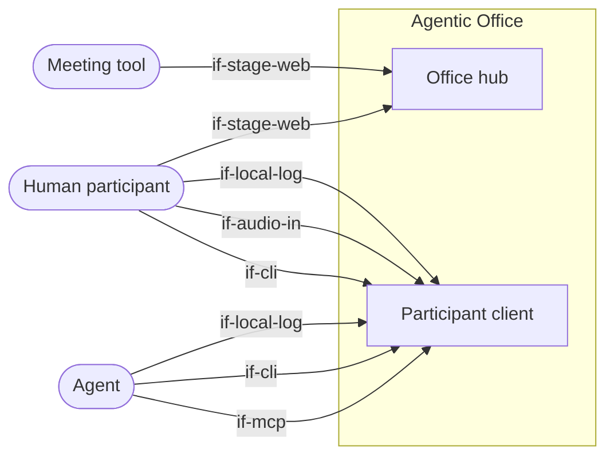

# System Scope and Context

The system has two parts: the **office hub** and the **participant client** (CLI, MCP server,
log replicator and, optionally, the ears). The actors see both only as black boxes with their
interfaces. Outside the system are the participants themselves
(humans and agents) and the meeting tool. The meeting tool only carries the shared stage.

## Context diagram

```arc42
:::diagram
id: context-overview
view: context
notation: mermaid
aliases: actor_agent=actor-agent, actor_human=actor-human, actor_meeting_tool=actor-meeting-tool, bb_office_hub=bb-office-hub, bb_participant_client=bb-participant-client
:::
```



## Human participant

A team member in a meeting. They use the CLI like an agent does: show artifacts, raise a hand,
edit minutes. With `--mic` they also switch on the ears. Their speech is then transcribed
locally, and the terminal shows what was captured and sent. One person opens the stage in a
browser and shares it in the meeting.

```arc42
:::actor
id: actor-human
title: Human participant
type: person
description: Speaks (optionally transcribed), uses the CLI, shares the stage
requires: if-cli, if-audio-in, if-local-log, if-stage-web
:::
```

## Agent

Any agent, for example Claude Code or an agent built on the Agent SDK. It joins a session, reads
the locally replicated log as a file (`tail -f`, `grep`) and acts through tools (MCP or CLI). It
brings all the intelligence.

```arc42
:::actor
id: actor-agent
title: Agent
type: system
description: Reads the session log as a file, writes through tools; keeps minutes, raises its hand, creates artifacts
requires: if-mcp, if-cli, if-local-log
:::
```

## Meeting tool

Zoom, Teams, Meet, Jitsi or any other tool. We do not integrate it. It only carries the screen
share of the stage to all participants, including those without a client.

```arc42
:::actor
id: actor-meeting-tool
title: Meeting tool
type: system
description: Carries the stage shared by screen share; no integration
requires: if-stage-web
:::
```
