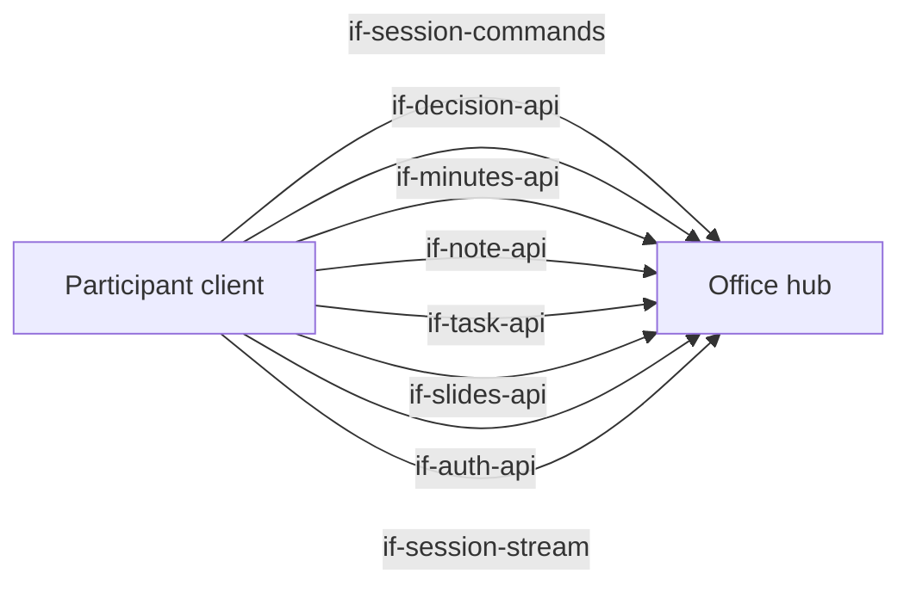
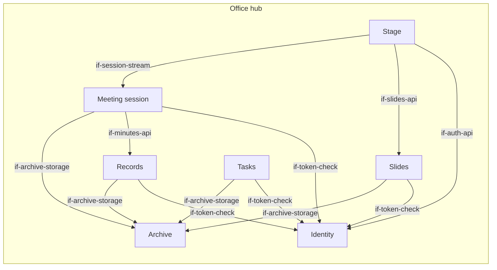
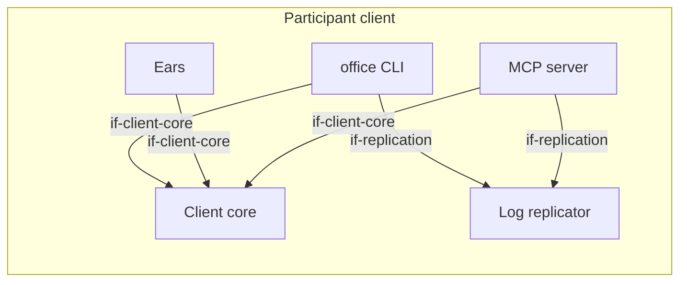

# Building Block View

The diagram shows every dependency between building blocks: an arrow is an interface that a
block lists in `requires`, pointing to the provider. The architecture test enforces exactly these
dependencies in the code (`concept-module-boundaries`). Interfaces that only external actors use
(CLI, MCP, stage view, audio input) are in chapter 3.

At the top level the system has two parts. The **office hub** manages sessions, the records of
the team (decisions, minutes and notes), the tasks, the slide decks and the stage. The **participant client** runs on the computer of every participant,
human or agent.

## Overview

```arc42
:::diagram
id: bb-overview
view: building-block
notation: mermaid
roots: bb-office-hub, bb-participant-client
aliases: bb_office_hub=bb-office-hub, bb_participant_client=bb-participant-client
:::
```



## Office hub

The central, headless part. It holds the state of the team and of running meetings, offers
deterministic tools and renders the stage. It is the gateway to the archive. It contains no LLM.

```arc42
:::building-block
id: bb-office-hub
title: Office hub
technology: Go (monorepo)
implements: concept-event-log, concept-participant-model, concept-module-boundaries
path: hub
:::
```

White box: the parts of the office hub and how they use each other. An arrow to a part that
realizes an interface of the office hub points to that part.

```arc42
:::diagram
id: bb-office-hub-whitebox
view: building-block
notation: mermaid
roots: bb-office-hub
aliases: bb_office_hub=bb-office-hub, bb_archive=bb-archive, bb_identity=bb-identity, bb_records=bb-records, bb_session_service=bb-session-service, bb_slides=bb-slides, bb_stage=bb-stage, bb_tasks=bb-tasks
:::
```



### Session commands

Synchronous calls that answer at once: `join`, `leave`, `utterance.submit`, `utterance.mark_off_the_record`,
`pause`, `hand.raise`, `minutes.update`, `stage.show`. Each successful call creates one event in the
log. Each call carries an ID created by the client, so a repeated call has no extra effect.

The session commands also let anyone with a token check a session log (`dec-merkle-log`): they
return the signed tree head of a log (for the current log or for its first events), a
consistency proof between two sizes, an inclusion proof for one event, and the public key of the
hub that signs the tree heads. The verification code for clients belongs to this interface,
because the interface owns the event types.

After a restart, a peer offers its copy of a session log with one more command
(`dec-restore-from-peers`): the events the hub misses and a tree head signed by the hub over the
copy. The hub accepts the copy only if it verifies and extends its own log. A copy that is not
longer has no effect, and a copy that does not verify or forks fails.

```arc42
:::ignore H020 Commands and stream are two contracts of one Connect service; they share its package :::
:::interface
id: if-session-commands
title: Session commands
provider: bb-office-hub
x-realized-by: bb-session-service
protocol: Connect RPC, unary (dec-connect-rpc)
path: hub/session/api
:::
```

### Session stream

Delivers the event log of a session from a cursor onwards, then live. This is the basis for local
replication and for the stage. After a drop, the subscriber reconnects with its last event ID.
It also answers a one-time request for the events after a cursor. A participant uses it when it
finds a gap in its copy, or to follow the session without a file system (`dec-events-from-cursor`).
With the last event it has, the stream sends a tree head signed by the hub over all events up to
it, so a subscriber always holds a signed head over its whole copy (`dec-signed-head-in-stream`).
A cursor beyond the end of the log means that the hub lost events: the subscriber then offers its
copy.

The interface also defines the stored form of a session log: one line per event and the signed
tree head next to it. The local log of a participant and the session log in the archive use the
same lines (`dec-yaml-git-storage`), so every reader can rebuild the events and check them
against the tree head with the event types of this interface alone.

```arc42
:::interface
id: if-session-stream
title: Session stream (replication from a cursor)
provider: bb-office-hub
x-realized-by: bb-session-service
protocol: Connect RPC, server streaming (dec-connect-rpc)
path: hub/session/api
:::
```

### Auth API

Challenge and response: the client asks for a challenge, signs it with its private key and gets a
short-lived access token that is bound to its key. Also: create a read-only stage link.

```arc42
:::interface
id: if-auth-api
title: Auth API
provider: bb-office-hub
x-realized-by: bb-identity
protocol: Connect RPC, unary (dec-connect-rpc)
path: hub/identity/api
:::
```

### Decisions

Record a decision and list the decisions, oldest first, by session and from a cursor. A decision
records its author and whether the author is a human or an agent. Each command carries an ID
created by the client, so a repeated command has no extra effect. A sentence that is off the
record must not go into a decision (`dec-off-the-record`).

```arc42
:::interface
id: if-decision-api
title: Decisions
provider: bb-office-hub
x-realized-by: bb-records
protocol: Connect RPC, unary (dec-connect-rpc)
path: hub/records/decision/api
:::
```

### Minutes

The minutes of a session. While the session runs, participants write the running minutes
through the session commands (`minutes.update`). When the session ends, the meeting session
stores the last version through this interface (`rs-session-ends`). Clients read the stored
minutes of a session and list all stored minutes; they do not write them here. A sentence that
is off the record must not go into the minutes.

```arc42
:::interface
id: if-minutes-api
title: Minutes
provider: bb-office-hub
x-realized-by: bb-records
protocol: Connect RPC, unary (dec-connect-rpc); in-process for the meeting session
path: hub/records/minutes/api
:::
```

### Notes

Add a free note, with or without a session, and list the notes like the decisions. A sentence
that is off the record must not go into a note.

```arc42
:::interface
id: if-note-api
title: Notes
provider: bb-office-hub
x-realized-by: bb-records
protocol: Connect RPC, unary (dec-connect-rpc)
path: hub/records/note/api
:::
```

### Tasks

Create a task, read one, list tasks and change them: title, description, assignee, status (open,
in progress, done, cancelled) and a link to a session. List filters by status, assignee and
session and reads page by page. A task records its author and whether the author is a human or
an agent, and who changed it last. Each command carries an ID created by the client, so a
repeated command has no extra effect. A sentence that is off the record must not go into a task.

For now every task is a local draft of the hub (`dec-yaml-git-storage`). Later the hub syncs tasks
with the task tool of the team, and the synced task replaces the draft. So that this step does
not change the contract, a task is named by a stable reference with a scheme, for example
`local:42` today and `github:owner/repo#12` later. Clients treat the reference as opaque: they
keep it and pass it back. Each task also says where it lives; today that is always the hub.
OPEN: how a synced task replaces its draft, and which side is the truth (#40).

```arc42
:::interface
id: if-task-api
title: Tasks
provider: bb-office-hub
x-realized-by: bb-tasks
protocol: Connect RPC, unary (dec-connect-rpc)
path: hub/tasks/api
:::
```

### Slides

Render a slide deck from a structured description (an optional title; slides with a title,
bullets and speaker notes) and fetch a deck by its ID, with its input and its rendered output. A
deck records its author and whether the author is a human or an agent. Each command carries an ID
created by the client, so a repeated command has no extra effect. Rendering is deterministic
(`con-no-intelligence`): the same input gives the same output. A sentence that is off the record
must not go into a deck.

A deck has an ID with the type in front, for example `slides/42`. The stage shows a deck by this
ID. In general, an artifact is anything that the stage can show by an ID like this; today slide
decks are the only type (`term-artifact`).

```arc42
:::interface
id: if-slides-api
title: Slides
provider: bb-office-hub
x-realized-by: bb-slides
protocol: Connect RPC, unary (dec-connect-rpc); in-process for the stage
path: hub/slides/api
:::
```

### Stage view

A browser view of one session, opened by a link.

```arc42
:::interface
id: if-stage-web
title: Stage view
provider: bb-office-hub
x-realized-by: bb-stage
protocol: HTTPS (browser)
path: hub/stage
:::
```

### Meeting session

Manages sessions and their participants. Accepts utterances from the ears and actions from
participants, and writes everything to one append-only event log per session. Subscribers receive
the log from a cursor onwards. Events are merged by time only: the participant model already says
who spoke.

```arc42
:::building-block
id: bb-session-service
title: Meeting session
technology: Go / connect-go
parent: bb-office-hub
implements: concept-event-log, concept-participant-model, concept-identity
requires: if-minutes-api, if-token-check, if-archive-storage
path: hub/session
:::
```

The meeting session writes the log of every session that changed to the archive, at a
configurable interval and when the session ends (`dec-session-persistence`). The write runs in
the background: commands and the stream never wait for it. At most one write is in progress. A
slow write makes the next write take everything that has come since. Every write stores the raw
log (with the original text of sentences that are off the record, and their marks) and the tree
head signed by the hub over exactly that log (`dec-merkle-log`).

When the hub starts, the meeting session reads every stored log back from the archive and checks
it against its signed tree head before it uses it (`dec-restore-from-peers`). A restored session
keeps its IDs, so every cursor stays valid. The events after the last write are lost; a peer
fills them in. Until a peer copy fits, or a configurable wait is over, a restored session that has
not ended takes no commands (`dec-signed-head-in-stream`). The archive also records whether the
hub stopped after a last write of every session; then nothing is lost and there is no wait.

### Records

The memory of the team: decisions, minutes and notes (`dec-records-per-type`). Each type has its
own interface and its own types.
Each record keeps its origin: who wrote it, and whether a human or an agent. Tasks are not part
of this block; they have their own part of the hub.

Every record is one YAML file in the archive, and every new record is one commit
(`dec-yaml-git-storage`). A command returns only after its commit, so a record that a client got
back is stored. Local commits are fast, so this does not slow the meeting; the commit of the
minutes is part of ending a session. When the hub starts, the block reads its records back from
the archive, so they survive a restart.

```arc42
:::building-block
id: bb-records
title: Records (decisions, minutes, notes)
technology: Go / YAML in the archive
parent: bb-office-hub
path: hub/records
requires: if-token-check, if-archive-storage
:::
```

### Tasks part

Keeps the tasks of the team behind the task interface (`dec-records-per-type`). For now every
task is a local draft: one YAML file in the archive per task (`dec-yaml-git-storage`). Creating a
task is one commit, and every change rewrites the file in a new commit, so the archive keeps the
history of every task. A command returns only after its commit. When the hub starts, the block
reads its tasks back from the archive, so they survive a restart. Like the records part, it
writes synchronously and can wait behind a session write of the archive (#45).

A later sync with the task tool of the team (#40) belongs to this block. Only the hub will hold
the credentials of that tool.

```arc42
:::building-block
id: bb-tasks
title: Tasks
technology: Go / YAML in the archive
parent: bb-office-hub
path: hub/tasks
requires: if-token-check, if-archive-storage
:::
```

### Slides part

Renders slide decks and keeps them behind the slides interface (`dec-records-per-type`). Rendering
is deterministic and without streaming. Every deck is stored in the archive in one commit
(`dec-yaml-git-storage`): its input as YAML and its rendered output next to it. A command returns
only after its commit. The output is stored and not rendered again on read, so a deck stays
exactly what was shown in a meeting, even if a later version of the hub renders differently.
Because rendering is deterministic, the stored input is enough to get the same output again.
When the hub starts, the block reads its decks back from the archive, so they survive a restart.
Like the records part, it writes synchronously and can wait behind a session write of the
archive (#45).

The check of business plans by calculation (consistency, unit economics, completeness) is a
different type with its own interface when it is built (#3).

```arc42
:::building-block
id: bb-slides
title: Slides
technology: Go / YAML and HTML in the archive
parent: bb-office-hub
path: hub/slides
requires: if-token-check, if-archive-storage
:::
```

### Archive

The storage that all record parts of the hub use (`dec-records-per-type`). It stores records as
files in a local Git repository on the hub host and commits locally (`dec-yaml-git-storage`).
Every change of a caller is one commit. The archive does not know the records: the caller
decides the files and their content. Callers read their files back from the current commit, for
example to rebuild their index at start. After every commit, the archive pushes to a remote. The
push is mocked for now: it does nothing and reports success. A commit can be slow, so callers
that must not wait call it in the background.

```arc42
:::building-block
id: bb-archive
title: Archive
technology: Go / local Git repository
parent: bb-office-hub
path: hub/archive
:::
```

#### Archive storage

The in-process interface of the archive: write a set of files as one commit, and read the files
of a directory as they are in the current commit. Paths are relative to the repository.

```arc42
:::interface
id: if-archive-storage
title: Archive storage
provider: bb-archive
protocol: In-process Go call
path: hub/archive/storage
:::
```

### Stage

One web page per session, shown in the meeting by screen share. It shows the running minutes,
raised hands, the shown artifact (a slide deck), and who is captured or paused. It is only a view of the session log and
has no logic of its own.

```arc42
:::building-block
id: bb-stage
title: Stage
technology: Go, rendered by the hub / server-sent events
parent: bb-office-hub
requires: if-session-stream, if-slides-api, if-auth-api
implements: concept-transparency
path: hub/stage
:::
```

### Identity

Knows all participants and their public keys. Each participant, human or agent, is its own actor
with its own Ed25519 key pair. The client creates the key pair locally and sends only the public
key. In the first stage, a new public key is registered by hand when we meet the person
(issue #2 describes a real enrollment flow). Identity issues short-lived access tokens and creates
read-only links for the stage.

```arc42
:::building-block
id: bb-identity
title: Identity
technology: Go
parent: bb-office-hub
implements: concept-identity
path: hub/identity
:::
```

#### Token check

Other parts of the hub check access tokens here and learn which participant a token belongs to.

```arc42
:::interface
id: if-token-check
title: Token check
provider: bb-identity
protocol: In-process Go call
path: hub/identity/tokencheck
:::
```

## Participant client

Runs locally on every participant's computer and is the same for humans and agents. It contains
the CLI, the MCP server, the log replicator and, optionally, the ears.

```arc42
:::building-block
id: bb-participant-client
title: Participant client
technology: Go (one binary)
implements: concept-participant-model, concept-read-file-write-tools, concept-module-boundaries
path: client
:::
```

White box: the parts of the participant client and how they use each other. An arrow to a part that
realizes an interface of the participant client points to that part.

```arc42
:::diagram
id: bb-participant-client-whitebox
view: building-block
notation: mermaid
roots: bb-participant-client
aliases: bb_participant_client=bb-participant-client, bb_cli=bb-cli, bb_client_core=bb-client-core, bb_ears=bb-ears, bb_mcp=bb-mcp, bb_replicator=bb-replicator
:::
```



### CLI

Shell commands with machine-readable output (OPEN: `--json` convention).

```arc42
:::interface
id: if-cli
title: office CLI
provider: bb-participant-client
x-realized-by: bb-cli
protocol: Shell / stdout
path: client/cli
:::
```

### MCP tools

Tools such as `meeting.join`, `meeting.leave`, `hand.raise`, `minutes.update`, `stage.show`,
`slides.render`, `slides.get`, `plan.validate`, `decision.record`, `minutes.get`, `note.add`, `task.create`,
`task.update`.

```arc42
:::interface
id: if-mcp
title: MCP tools
provider: bb-participant-client
x-realized-by: bb-mcp
protocol: MCP (stdio)
path: client/mcp
:::
```

### Local session log

An append-only JSONL file with one compact line per event. Every line carries the event type in
dotted form (for example `"type":"utterance.final"`) and the event ID as a JSON number, so that
`tail -f`, `grep` and `jq` work without conversion. The line form belongs to the session stream,
so the session log in the archive has the same lines. Next to the log, the replicator keeps the
latest tree head that the hub signed over it (`dec-signed-head-in-stream`).

```arc42
:::interface
id: if-local-log
title: Local session log
provider: bb-participant-client
x-realized-by: bb-replicator
protocol: JSONL file (append-only)
path: client/replicator
:::
```

### Audio input

The participant's local audio device (headset).

```arc42
:::interface
id: if-audio-in
title: Audio input
provider: bb-participant-client
x-realized-by: bb-ears
protocol: Local audio device
path: client/ears
:::
```

### Client core

The shared core of the CLI, the MCP server and the ears ("one core, two adapters",
`dec-cli-and-mcp`). It holds the configuration of a participant, authenticates with Identity,
creates the command IDs and calls the interfaces of the office hub. The adapters add only their
own way of talking to a human or an agent.

```arc42
:::building-block
id: bb-client-core
title: Client core
technology: Go
parent: bb-participant-client
path: client/core
requires: if-session-commands, if-auth-api, if-decision-api, if-minutes-api, if-note-api, if-task-api, if-slides-api
:::
```

#### Client core API

The in-process interface of the client core for the adapters: configuration, authenticated
clients of the office hub, command IDs and the commands of a participant.

```arc42
:::interface
id: if-client-core
title: Client core API
provider: bb-client-core
protocol: In-process Go call
path: client/core
:::
```

### office CLI

The main access for humans and for agents with a shell. `office meeting join <session> [--mic]`
starts the replication and prints the log path. With `--mic`, the terminal shows the user's own
utterances with their status (partial → final → sent / off the record). Keys let the user pause and
mark a sentence off the record. Other commands cover slides, the stage, decisions, minutes,
notes and tasks.

```arc42
:::building-block
id: bb-cli
title: office CLI
technology: Go, single binary
parent: bb-participant-client
requires: if-client-core, if-replication, if-session-commands, if-slides-api, if-auth-api
implements: concept-read-file-write-tools
path: client/cli
:::
```

### MCP server

A local MCP server (stdio) with the same features as the CLI. `meeting.join` starts the
replication and returns the path to the log file. The replication lives as long as the MCP
process.

```arc42
:::building-block
id: bb-mcp
title: MCP server
technology: Go / official MCP Go SDK
parent: bb-participant-client
requires: if-client-core, if-replication, if-session-commands, if-slides-api, if-auth-api
implements: concept-read-file-write-tools
path: client/mcp
:::
```

### Log replicator

A local process. It keeps a connection to the session stream and appends every event as one line to
a file. There is one file per session and participant, in a private runtime directory of the user,
so several participants on one machine (for example a human and an agent) do not collide and no
other user can read the file. After a drop, it reconnects and continues after the last complete
line in the file. On `session.ended` it writes a final line and stops.
It also stops when its parent process dies.

If the hub does not know its cursor, the hub has lost events (`dec-restore-from-peers`). The
replicator then offers the events the hub misses, with the signed tree head it keeps, through the
session commands. It retries until the hub has its cursor again, from its own copy or from another
peer. Before it goes on, it checks that the log of the hub up to the cursor has the same root
hash as the local log; if not, it stops with an error instead of continuing a copy that forks.

```arc42
:::building-block
id: bb-replicator
title: Log replicator
technology: Go / connect-go
parent: bb-participant-client
requires: if-session-stream, if-session-commands
implements: concept-event-log, concept-read-file-write-tools, concept-test-strategy
path: client/replicator
:::
```

#### Replication control

The in-process interface to start the replication of a session for a participant, to find a
running replicator and to stop it. The CLI runs the replicator as its own process; the MCP server
runs it inside its own process.

```arc42
:::ignore H020 The local log is a file for actors, replication control is an in-process call; both are realized by the replicator :::
:::interface
id: if-replication
title: Replication control
provider: bb-replicator
protocol: In-process Go call
path: client/replicator
:::
```

### Ears

Only for humans with `--mic`. Pipeline: microphone → VAD → Whisper (local) → utterances to the
session. The first stage needs a headset and has no voice print and no echo cancellation
(`con-headset-only`). Raw audio never leaves the device. During a network drop, the ears keep
transcribing and queue the utterances locally. They send them in order once the connection is back.

```arc42
:::building-block
id: bb-ears
title: Ears
parent: bb-participant-client
technology: Go / whisper.cpp, including its voice activity detection
requires: if-client-core, if-session-commands
implements: concept-edge-transcription, concept-test-strategy
path: client/ears
:::
```

