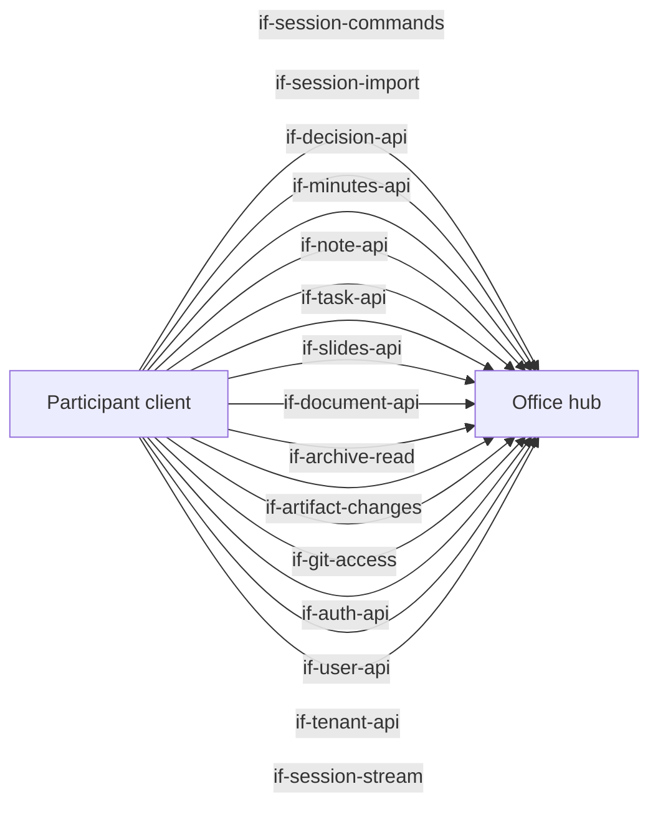
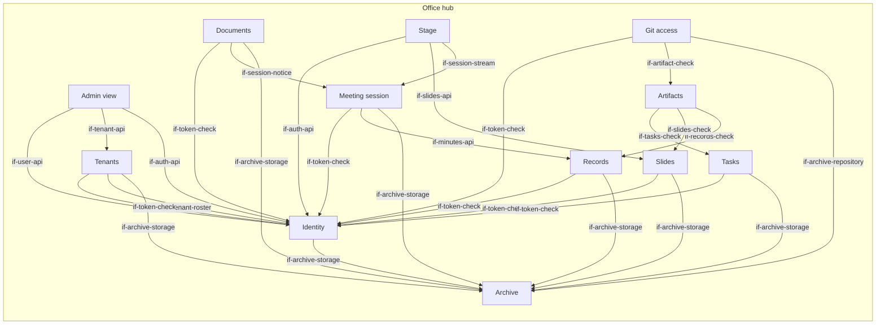
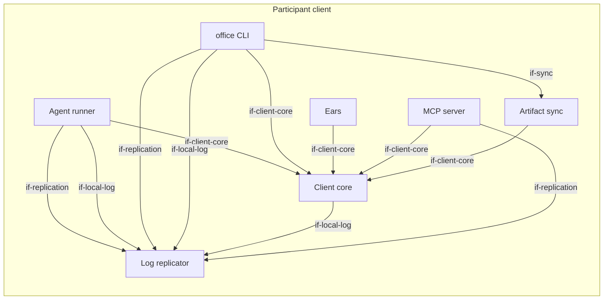

# Building Block View

The diagram shows every dependency between building blocks: an arrow is an interface that a
block lists in `requires`, pointing to the provider. The architecture test enforces exactly these
dependencies in the code (`concept-module-boundaries`). Every building block and every interface
has its own path; no two share one. Interfaces that only external actors use (CLI, MCP, stage
view, audio input) are in chapter 3.

At the top level the system has two parts. The **office hub** manages sessions, the records of
the team (decisions, minutes and notes), the tasks, the slide decks and the stage. The **participant client** runs on the computer of every participant,
human or agent.

## Overview

```arc42
:::diagram
id: bb-overview
view: building-block
notation: mermaid
roots: bb-office-hub, bb-participant-client
aliases: bb_office_hub=bb-office-hub, bb_participant_client=bb-participant-client
:::
```



## Office hub

The central, headless part. It holds the state of the team and of running meetings, offers
deterministic tools and renders the stage. It is the gateway to the archive. It contains no LLM.

```arc42
:::building-block
id: bb-office-hub
title: Office hub
technology: Go (monorepo)
implements: concept-event-log, concept-participant-model, concept-module-boundaries
path: hub
:::
```

White box: the parts of the office hub and how they use each other. An arrow to a part that
realizes an interface of the office hub points to that part.

```arc42
:::diagram
id: bb-office-hub-whitebox
view: building-block
notation: mermaid
roots: bb-office-hub
aliases: bb_office_hub=bb-office-hub, bb_admin=bb-admin, bb_archive=bb-archive, bb_artifacts=bb-artifacts, bb_documents=bb-documents, bb_git_access=bb-git-access, bb_identity=bb-identity, bb_records=bb-records, bb_session_service=bb-session-service, bb_slides=bb-slides, bb_stage=bb-stage, bb_tasks=bb-tasks, bb_tenants=bb-tenants
:::
```



### Session commands

The synchronous way to act in a session: join and leave, say something or mark a sentence off the
record, pause, raise a hand, update the minutes, focus an artifact. Each successful call creates
exactly one event in the log, and each call carries an ID created by the client, so a repeated
call has no extra effect and a client may always repeat after a drop.

The same interface lets anyone with a token check a session log (`dec-merkle-log`): it hands out
signed tree heads, proofs and the public key of the hub. It owns no log types. The events, the tree
heads and the code that verifies them belong to the session stream, which owns the event log.

After a restart, a peer offers its copy of a session log through this interface
(`dec-restore-from-peers`). The hub accepts a copy only if it verifies and extends its own log. A
copy that is not longer has no effect, and a copy that does not verify or forks fails, so a peer
can never rewrite history.

```arc42
:::interface
id: if-session-commands
title: Session commands
provider: bb-office-hub
x-realized-by: bb-session-service
protocol: Connect RPC, unary (dec-connect-rpc)
path: hub/session/commandsapi
:::
```

### Session stream

Delivers the event log of a session from a cursor onwards, then live. It is the one basis for the
local replication and for the stage, so every reader sees the same log. After a drop, the
subscriber reconnects with its last event ID. A one-time request for the events after a cursor
serves a participant that finds a gap in its copy, or that follows the session without a file
system (`dec-events-from-cursor`). With its last event, the stream sends a tree head signed by the
hub over everything up to it, so a subscriber always holds a signed head over its whole copy
(`dec-signed-head-in-stream`). A cursor beyond the end of the log means that the hub lost events;
the subscriber then offers its copy.

The interface owns the event log: the event types, the signed tree head and the code that builds
and verifies the Merkle tree (`dec-merkle-log`). The other interfaces return events and tree heads
of these types. The stored form of a session log is the same as the local one
(`dec-yaml-git-storage`), so every reader can rebuild a log and check it against its tree head
with this interface alone.

```arc42
:::interface
id: if-session-stream
title: Session stream (replication from a cursor)
provider: bb-office-hub
x-realized-by: bb-session-service
protocol: Connect RPC, server streaming (dec-connect-rpc)
path: hub/session/streamapi
:::
```

### Session import

Imports a whole conversation that happened outside the office as a new session
(`dec-session-import`): a meeting in another tool, a chat, or a conversation with an agent. It
takes the source, the participants and the utterances in order, in one call or in pages. Each page
carries an ID created by the client, so a repeated page has no extra effect.

The import only fills the log. The meeting session writes its events like those of live commands,
so the log keeps one writer, and the other interfaces treat an imported session like any other
once the import is complete. The first event marks the session as imported, so nobody mistakes it
for a live one. Until the import is complete, only the participant who started it may add pages.

The speakers of an imported conversation are not registered participants: the hub cannot check who
they are. So their IDs are marked as imported and never match a registered participant. The
signature of the hub proves which participant imported the log and that it has not changed since;
it does not prove that the speakers said what the log says.

```arc42
:::interface
id: if-session-import
title: Session import
provider: bb-office-hub
x-realized-by: bb-session-service
protocol: Connect RPC, unary (dec-connect-rpc)
path: hub/session/importapi
:::
```

### Auth API

Proves who a caller is: the client signs a challenge from the hub with its private key and gets a
short-lived access token that is bound to its key. The interface also creates the read-only links
for the stage. The calls of the meeting session, the records, the tasks and the slides name a
tenant, and Identity checks that the caller is a member of it. The auth, user and tenant APIs name
no tenant, because they work across tenants.

```arc42
:::interface
id: if-auth-api
title: Auth API
provider: bb-office-hub
x-realized-by: bb-identity
protocol: Connect RPC, unary (dec-connect-rpc)
path: hub/identity/api
:::
```

### User API

Manages users in two steps, because a user is global and a membership belongs to a tenant. First
the user and its keys are registered at the hub. Then the user is assigned to tenants with a role,
and system admins are named. A system admin may do everything, a tenant admin only the memberships
of their own tenant, and everyone else only their own keys. Every change is checked against the
rules in `concept-multi-tenancy` and refused if it breaks one. A user ID is never used again.

```arc42
:::interface
id: if-user-api
title: User API
provider: bb-office-hub
x-realized-by: bb-identity
protocol: Connect RPC, unary (dec-connect-rpc)
path: hub/identity/userapi
:::
```

### Tenant API

Creates, lists and removes tenants; only a system admin may. Creating a tenant gives it its own
repository and names its first tenant admin.

```arc42
:::interface
id: if-tenant-api
title: Tenant API
provider: bb-office-hub
x-realized-by: bb-tenants
protocol: Connect RPC, unary (dec-connect-rpc)
path: hub/tenant/api
:::
```

### Decisions

Records decisions and lists them in order, by session and from a cursor. A decision keeps its
author and whether the author is a human or an agent. Each command carries an ID created by the
client, so a repeated command has no extra effect. A sentence that is off the record must not go
into a decision (`dec-off-the-record`).

```arc42
:::interface
id: if-decision-api
title: Decisions
provider: bb-office-hub
x-realized-by: bb-records
protocol: Connect RPC, unary (dec-connect-rpc)
path: hub/records/decision/api
:::
```

### Minutes

The minutes of a session. While the session runs, participants write the running minutes through
the session commands. When the session ends, the meeting session stores the last version through
this interface (`rs-session-ends`). Clients only read the stored minutes here, so the stored
minutes have one writer. A sentence that is off the record must not go into the minutes.

```arc42
:::interface
id: if-minutes-api
title: Minutes
provider: bb-office-hub
x-realized-by: bb-records
protocol: Connect RPC, unary (dec-connect-rpc); in-process for the meeting session
path: hub/records/minutes/api
:::
```

### Notes

Adds free notes, with or without a session, and lists them like the decisions. A sentence that is
off the record must not go into a note.

```arc42
:::interface
id: if-note-api
title: Notes
provider: bb-office-hub
x-realized-by: bb-records
protocol: Connect RPC, unary (dec-connect-rpc)
path: hub/records/note/api
:::
```

### Tasks

Creates and changes tasks and lists them by status, assignee and session. A task keeps its author,
whether the author is a human or an agent, and who changed it last. Each command carries an ID
created by the client, so a repeated command has no extra effect. A sentence that is off the
record must not go into a task.

Every task is a local draft of the hub (`dec-yaml-git-storage`). A sync with the task tool of the
team would replace the draft by the synced task. So that this step does not change the contract, a
task is named by a stable reference with a scheme, for example `local:42` or
`github:owner/repo#12`. Clients treat the reference as opaque: they keep it and pass it back. Each
task also says where it lives. OPEN: how a synced task replaces its draft, and which side is the
truth.

```arc42
:::interface
id: if-task-api
title: Tasks
provider: bb-office-hub
x-realized-by: bb-tasks
protocol: Connect RPC, unary (dec-connect-rpc)
path: hub/tasks/api
:::
```

### Slides

Renders a slide deck from a structured description and returns a deck by its ID, with its input
and its rendered output. A deck keeps its author and whether the author is a human or an agent.
Each command carries an ID created by the client, so a repeated command has no extra effect.
Rendering is deterministic (`con-no-intelligence`): the same input gives the same output, so the
hub stays free of a model. A sentence that is off the record must not go into a deck.

A deck has an ID with the type in front, for example `slides/42`, and the stage shows a deck by
this ID. In general, an artifact is anything that the stage can show by an ID like this; slide
decks are the first type (`term-artifact`).

```arc42
:::interface
id: if-slides-api
title: Slides
provider: bb-office-hub
x-realized-by: bb-slides
protocol: Connect RPC, unary (dec-connect-rpc); in-process for the stage
path: hub/slides/api
:::
```

### Documents

Creates and changes text documents: Markdown files without a schema (`dec-artifacts`). The path is
the identity of a document. A change names the version that its author read, and the hub refuses
it when another change came first, so two authors never overwrite each other unnoticed. The
archive records the caller as the author of the commit. A call may name a session; the hub then
tells the meeting session, which logs it. A sentence that is off the record must not go into a
document; the hub cannot check this, so the author takes care of it.

```arc42
:::interface
id: if-document-api
title: Documents
provider: bb-office-hub
x-realized-by: bb-documents
protocol: Connect RPC, unary (dec-connect-rpc)
path: hub/documents/api
:::
```

### Admin view

A browser view for the system admins of the hub, opened by a link that a system admin creates with
the CLI. It shows the users with their keys, the tenants and the system admins, and it manages
users and keys. Memberships and tenants stay with the CLI. It has the same design as the stage.
The link works once and is swapped for an access token that the scripts of the page cannot read.

```arc42
:::interface
id: if-admin-web
title: Admin view
provider: bb-office-hub
x-realized-by: bb-admin
protocol: HTTPS (browser)
path: hub/admin/web
:::
```

### Admin part

The admin part renders the admin view on the server. It has no logic and no state of its own:
every page asks the user API and the tenant API with the access token of the system admin and shows
what it gets, so the admin view has exactly the rights of the admin key (`dec-admin-web`).

```arc42
:::building-block
id: bb-admin
title: Admin view
technology: Go, rendered by the hub
parent: bb-office-hub
requires: if-auth-api, if-user-api, if-tenant-api
path: hub/admin
:::
```

### Stage view

A browser view of one session, opened by a link.

```arc42
:::interface
id: if-stage-web
title: Stage view
provider: bb-office-hub
x-realized-by: bb-stage
protocol: HTTPS (browser)
path: hub/stage/web
:::
```

### Health check

A plain address for container platforms and load balancers. It needs no token, reads no state and
has no side effects. It answers on the TLS port of the hub, so it shows that the handshake and the
HTTP server work, not only that the port is open.

```arc42
:::interface
id: if-health
title: Health check
provider: bb-office-hub
protocol: HTTPS (GET /healthz)
path: hub/health
:::
```

### Meeting session

Manages sessions and their participants. It accepts utterances from the ears and actions from
participants, and writes everything to one append-only event log per session. It also takes
imported conversations (`if-session-import`) and writes them into the log of a new session, so a
session log has one writer in every case. Subscribers receive the log from a cursor onwards.
Events are merged by time only: the participant model already says who spoke.

```arc42
:::building-block
id: bb-session-service
title: Meeting session
technology: Go / connect-go
parent: bb-office-hub
implements: concept-event-log, concept-participant-model, concept-identity
requires: if-minutes-api, if-token-check, if-archive-storage
path: hub/session
:::
```

#### Session notice

Lets a part of the hub that writes artifacts tell the session about it. The session logs the
change for the participant who wrote, who must have joined the session.

```arc42
:::interface
id: if-session-notice
title: Session notice
provider: bb-session-service
protocol: In-process Go call
path: hub/session/notice
:::
```

The meeting session writes the log of every session that changed to the archive, at an interval
and when the session ends (`dec-session-persistence`); the end of an import also starts a write.
The write runs in the background, so commands and the stream never wait for it, and a slow write
makes the next one take everything that has come since. Every write stores the raw log, with the
original text of sentences that are off the record, and the tree head signed by the hub over
exactly that log (`dec-merkle-log`).

When the hub starts, the meeting session reads every stored log back and checks it against its
signed tree head before it uses it (`dec-restore-from-peers`). A restored session keeps its IDs, so
every cursor stays valid. The events after the last write are lost; a peer fills them in. Until a
peer copy fits, or a wait is over, a restored session that has not ended takes no commands
(`dec-signed-head-in-stream`). The archive also records whether the hub stopped after a last write
of every session; then nothing is lost and there is no wait.

### Records

The memory of the team: decisions, minutes and notes (`dec-records-per-type`). Each type has its
own interface and its own types, and each record keeps who wrote it and whether that was a human
or an agent. Tasks are not part of this block; they have their own part of the hub.

Every new record is one commit in the archive (`dec-yaml-git-storage`). A command returns only
after its commit, so a record that a client got back is stored. Local commits are fast, so this
does not slow the meeting; the commit of the minutes is part of ending a session. The block reads
its records back from the archive at start, so they survive a restart.

```arc42
:::building-block
id: bb-records
title: Records (decisions, minutes, notes)
technology: Go / YAML in the archive
parent: bb-office-hub
path: hub/records
requires: if-token-check, if-archive-storage
:::
```

#### Records check

Lets the artifacts part check a file of a record type (decision, minutes or note) before it accepts a push. The part owns the schemas of
its types, and the same check serves its own interface, so every rule exists once. The part names the schemas that it owns. A call
gives the path, the content and the name of the schema; the part answers that the file is valid, or
that it is invalid, with the reasons in plain words.

```arc42
:::interface
id: if-records-check
title: Records check
provider: bb-records
protocol: In-process Go call
path: hub/records/check
:::
```

### Tasks part

Keeps the tasks of the team behind the task interface (`dec-records-per-type`). Every change is
one commit, so the archive keeps the history of every task, and a command returns only after its
commit. Like the records part, it writes synchronously and can wait behind a session write of the
archive. A sync with the task tool of the team would belong to this block, and only the hub would
hold the credentials of that tool.

```arc42
:::building-block
id: bb-tasks
title: Tasks
technology: Go / YAML in the archive
parent: bb-office-hub
path: hub/tasks
requires: if-token-check, if-archive-storage
:::
```

#### Tasks check

Lets the artifacts part check a file of a task before it accepts a push. The part owns the schemas of
its types, and the same check serves its own interface, so every rule exists once. The part names the schemas that it owns. A call
gives the path, the content and the name of the schema; the part answers that the file is valid, or
that it is invalid, with the reasons in plain words.

```arc42
:::interface
id: if-tasks-check
title: Tasks check
provider: bb-tasks
protocol: In-process Go call
path: hub/tasks/check
:::
```

### Documents part

The documents part stores each text document as one Markdown file in the archive and one commit
per change. It checks the base version of a change and tells the meeting session when a call names
one.

```arc42
:::building-block
id: bb-documents
title: Documents
technology: Go / Markdown in the archive
parent: bb-office-hub
requires: if-token-check, if-archive-storage, if-session-notice
path: hub/documents
:::
```

### Slides part

Renders slide decks and keeps them behind the slides interface (`dec-records-per-type`).
Rendering is deterministic and without streaming. A deck is stored in one commit with its input
and its rendered output (`dec-yaml-git-storage`). The output is stored and not rendered again on
read, so a deck stays exactly what was shown in a meeting, even if a later version of the hub
renders differently; the stored input is enough to get the same output again. Like the records
part, it writes synchronously and can wait behind a session write of the archive.

The check of business plans by calculation (consistency, unit economics, completeness) is a
different type with its own interface when it is built.

```arc42
:::building-block
id: bb-slides
title: Slides
technology: Go / YAML and HTML in the archive
parent: bb-office-hub
path: hub/slides
requires: if-token-check, if-archive-storage
:::
```

#### Slides check

Lets the artifacts part check a file of a slide deck before it accepts a push. The part owns the schemas of
its types, and the same check serves its own interface, so every rule exists once. The part names the schemas that it owns. A call
gives the path, the content and the name of the schema; the part answers that the file is valid, or
that it is invalid, with the reasons in plain words.

```arc42
:::interface
id: if-slides-check
title: Slides check
provider: bb-slides
protocol: In-process Go call
path: hub/slides/check
:::
```

### Archive

The storage that all record parts of the hub use (`dec-records-per-type`): a local Git repository
on the hub host with one commit for every change of a caller (`dec-yaml-git-storage`). The archive
does not know the records: the caller decides the files and their content. A commit can be slow,
so callers that must not wait call it in the background. The push to a remote is mocked: it does
nothing and reports success.

A tenant repository has no work tree, because a participant can push to it through Git access
(`dec-artifact-sync`). The archive and a push both move the branch main in one atomic step of Git.
When a push comes first, the archive repeats its commit on the new state. The archive is the one
place that learns about every change of main, whatever its source. It finds which artifacts
changed and tells the clients that follow the tenant.

```arc42
:::building-block
id: bb-archive
title: Archive
technology: Go / local Git repository
parent: bb-office-hub
requires: if-token-check
path: hub/archive
:::
```

#### Archive read

Reads artifacts by their path (`dec-artifacts`): one file with its content and its version, or
the files of a directory. The caller needs the access token of a participant. A stage link cannot
use it, because the link is shown on the shared screen. The stage reads in-process, and only paths
that the log of its own session names. Only Markdown and YAML files can be read. Nothing under the
session logs can be read, because they hold the original of sentences that are off the record.
OPEN: how a call names the tenant, once the archive keeps one repository per tenant
(`dec-multi-tenancy`).

```arc42
:::interface
id: if-archive-read
title: Archive read
provider: bb-archive
protocol: Connect RPC, unary (dec-connect-rpc); in-process for the stage
path: hub/archive/api
:::
```

#### Archive storage

The in-process interface of the archive: write a set of files as one commit, and list and read
files as they are in the current commit. The archive keeps one git repository for each tenant and
one for the hub itself, for the users, the tenants, the memberships and the system admins. Each
repository has its own commit queue, so one tenant does not hold up another. A tenant repository is
created with the tenant and stays when the tenant is removed.

```arc42
:::interface
id: if-archive-storage
title: Archive storage
provider: bb-archive
protocol: In-process Go call
path: hub/archive/storage
:::
```

#### Archive repository

The in-process interface that lets Git access use the repository of a tenant: it says where Git
finds the repository, and it tells the archive that a push moved the branch main, so that the
archive can report the change. Git access writes no file through it.

```arc42
:::interface
id: if-archive-repository
title: Archive repository
provider: bb-archive
protocol: In-process Go call
path: hub/archive/repository
:::
```

#### Archive changes

A participant follows the changes of the artifacts of a tenant. The call needs the access token of
a participant who belongs to the tenant, and it may name path prefixes. The hub sends one event for
each change of the branch main: the artifacts that were created, changed or removed, with their new
versions. An artifact is a Markdown or YAML file, and nothing under the session logs is ever named.
An event holds no content and the stream has no position and no replay. A client that connects, or
connects again, first updates its clone through Git access and then follows. A change that the
archive wrote and a change that came by a push give the same event.

```arc42
:::interface
id: if-artifact-changes
title: Archive changes
provider: bb-archive
protocol: Connect RPC, server stream (dec-connect-rpc)
path: hub/archive/changes
:::
```

### Git access

Serves the repository of every tenant over the Git protocol, so that participants fetch the
artifacts of their tenant and push changes with plain Git (`dec-artifact-sync`). It has no
records of its own and no layer that translates Git; Git does the work and this part sets the
rules. It does three things:

- A gate: before Git reads anything, it checks the access token and the membership in the tenant
  of the address, and it finds the repository through the archive. A fetch has no check inside
  Git, and a push is checked inside Git only after the upload, so the gate comes first.
- Rules for every push, which Git runs before it accepts the push: the author of every new commit
  is the participant of the token; only the branch main changes and no history is rewritten; only
  artifact files change and none of them lies under the session logs; and every file with a schema
  is valid against the schema that it names. Git access knows no schema: it asks the artifacts
  part, which hands the check to the part of the hub that owns the schema. A refused push shows
  its reason to the participant.
- After an accepted push, it tells the archive that main moved.

Git alone decides whether a push builds on the current state: a push on an old base is refused,
and the participant fetches first. This is the base version of the interfaces of the types.

```arc42
:::building-block
id: bb-git-access
title: Git access
technology: Go / Git (smart HTTP)
parent: bb-office-hub
requires: if-token-check, if-archive-repository, if-artifact-check
implements: concept-multi-tenancy
path: hub/gitaccess
:::
```

#### Git protocol

The repository of a tenant under one fixed address of the hub (the hub address and the tenant).
Any Git client can fetch and push. The password is the access token of the participant, which
lives one hour; the client of the participant gives Git a fresh token when it needs one. Only
participants of the tenant get access. They read and push the branch main and nothing else. The
author of a commit has the form that the hub uses for its own commits: the display name of the
participant and an address that is built from the participant ID.

```arc42
:::interface
id: if-git-access
title: Git access
provider: bb-git-access
protocol: Git over HTTPS (smart protocol), access token as password
path: hub/gitaccess/web
:::
```

### Artifacts

Knows which part of the hub owns which schema and passes the check of a file to that part. It
owns no schema, because a schema belongs to its type (`dec-artifacts`). It finds the owner by the
name of the schema that the file names. A file that names no schema is plain text, and a file
that names a schema that no part owns is invalid. A new type needs a check in its own part and a
line in this part.

```arc42
:::building-block
id: bb-artifacts
title: Artifacts
technology: Go
parent: bb-office-hub
requires: if-records-check, if-slides-check, if-tasks-check
implements: concept-module-boundaries
path: hub/artifacts
:::
```

#### Artifact check

Checks the content of one file against the schema that the file names, whichever part owns the
schema. The answer is valid, or invalid with the reasons in plain words.

```arc42
:::interface
id: if-artifact-check
title: Artifact check
provider: bb-artifacts
protocol: In-process Go call
path: hub/artifacts/check
:::
```

### Stage

One web page per session, shown in the meeting by screen share. It shows the artifact in focus,
the other artifacts as tabs, the transcript, and who is captured or paused, with the raised hands
in the same list. The minutes are the first artifact of every session and stay in focus until
someone focuses another artifact. Until there are minutes, the stage asks for an agent that takes
them. It marks an imported session with its source and never shows it as live. It is only a view of
the session log and has no logic of its own: it reads an artifact straight from the archive
(`if-archive-read`) and renders it by its schema (`dec-artifacts`), and only paths that the log of
its own session names.

```arc42
:::building-block
id: bb-stage
title: Stage
technology: Go, rendered by the hub / server-sent events
parent: bb-office-hub
requires: if-session-stream, if-slides-api, if-auth-api, if-archive-read
implements: concept-transparency
path: hub/stage
:::
```

### Identity

Knows all users (participants), their public keys, their tenant memberships and the system admins
in one place for the whole hub, and keeps them in the hub repository through the archive. It is
the only writer there and checks every change. Each user, human or agent, is its own actor with
its own key pair. The client creates the key pair locally and sends only the public key. A user can
be a member of several tenants, with a role in each, and can also be a system admin. A new public
key is registered by hand when we meet the person. Identity issues short-lived access tokens and
creates read-only links for the stage. The token check tells the other parts of the hub who the
caller is, whether they are a system admin and which tenants they belong to with which role.

```arc42
:::building-block
id: bb-identity
title: Identity
technology: Go
parent: bb-office-hub
implements: concept-identity
requires: if-archive-storage
path: hub/identity
:::
```

#### Token check

Other parts of the hub check access tokens here and learn which participant a token belongs to.

```arc42
:::interface
id: if-token-check
title: Token check
provider: bb-identity
protocol: In-process Go call
path: hub/identity/tokencheck
:::
```

#### Tenant roster

Identity keeps the tenant records next to the users and memberships, so it can check that a
membership belongs to a tenant that exists. Tenants uses this in-process interface to create a
tenant together with its first tenant admin, to end a tenant with all its memberships, and to list
tenants. A tenant ID is never used again.

```arc42
:::interface
id: if-tenant-roster
title: Tenant roster
provider: bb-identity
protocol: In-process Go call
path: hub/identity/roster
:::
```

### Tenants

Knows the tenants and their members. A tenant is the unit of separation: its sessions, records,
tasks and slides live only in the git repository of the tenant and are visible only to its members.
Only a system admin creates, lists and removes tenants. Tenants does not keep the tenant records or
the memberships: Identity owns them and Tenants asks Identity through the tenant roster. Creating
a tenant also creates its repository (`if-archive-storage`). Synchronisation with
remotes is not part of this stage.

```arc42
:::building-block
id: bb-tenants
title: Tenants
technology: Go
parent: bb-office-hub
implements: concept-multi-tenancy
requires: if-token-check, if-tenant-roster, if-archive-storage
path: hub/tenant
:::
```

## Participant client

Runs locally on every participant's computer and is the same for humans and agents. It contains
the CLI, the MCP server, the log replicator, the artifact sync, the agent runner and, optionally, the ears. Unlike the
hub, the client may contain models (`dec-models-in-client`): the speech model of the ears, and a
decision model that the user brings for the agent runner.

```arc42
:::building-block
id: bb-participant-client
title: Participant client
technology: Go (one binary)
implements: concept-participant-model, concept-read-file-write-tools, concept-module-boundaries
path: client
:::
```

White box: the parts of the participant client and how they use each other. An arrow to a part that
realizes an interface of the participant client points to that part.

```arc42
:::diagram
id: bb-participant-client-whitebox
view: building-block
notation: mermaid
roots: bb-participant-client
aliases: bb_participant_client=bb-participant-client, bb_agent_runner=bb-agent-runner, bb_cli=bb-cli, bb_client_core=bb-client-core, bb_ears=bb-ears, bb_mcp=bb-mcp, bb_replicator=bb-replicator, bb_sync=bb-sync
:::
```



### CLI

Shell commands with machine-readable output (OPEN: `--json` convention).

```arc42
:::interface
id: if-cli
title: office CLI
provider: bb-participant-client
x-realized-by: bb-cli
protocol: Shell / stdout
path: client/cli/commands
:::
```

### MCP tools

The office as tools for an agent, with the same features as the CLI: join and leave a meeting,
raise a hand, update the minutes, focus an artifact, render slides, record decisions, add notes,
create and update tasks, import a session. The names say what an agent does, not how the hub works.

```arc42
:::interface
id: if-mcp
title: MCP tools
provider: bb-participant-client
x-realized-by: bb-mcp
protocol: MCP (stdio)
path: client/mcp/tools
:::
```

### Local session log

An append-only file with one line per event. Every line carries the event type and the event ID in
a form that ordinary tools read without conversion (`tail -f`, `grep`, `jq`). The line form
belongs to the session stream, so the session log in the archive has the same lines. Next to the
log, the replicator keeps the latest tree head that the hub signed over it
(`dec-signed-head-in-stream`). The parts of the client that follow the log (the CLI, the client
core and the agent runner) read it through this interface, as an agent does with `tail -f`.

```arc42
:::interface
id: if-local-log
title: Local session log
provider: bb-participant-client
x-realized-by: bb-replicator
protocol: JSONL file (append-only)
path: client/replicator/locallog
:::
```

### Audio input

The participant's local audio device (headset).

```arc42
:::interface
id: if-audio-in
title: Audio input
provider: bb-participant-client
x-realized-by: bb-ears
protocol: Local audio device
path: client/ears/audio
:::
```

### Agent Client Protocol (client side)

The participant client is the client of the Agent Client Protocol (ACP) for an agent harness, for
example Claude Code through its ACP adapter, opencode or Kiro. The agent runner starts the harness
as a child process and talks JSON-RPC with it over its standard input and output. The contract is
the published protocol; the client takes the client side and the harness the agent side
(`dec-agent-runner-acp`). The runner hands the harness the office tools as an MCP server that
runs with the key of the agent. It answers the requests of the harness for permission to use a
tool by a rule of the user (`dec-agent-runner-delivery`) and offers it no access to its file
system or terminal.

```arc42
:::interface
id: if-acp-client
title: Agent Client Protocol (client side)
provider: bb-participant-client
x-realized-by: bb-agent-runner
protocol: ACP, JSON-RPC over stdio (agentclientprotocol.com)
path: client/agentrunner/acpclient
:::
```

### Forwarding judge

The contract for a forwarding judge that the user brings (`dec-byo-decision-model`), used by the
wake strategy `llm`: the runner forwards its question to a model or program that judges. After
each utterance of another participant, and when that participant ends the turn, the runner sends
the context and the new utterances that the agent has not got yet
(`dec-wake-check-per-utterance`). The judge answers with structured output: whether the agent
should act now, whom the speaker addressed, whether a block of topics has ended, and a short reason
for the log of the runner.

The judge may be a chat endpoint or a command, so a user can bring a hosted model, a local model or
a script. The contract owns the request, the answer and its schema.

```arc42
:::interface
id: if-forwarding-judge
title: Forwarding judge
provider: bb-participant-client
x-realized-by: bb-agent-runner
protocol: OpenAI-compatible chat completions with JSON schema, or JSON on stdin and stdout of a command
path: client/agentrunner/forwardingjudge
:::
```

### Decision model

The contract for a decision model that the user brings (`dec-byo-decision-model`), used by the
wake strategy `decision-model`: the System One API, which TypeSafe Jev offers and Cloudflare Clef
states to be compatible with. After each utterance of another participant, and when that
participant ends the turn, the runner sends the state of the meeting and three questions: should
the agent act now, has a block of topics ended, and whom did the speaker address. The model
answers with probabilities, and a threshold of the user turns them into yes or no. The answer has
no reason, so the runner logs the probabilities. The contract owns the request, the state, the
questions and the answer.

```arc42
:::interface
id: if-decision-model
title: Decision model
provider: bb-participant-client
x-realized-by: bb-agent-runner
protocol: System One API, JSON over HTTPS with a bearer key
path: client/agentrunner/systemone
:::
```

### Client core

The shared core of the CLI, the MCP server and the ears ("one core, two adapters",
`dec-cli-and-mcp`). It holds the configuration of a participant, authenticates with Identity,
creates the command IDs and calls the interfaces of the office hub. It reads the import format
of conversations and sends a conversation to the session import in pages
(`dec-import-format`), so the CLI and the MCP server import in the same way. The adapters add only their
own way of talking to a human or an agent.

```arc42
:::building-block
id: bb-client-core
title: Client core
technology: Go
parent: bb-participant-client
path: client/core
requires: if-session-commands, if-session-stream, if-session-import, if-auth-api, if-user-api, if-tenant-api, if-decision-api, if-minutes-api, if-note-api, if-task-api, if-slides-api, if-local-log, if-document-api, if-archive-read
:::
```

#### Client core API

The in-process interface of the client core for the adapters: configuration, an authenticated
client of the office hub with the commands of a participant, command IDs, and the shapes of input
and output that the CLI and the MCP server share. The wiring of the participant client hands the
client core to the adapters, so they know only this contract.

```arc42
:::interface
id: if-client-core
title: Client core API
provider: bb-client-core
protocol: In-process Go call
path: client/core/api
:::
```

### office CLI

The main access for humans and for agents with a shell. It joins a meeting and starts the
replication, runs the agent runner, imports conversations, and covers slides, the stage,
decisions, minutes, notes and tasks. It sets up, updates and follows the local clone of a tenant
(`dec-artifact-sync`) but runs no other Git command: commits and pushes are plain Git. With a microphone, the terminal shows the user's own
utterances with their status and lets the user pause and mark a sentence off the record.

The CLI reads the configuration files of the client (`concept-client-configuration`), merges them
with the environment and the command-line options and hands the result to the part that runs the
command. It can show the effective settings and where each comes from.

```arc42
:::building-block
id: bb-cli
title: office CLI
technology: Go, single binary
parent: bb-participant-client
requires: if-client-core, if-replication, if-local-log, if-session-commands, if-session-stream, if-slides-api, if-auth-api, if-user-api, if-sync
implements: concept-read-file-write-tools, concept-client-configuration
path: client/cli
:::
```

### MCP server

A local MCP server (stdio) with the same features as the CLI. `meeting.join` starts the
replication and returns the path to the log file. The replication lives as long as the MCP
process.

```arc42
:::building-block
id: bb-mcp
title: MCP server
technology: Go / official MCP Go SDK
parent: bb-participant-client
requires: if-client-core, if-replication, if-session-commands, if-slides-api
implements: concept-read-file-write-tools
path: client/mcp
:::
```

### Agent runner

Keeps an agent in the meeting (`dec-agent-runner-acp`). Agents work in turns
(`con-turn-based-agents`): after a turn they wait for a human. The runner does not wait. For one
session and one agent key, it:

- joins the session as the agent and runs the log replicator in its own process, so it follows
  the local log of the agent;
- starts the agent harness, opens one ACP session, hands it the office tools as an MCP server with
  the key of the agent and sends a first prompt with the role of the agent and the meeting;
- decides with one wake strategy, chosen by the user at start, when to wake the agent
  (`dec-agent-runner-delivery`): at each change of speaker, or when a forwarding judge or a
  decision model that the user brings says so (`dec-wake-check-per-utterance`,
  `dec-byo-decision-model`); when the model fails, it falls back to the change of speaker;
- when it wakes the agent, sends what others said since its last delivery, with who said it and
  whether that participant is a human or an agent, but not the agent's own utterances or
  sentences off the record; nothing is lost and nothing is sent twice;
- after the session ends, sends a last prompt and stops the harness.

The runner never speaks for the agent and judges nothing itself: the agent decides whether it is
addressed and acts through the office tools. Whatever the harness writes as a reply is only
logged.

Inside the runner, the wake strategy is one seam that serves the runner as its consumer. The
runner hands it the pending utterances in its own terms and gets back its own verdict: wake, wait,
or check with the model. Only the strategies that use a model know the external contracts,
`if-forwarding-judge` and `if-decision-model`, and each maps the request and the verdict to its
contract. The seam lies inside the runner, so it is no interface of the model.

```arc42
:::building-block
id: bb-agent-runner
title: Agent runner
technology: Go / Agent Client Protocol
parent: bb-participant-client
requires: if-client-core, if-replication, if-local-log, if-session-stream
implements: concept-read-file-write-tools, concept-participant-model
path: client/agentrunner
:::
```

### Log replicator

A local process that keeps a connection to the session stream and appends every event as one line
to a file, so a person or an agent can follow a session with ordinary tools. There is one file for
each session and participant, in a private runtime directory of the user, so several participants
on one machine do not collide and no other user can read the file. After a drop, it reconnects and
continues after the last complete line.

If the hub does not know its cursor, the hub has lost events (`dec-restore-from-peers`). The
replicator then offers the events the hub misses, with the signed tree head it keeps, and retries
until the hub has its cursor again, from its own copy or from another peer. Before it goes on, it
checks that the log of the hub up to the cursor has the same root hash as the local log. If not,
it stops with an error instead of continuing a copy that forks.

```arc42
:::building-block
id: bb-replicator
title: Log replicator
technology: Go / connect-go
parent: bb-participant-client
requires: if-session-stream, if-session-commands
implements: concept-event-log, concept-read-file-write-tools, concept-test-strategy
path: client/replicator
:::
```

#### Replication control

The in-process interface to start the replication of a session for a participant, to find a
running replicator and to stop it. The CLI runs the replicator as its own process; the MCP server
runs it inside its own process.

```arc42
:::interface
id: if-replication
title: Replication control
provider: bb-replicator
protocol: In-process Go call
path: client/replicator/control
:::
```

### Artifact sync

Keeps a clone of the tenant repository in a directory that the participant has set up on purpose
(`dec-artifact-sync`). It never syncs a directory by itself.

- Set-up works out the address of the repository from the hub address and the tenant, clones the
  branch main and writes into the own Git configuration of the clone: the author of the
  participant, the way to get a fresh access token for Git, and a check that stops commits in the
  main directory.
- An update fetches and moves main forward without a merge. It runs when a client process starts,
  after every reconnect and on request. It stops and reports when the main directory has commits
  of its own or when the hub rewrote history. It never touches files that a participant has
  changed and not committed.
- While a client process runs, it follows the changes of the artifacts (`if-artifact-changes`),
  optionally for path prefixes, and updates the clone after each event.

The main directory is a mirror of main. Participants and agents work in worktrees next to it, on
local branches, and push with plain Git. The sync runs no other Git command than clone and
update, and the office CLI passes none on.

```arc42
:::building-block
id: bb-sync
title: Artifact sync
technology: Go / Git command line tool
parent: bb-participant-client
requires: if-client-core, if-git-access, if-artifact-changes
path: client/sync
:::
```

#### Sync control

The in-process interface to set up a directory, to update it once, to follow the changes until
the process ends, and to stop. The CLI runs the sync as its own process, like the replication.

```arc42
:::interface
id: if-sync
title: Sync control
provider: bb-sync
protocol: In-process Go call
path: client/sync/control
:::
```

### Ears

Only for humans with a microphone. Pipeline: microphone → voice activity detection → Whisper
(local) → utterances to the session. The first stage needs a headset and has no voice print and no
echo cancellation (`con-headset-only`). Raw audio never leaves the device. During a network drop,
the ears keep transcribing and queue the utterances locally. They send them in order once the
connection is back. The ears also end the turn of their participant: after a longer silence that
follows the last sentence, once per turn and never while paused. They choose their speech model by
language and speed (`dec-model-download`). They give Whisper the vocabulary of the project and the
names of the participants as a prompt (`dec-vocabulary-prompt`); the CLI reads the names from the
local log and passes them on. On request, the ears also build the vocabulary from the documents of
a project: a model for named-entity recognition finds persons, organisations and places, and simple
rules find other terms (`dec-ner-model`).

```arc42
:::building-block
id: bb-ears
title: Ears
parent: bb-participant-client
technology: Go / whisper.cpp, including its voice activity detection
requires: if-client-core, if-session-stream
implements: concept-edge-transcription, concept-test-strategy
path: client/ears
:::
```

