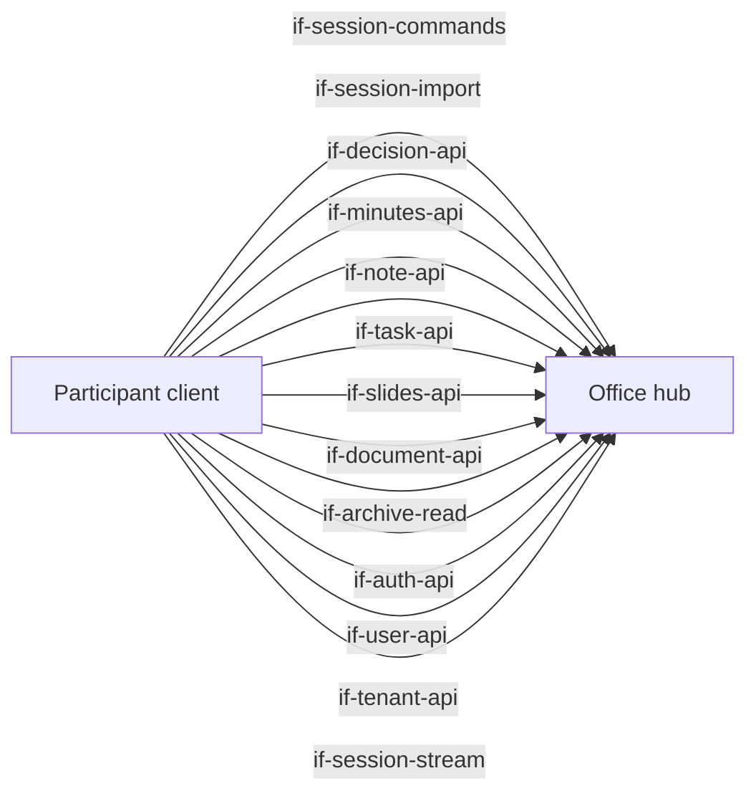
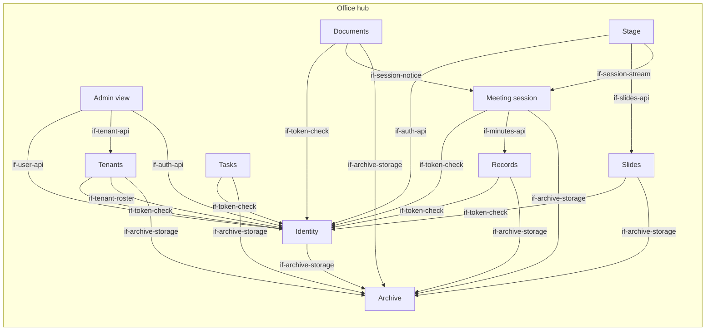
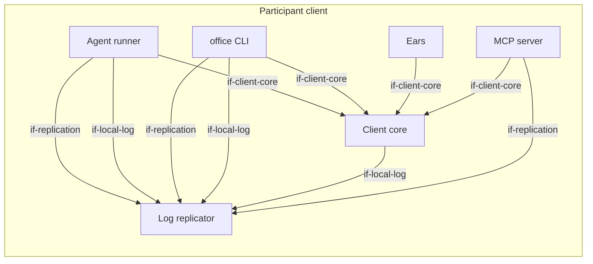

# Building Block View

The diagram shows every dependency between building blocks: an arrow is an interface that a
block lists in `requires`, pointing to the provider. The architecture test enforces exactly these
dependencies in the code (`concept-module-boundaries`). Every building block and every interface
has its own path; no two share one. Interfaces that only external actors use (CLI, MCP, stage
view, audio input) are in chapter 3.

At the top level the system has two parts. The **office hub** manages sessions, the records of
the team (decisions, minutes and notes), the tasks, the slide decks and the stage. The **participant client** runs on the computer of every participant,
human or agent.

## Overview

```arc42
:::diagram
id: bb-overview
view: building-block
notation: mermaid
roots: bb-office-hub, bb-participant-client
aliases: bb_office_hub=bb-office-hub, bb_participant_client=bb-participant-client
:::
```



## Office hub

The central, headless part. It holds the state of the team and of running meetings, offers
deterministic tools and renders the stage. It is the gateway to the archive. It contains no LLM.

```arc42
:::building-block
id: bb-office-hub
title: Office hub
technology: Go (monorepo)
implements: concept-event-log, concept-participant-model, concept-module-boundaries
path: hub
:::
```

White box: the parts of the office hub and how they use each other. An arrow to a part that
realizes an interface of the office hub points to that part.

```arc42
:::diagram
id: bb-office-hub-whitebox
view: building-block
notation: mermaid
roots: bb-office-hub
aliases: bb_office_hub=bb-office-hub, bb_admin=bb-admin, bb_archive=bb-archive, bb_documents=bb-documents, bb_identity=bb-identity, bb_records=bb-records, bb_session_service=bb-session-service, bb_slides=bb-slides, bb_stage=bb-stage, bb_tasks=bb-tasks, bb_tenants=bb-tenants
:::
```



### Session commands

Synchronous calls that answer at once: `join`, `leave`, `utterance.submit`, `utterance.mark_off_the_record`,
`pause`, `hand.raise`, `minutes.update`, `stage.focus`. Each successful call creates one event in the
log. Each call carries an ID created by the client, so a repeated call has no extra effect.

The session commands also let anyone with a token check a session log (`dec-merkle-log`): they
return the signed tree head of a log (for the current log or for its first events), a
consistency proof between two sizes, an inclusion proof for one event, and the public key of the
hub that signs the tree heads. The tree heads, the events in a result and the code that verifies
them are those of the session stream, which owns the event log.

After a restart, a peer offers its copy of a session log with one more command
(`dec-restore-from-peers`): the events the hub misses and a tree head signed by the hub over the
copy. The hub accepts the copy only if it verifies and extends its own log. A copy that is not
longer has no effect, and a copy that does not verify or forks fails.

```arc42
:::interface
id: if-session-commands
title: Session commands
provider: bb-office-hub
x-realized-by: bb-session-service
protocol: Connect RPC, unary (dec-connect-rpc)
path: hub/session/commandsapi
:::
```

### Session stream

Delivers the event log of a session from a cursor onwards, then live. This is the basis for local
replication and for the stage. After a drop, the subscriber reconnects with its last event ID.
It also answers a one-time request for the events after a cursor. A participant uses it when it
finds a gap in its copy, or to follow the session without a file system (`dec-events-from-cursor`).
With the last event it has, the stream sends a tree head signed by the hub over all events up to
it, so a subscriber always holds a signed head over its whole copy (`dec-signed-head-in-stream`).
A cursor beyond the end of the log means that the hub lost events: the subscriber then offers its
copy.

The interface owns the event log: the event types, the signed tree head and the code that builds
and verifies the Merkle tree over a log (`dec-merkle-log`). The session commands and the session
import return events and tree heads of these types. The interface also defines the stored form of
a session log: one line per event and the signed tree head next to it. The local log of a participant and the session log in the archive use the
same lines (`dec-yaml-git-storage`), so every reader can rebuild the events and check them
against the tree head with the event types of this interface alone.

```arc42
:::interface
id: if-session-stream
title: Session stream (replication from a cursor)
provider: bb-office-hub
x-realized-by: bb-session-service
protocol: Connect RPC, server streaming (dec-connect-rpc)
path: hub/session/streamapi
:::
```

### Session import

Imports a whole conversation that happened outside the office as a new session
(`dec-session-import`): a meeting in another tool, a chat, or a conversation with an agent. The
import names its source and, optionally, a title. It lists the participants (a name, human or
agent) and the utterances in order (speaker, text, modality and, if known, the time they were
made). A conversation comes in one call or in pages. Each page carries an ID created by the client,
so a repeated page has no extra effect. The last page completes the import.

The import only fills the log. The meeting session writes the events of an import like those of
live commands, and the session stream, the events after a cursor and the archive deliver them the
same way. The first event of an imported session marks it as imported, with its source and the
participant who imported it. A last event marks the end of the import. While an import is not
complete, the session takes only the next pages of the same participant. After it, the session
behaves like any other session, so participants derive minutes, decisions, notes and tasks
through the existing interfaces.

The speakers of an imported conversation are not registered participants: the hub cannot check
who they are. Their participant IDs are marked as imported, so they never match a registered
participant. The hub signs tree heads over an imported log like over every log. Such a signature
proves which participant imported the log and that the log has not changed since; it does not
prove that the speakers said what the log says.

```arc42
:::interface
id: if-session-import
title: Session import
provider: bb-office-hub
x-realized-by: bb-session-service
protocol: Connect RPC, unary (dec-connect-rpc)
path: hub/session/importapi
:::
```

### Auth API

Challenge and response: the client asks for a challenge, signs it with its private key and gets a
short-lived access token that is bound to its key. Also: create a read-only stage link. The calls of the meeting session, the records, the tasks and the slides name their tenant in a header, and Identity checks that the caller is a member of it; the auth API, the user API and the tenant API name no tenant.

```arc42
:::interface
id: if-auth-api
title: Auth API
provider: bb-office-hub
x-realized-by: bb-identity
protocol: Connect RPC, unary (dec-connect-rpc)
path: hub/identity/api
:::
```

### User API

Two steps. First, register a user at the hub: create the user, add a key, revoke a key, list users.
Second, assign the user to tenants: add the user to a tenant with the role `member` or
`tenant admin`, change the role and remove the user. Name and remove system admins. Who may do
what: a system admin everything; a tenant admin only the memberships of their own tenant; everyone
else only their own keys. Every change is checked against the rules in `concept-multi-tenancy`
and refused if it breaks one. A user ID is never used again.

```arc42
:::interface
id: if-user-api
title: User API
provider: bb-office-hub
x-realized-by: bb-identity
protocol: Connect RPC, unary (dec-connect-rpc)
path: hub/identity/userapi
:::
```

### Tenant API

Create, list and remove tenants. Creating a tenant creates its git repository and names its first
tenant admin. Who may do what: only a system admin.

```arc42
:::interface
id: if-tenant-api
title: Tenant API
provider: bb-office-hub
x-realized-by: bb-tenants
protocol: Connect RPC, unary (dec-connect-rpc)
path: hub/tenant/api
:::
```

### Decisions

Record a decision and list the decisions, oldest first, by session and from a cursor. A decision
records its author and whether the author is a human or an agent. Each command carries an ID
created by the client, so a repeated command has no extra effect. A sentence that is off the
record must not go into a decision (`dec-off-the-record`).

```arc42
:::interface
id: if-decision-api
title: Decisions
provider: bb-office-hub
x-realized-by: bb-records
protocol: Connect RPC, unary (dec-connect-rpc)
path: hub/records/decision/api
:::
```

### Minutes

The minutes of a session. While the session runs, participants write the running minutes
through the session commands (`minutes.update`). When the session ends, the meeting session
stores the last version through this interface (`rs-session-ends`). Clients read the stored
minutes of a session and list all stored minutes; they do not write them here. A sentence that
is off the record must not go into the minutes.

```arc42
:::interface
id: if-minutes-api
title: Minutes
provider: bb-office-hub
x-realized-by: bb-records
protocol: Connect RPC, unary (dec-connect-rpc); in-process for the meeting session
path: hub/records/minutes/api
:::
```

### Notes

Add a free note, with or without a session, and list the notes like the decisions. A sentence
that is off the record must not go into a note.

```arc42
:::interface
id: if-note-api
title: Notes
provider: bb-office-hub
x-realized-by: bb-records
protocol: Connect RPC, unary (dec-connect-rpc)
path: hub/records/note/api
:::
```

### Tasks

Create a task, read one, list tasks and change them: title, description, assignee, status (open,
in progress, done, cancelled) and a link to a session. List filters by status, assignee and
session and reads page by page. A task records its author and whether the author is a human or
an agent, and who changed it last. Each command carries an ID created by the client, so a
repeated command has no extra effect. A sentence that is off the record must not go into a task.

For now every task is a local draft of the hub (`dec-yaml-git-storage`). Later the hub syncs tasks
with the task tool of the team, and the synced task replaces the draft. So that this step does
not change the contract, a task is named by a stable reference with a scheme, for example
`local:42` today and `github:owner/repo#12` later. Clients treat the reference as opaque: they
keep it and pass it back. Each task also says where it lives; today that is always the hub.
OPEN: how a synced task replaces its draft, and which side is the truth (#40).

```arc42
:::interface
id: if-task-api
title: Tasks
provider: bb-office-hub
x-realized-by: bb-tasks
protocol: Connect RPC, unary (dec-connect-rpc)
path: hub/tasks/api
:::
```

### Slides

Render a slide deck from a structured description (an optional title; slides with a title,
bullets and speaker notes) and fetch a deck by its ID, with its input and its rendered output. A
deck records its author and whether the author is a human or an agent. Each command carries an ID
created by the client, so a repeated command has no extra effect. Rendering is deterministic
(`con-no-intelligence`): the same input gives the same output. A sentence that is off the record
must not go into a deck.

A deck has an ID with the type in front, for example `slides/42`. The stage shows a deck by this
ID. In general, an artifact is anything that the stage can show by an ID like this; today slide
decks are the only type (`term-artifact`).

```arc42
:::interface
id: if-slides-api
title: Slides
provider: bb-office-hub
x-realized-by: bb-slides
protocol: Connect RPC, unary (dec-connect-rpc); in-process for the stage
path: hub/slides/api
:::
```

### Documents

Create and change text documents: Markdown files under `documents` in the archive, without a
schema (`dec-artifacts`). The path is the identity of a document. A change names the version that
its author read, and the hub refuses it when another change came first. The archive records the
participant who calls as the author of the commit. A call may name a session; the hub then tells
the meeting session, which appends `artifact.created` or `artifact.changed`. A sentence that is off
the record must not go into a document; the author takes care of that.

```arc42
:::interface
id: if-document-api
title: Documents
provider: bb-office-hub
x-realized-by: bb-documents
protocol: Connect RPC, unary (dec-connect-rpc)
path: hub/documents/api
:::
```

### Admin view

A browser view for the system admins of the hub, opened by a link that a system admin creates with
the CLI. It shows the users with their keys, the tenants and the system admins, and it creates users
and adds and revokes keys. Memberships and tenants are still managed with the CLI. It has the same
design as the stage. The link holds a code that works once;
the admin view swaps it for an access token and keeps the token in a cookie that the page scripts
cannot read.

```arc42
:::interface
id: if-admin-web
title: Admin view
provider: bb-office-hub
x-realized-by: bb-admin
protocol: HTTPS (browser)
path: hub/admin/web
:::
```

### Admin part

The admin part renders the admin view on the server. It has no logic and no state of its own:
every page asks the user API and the tenant API with the access token of the system admin and shows
what it gets, so the admin view has exactly the rights of the admin key (`dec-admin-web`).

```arc42
:::building-block
id: bb-admin
title: Admin view
technology: Go, rendered by the hub
parent: bb-office-hub
requires: if-auth-api, if-user-api, if-tenant-api
path: hub/admin
:::
```

### Stage view

A browser view of one session, opened by a link.

```arc42
:::interface
id: if-stage-web
title: Stage view
provider: bb-office-hub
x-realized-by: bb-stage
protocol: HTTPS (browser)
path: hub/stage/web
:::
```

### Meeting session

Manages sessions and their participants. Accepts utterances from the ears and actions from
participants, and writes everything to one append-only event log per session. It also takes
imported conversations (`if-session-import`) and writes them into the log of a new session, so a
session log has one writer in every case. Subscribers receive
the log from a cursor onwards. Events are merged by time only: the participant model already says
who spoke.

```arc42
:::building-block
id: bb-session-service
title: Meeting session
technology: Go / connect-go
parent: bb-office-hub
implements: concept-event-log, concept-participant-model, concept-identity
requires: if-minutes-api, if-token-check, if-archive-storage
path: hub/session
:::
```

#### Session notice

The notice interface lets a part of the hub that writes artifacts tell the session about it. The
session appends `artifact.created` or `artifact.changed` for the participant who wrote, who must
have joined the session.

```arc42
:::interface
id: if-session-notice
title: Session notice
provider: bb-session-service
protocol: In-process Go call
path: hub/session/notice
:::
```

The meeting session writes the log of every session that changed to the archive, at a
configurable interval and when the session ends (`dec-session-persistence`). The end of an import
also starts a write, so an imported session reaches the archive soon (`dec-session-import`). The write runs in
the background: commands and the stream never wait for it. At most one write is in progress. A
slow write makes the next write take everything that has come since. Every write stores the raw
log (with the original text of sentences that are off the record, and their marks) and the tree
head signed by the hub over exactly that log (`dec-merkle-log`).

When the hub starts, the meeting session reads every stored log back from the archive and checks
it against its signed tree head before it uses it (`dec-restore-from-peers`). A restored session
keeps its IDs, so every cursor stays valid. The events after the last write are lost; a peer
fills them in. Until a peer copy fits, or a configurable wait is over, a restored session that has
not ended takes no commands (`dec-signed-head-in-stream`). The archive also records whether the
hub stopped after a last write of every session; then nothing is lost and there is no wait.

### Records

The memory of the team: decisions, minutes and notes (`dec-records-per-type`). Each type has its
own interface and its own types.
Each record keeps its origin: who wrote it, and whether a human or an agent. Tasks are not part
of this block; they have their own part of the hub.

Every record is one YAML file in the archive, and every new record is one commit
(`dec-yaml-git-storage`). A command returns only after its commit, so a record that a client got
back is stored. Local commits are fast, so this does not slow the meeting; the commit of the
minutes is part of ending a session. When the hub starts, the block reads its records back from
the archive, so they survive a restart.

```arc42
:::building-block
id: bb-records
title: Records (decisions, minutes, notes)
technology: Go / YAML in the archive
parent: bb-office-hub
path: hub/records
requires: if-token-check, if-archive-storage
:::
```

### Tasks part

Keeps the tasks of the team behind the task interface (`dec-records-per-type`). For now every
task is a local draft: one YAML file in the archive per task (`dec-yaml-git-storage`). Creating a
task is one commit, and every change rewrites the file in a new commit, so the archive keeps the
history of every task. A command returns only after its commit. When the hub starts, the block
reads its tasks back from the archive, so they survive a restart. Like the records part, it
writes synchronously and can wait behind a session write of the archive (#45).

A later sync with the task tool of the team (#40) belongs to this block. Only the hub will hold
the credentials of that tool.

```arc42
:::building-block
id: bb-tasks
title: Tasks
technology: Go / YAML in the archive
parent: bb-office-hub
path: hub/tasks
requires: if-token-check, if-archive-storage
:::
```

### Documents part

The documents part stores each text document as one Markdown file in the archive and one commit
per change. It checks the base version of a change and tells the meeting session when a call names
one.

```arc42
:::building-block
id: bb-documents
title: Documents
technology: Go / Markdown in the archive
parent: bb-office-hub
requires: if-token-check, if-archive-storage, if-session-notice
path: hub/documents
:::
```

### Slides part

Renders slide decks and keeps them behind the slides interface (`dec-records-per-type`). Rendering
is deterministic and without streaming. Every deck is stored in the archive in one commit
(`dec-yaml-git-storage`): its input as YAML and its rendered output next to it. A command returns
only after its commit. The output is stored and not rendered again on read, so a deck stays
exactly what was shown in a meeting, even if a later version of the hub renders differently.
Because rendering is deterministic, the stored input is enough to get the same output again.
When the hub starts, the block reads its decks back from the archive, so they survive a restart.
Like the records part, it writes synchronously and can wait behind a session write of the
archive (#45).

The check of business plans by calculation (consistency, unit economics, completeness) is a
different type with its own interface when it is built (#3).

```arc42
:::building-block
id: bb-slides
title: Slides
technology: Go / YAML and HTML in the archive
parent: bb-office-hub
path: hub/slides
requires: if-token-check, if-archive-storage
:::
```

### Archive

The storage that all record parts of the hub use (`dec-records-per-type`). It stores records as
files in a local Git repository on the hub host and commits locally (`dec-yaml-git-storage`).
Every change of a caller is one commit. The archive does not know the records: the caller
decides the files and their content. Callers read their files back from the current commit, for
example to rebuild their index at start. After every commit, the archive pushes to a remote. The
push is mocked for now: it does nothing and reports success. A commit can be slow, so callers
that must not wait call it in the background.

```arc42
:::building-block
id: bb-archive
title: Archive
technology: Go / local Git repository
parent: bb-office-hub
requires: if-token-check
path: hub/archive
:::
```

#### Archive read

Read artifacts from the archive by their path (`dec-artifacts`): one file with its content and
its version, or the list of the files of a directory with their versions. The caller needs the
access token of a participant. A stage link cannot use it: the link is shown on the shared
screen. The stage reads in-process, and only paths that the log of its own session names. Only
Markdown and YAML files can be read. Nothing under the session logs can be read, because they
hold the original of sentences that are off the record. OPEN: how a call names the tenant, once
the archive keeps one repository per tenant (`dec-multi-tenancy`).

```arc42
:::interface
id: if-archive-read
title: Archive read
provider: bb-archive
protocol: Connect RPC, unary (dec-connect-rpc); in-process for the stage
path: hub/archive/api
:::
```

#### Archive storage

The in-process interface of the archive: write a set of files as one commit, list the paths of a
directory, and read the files of a directory (or one file) as they are in the current commit. Paths are relative to the repository. The archive
keeps one git repository for each tenant, with a directory per kind of content, and one further
repository for the hub itself, for the users, the tenants, the memberships and the system admins. A
caller asks for the archive of a repository, and each repository has its own commit queue, so one
tenant does not hold up another. A tenant repository is created with the tenant and stays when the
tenant is removed.

```arc42
:::interface
id: if-archive-storage
title: Archive storage
provider: bb-archive
protocol: In-process Go call
path: hub/archive/storage
:::
```

### Stage

One web page per session, shown in the meeting by screen share. It shows the artifact in focus,
the other artifacts of the session as tabs, a log of the changes of artifacts, the transcript, and
who is captured or paused, with the raised hands in the same list. The minutes are the first
artifact of every session: they are the first tab and are in focus until someone focuses another
artifact (`stage focus minutes` brings them back). Until there are minutes, the stage asks for an
agent that takes them. It marks an
imported session with its source and the participant who imported it, and never shows it as
live. It is only a view of the session log and has no logic of its own. It reads an artifact
straight from the archive (`if-archive-read`) by its path and renders it by its schema (`dec-artifacts`); it reads
only paths that the log of its own session names.

```arc42
:::building-block
id: bb-stage
title: Stage
technology: Go, rendered by the hub / server-sent events
parent: bb-office-hub
requires: if-session-stream, if-slides-api, if-auth-api, if-archive-read
implements: concept-transparency
path: hub/stage
:::
```

### Identity

Knows all users (participants), their public keys, their tenant memberships and the system admins
in one place for the whole hub, and keeps them in the hub repository through the archive. It is
the only writer there and checks every change. Each user,
human or agent, is its own actor with its own Ed25519 key pair. A user can be a member of several
tenants, with a role in each (`member` or `tenant admin`). A user can also be a system admin; this
role replaces the file of admin keys. The client creates the key pair locally and sends only the public
key. In the first stage, a new public key is registered by hand when we meet the person
(issue #2 describes a real enrollment flow). Identity issues short-lived access tokens and creates
read-only links for the stage. The token check tells other parts of the hub who the caller is,
whether they are a system admin and which tenants they belong to with which role.

```arc42
:::building-block
id: bb-identity
title: Identity
technology: Go
parent: bb-office-hub
implements: concept-identity
requires: if-archive-storage
path: hub/identity
:::
```

#### Token check

Other parts of the hub check access tokens here and learn which participant a token belongs to.

```arc42
:::interface
id: if-token-check
title: Token check
provider: bb-identity
protocol: In-process Go call
path: hub/identity/tokencheck
:::
```

#### Tenant roster

Identity keeps the tenant records in the hub repository, next to the users and memberships, so it
can check that a membership belongs to a tenant that exists. Tenants uses this in-process interface
to create a tenant together with its first tenant admin, to end a tenant with all its memberships,
and to list tenants. A tenant ID is never used again.

```arc42
:::interface
id: if-tenant-roster
title: Tenant roster
provider: bb-identity
protocol: In-process Go call
path: hub/identity/roster
:::
```

### Tenants

Knows the tenants and their members. A tenant is the unit of separation: its sessions, records,
tasks and slides live only in the git repository of the tenant and are visible only to its members.
Only a system admin creates, lists and removes tenants. Tenants does not keep the tenant records or
the memberships: Identity owns them and Tenants asks Identity through the tenant roster. Creating
a tenant also creates its repository (`if-archive-storage`). Synchronisation with
remotes is not part of this stage.

```arc42
:::building-block
id: bb-tenants
title: Tenants
technology: Go
parent: bb-office-hub
implements: concept-multi-tenancy
requires: if-token-check, if-tenant-roster, if-archive-storage
path: hub/tenant
:::
```

## Participant client

Runs locally on every participant's computer and is the same for humans and agents. It contains
the CLI, the MCP server, the log replicator, the agent runner and, optionally, the ears. Unlike the
hub, the client may contain models (`dec-models-in-client`): the speech model of the ears, and a
decision model that the user brings for the agent runner.

```arc42
:::building-block
id: bb-participant-client
title: Participant client
technology: Go (one binary)
implements: concept-participant-model, concept-read-file-write-tools, concept-module-boundaries
path: client
:::
```

White box: the parts of the participant client and how they use each other. An arrow to a part that
realizes an interface of the participant client points to that part.

```arc42
:::diagram
id: bb-participant-client-whitebox
view: building-block
notation: mermaid
roots: bb-participant-client
aliases: bb_participant_client=bb-participant-client, bb_agent_runner=bb-agent-runner, bb_cli=bb-cli, bb_client_core=bb-client-core, bb_ears=bb-ears, bb_mcp=bb-mcp, bb_replicator=bb-replicator
:::
```



### CLI

Shell commands with machine-readable output (OPEN: `--json` convention).

```arc42
:::interface
id: if-cli
title: office CLI
provider: bb-participant-client
x-realized-by: bb-cli
protocol: Shell / stdout
path: client/cli/commands
:::
```

### MCP tools

Tools such as `meeting.join`, `meeting.leave`, `hand.raise`, `minutes.update`, `stage.focus`,
`slides.render`, `slides.get`, `plan.validate`, `decision.record`, `minutes.get`, `note.add`, `task.create`,
`task.update`, `session.import`.

```arc42
:::interface
id: if-mcp
title: MCP tools
provider: bb-participant-client
x-realized-by: bb-mcp
protocol: MCP (stdio)
path: client/mcp/tools
:::
```

### Local session log

An append-only JSONL file with one compact line per event. Every line carries the event type in
dotted form (for example `"type":"utterance.final"`) and the event ID as a JSON number, so that
`tail -f`, `grep` and `jq` work without conversion. The line form belongs to the session stream,
so the session log in the archive has the same lines. Next to the log, the replicator keeps the
latest tree head that the hub signed over it (`dec-signed-head-in-stream`). The parts of the
client that follow the log (the CLI, the client core and the agent runner) read it through this
interface, as an agent does with `tail -f`.

```arc42
:::interface
id: if-local-log
title: Local session log
provider: bb-participant-client
x-realized-by: bb-replicator
protocol: JSONL file (append-only)
path: client/replicator/locallog
:::
```

### Audio input

The participant's local audio device (headset).

```arc42
:::interface
id: if-audio-in
title: Audio input
provider: bb-participant-client
x-realized-by: bb-ears
protocol: Local audio device
path: client/ears/audio
:::
```

### Agent Client Protocol (client side)

The participant client is the client of the Agent Client Protocol (ACP) for an agent harness,
for example Claude Code through its ACP adapter, opencode or Kiro. The agent runner starts the
harness as a child process and talks JSON-RPC with it over its standard input and output. The
contract is the published protocol; the client takes the client side and the harness the agent
side (`dec-agent-runner-acp`):

- The runner opens one ACP session per meeting and hands it the office tools as an MCP server
  that runs with the key of the agent.
- It sends prompts: a first one with the role and the meeting, then what was said.
- It answers the requests of the harness for permission to use a tool by a rule of the user
  (`dec-agent-runner-delivery`). It offers no access to its file system or terminal.
- It ends the harness when the runner ends.

```arc42
:::interface
id: if-acp-client
title: Agent Client Protocol (client side)
provider: bb-participant-client
x-realized-by: bb-agent-runner
protocol: ACP, JSON-RPC over stdio (agentclientprotocol.com)
path: client/agentrunner/acpclient
:::
```

### Forwarding judge

The contract for a forwarding judge that the user brings (`dec-byo-decision-model`), used by
the wake strategy `llm`: the runner forwards its question to a model or program, which judges. After each utterance of another participant, and when that participant ends the
turn, the agent runner sends a request (`dec-wake-check-per-utterance`): the session, the agent
and its role, the participants, the recent context, the new utterances that the agent has not
got yet, and whether the speaker of the last new utterance has ended the turn. The judge answers
with structured output:

- `act`: whether the agent should act now;
- `addressed`: the participant whom the speaker addressed, or empty;
- `topic_closed`: whether a block of topics has ended;
- `reason`: a short reason, for the log of the runner.

The judge is reached in one of two ways: an OpenAI-compatible chat endpoint with structured
output by JSON schema, or a command that reads the request as JSON on its standard input and
writes the answer as JSON on its standard output. The contract owns the request, the answer and
its JSON schema.

```arc42
:::interface
id: if-forwarding-judge
title: Forwarding judge
provider: bb-participant-client
x-realized-by: bb-agent-runner
protocol: OpenAI-compatible chat completions with JSON schema, or JSON on stdin and stdout of a command
path: client/agentrunner/forwardingjudge
:::
```

### Decision model

The contract for a decision model that the user brings (`dec-byo-decision-model`), used by the
wake strategy `decision-model`: the System One API, which TypeSafe Jev offers and Cloudflare Clef
states to be compatible with. After each utterance of another participant, and when that
participant ends the turn, the agent runner posts the model name, the state of the meeting and
three questions to the endpoint that the user gives. The state holds the same facts as the
request to a forwarding judge: the agent and its role, the participants, earlier and new utterances,
and whether the turn has ended. The questions:

- `act` (yes or no): should the agent act now? The answer is a probability.
- `topic_closed` (yes or no): has a topic or a block of topics ended? The answer is a probability.
- `addressed` (a choice): whom did the speaker address? The options are the participants and
  "nobody"; the answer is one option with its probability.

A probability at or above a threshold of the user counts as yes. The answer has no reason. The
endpoint may send the answer bare or inside the envelope of its platform; both count. The
contract owns the request, the state, the questions and the answer.

```arc42
:::interface
id: if-decision-model
title: Decision model
provider: bb-participant-client
x-realized-by: bb-agent-runner
protocol: System One API, JSON over HTTPS with a bearer key
path: client/agentrunner/systemone
:::
```

### Client core

The shared core of the CLI, the MCP server and the ears ("one core, two adapters",
`dec-cli-and-mcp`). It holds the configuration of a participant, authenticates with Identity,
creates the command IDs and calls the interfaces of the office hub. It reads the import format
of conversations and sends a conversation to the session import in pages
(`dec-import-format`), so the CLI and the MCP server import in the same way. The adapters add only their
own way of talking to a human or an agent.

```arc42
:::building-block
id: bb-client-core
title: Client core
technology: Go
parent: bb-participant-client
path: client/core
requires: if-session-commands, if-session-stream, if-session-import, if-auth-api, if-user-api, if-tenant-api, if-decision-api, if-minutes-api, if-note-api, if-task-api, if-slides-api, if-local-log, if-document-api, if-archive-read
:::
```

#### Client core API

The in-process interface of the client core for the adapters: configuration, an authenticated
client of the office hub with the commands of a participant, command IDs, and the shapes of input
and output that the CLI and the MCP server share. The wiring of the participant client hands the
client core to the adapters, so they know only this contract.

```arc42
:::interface
id: if-client-core
title: Client core API
provider: bb-client-core
protocol: In-process Go call
path: client/core/api
:::
```

### office CLI

The main access for humans and for agents with a shell. `office meeting join <session> [--mic]`
starts the replication and prints the log path. `office agent run` starts the agent runner for
an agent harness. With `--mic`, the terminal shows the user's own
utterances with their status (partial → final → sent / off the record). Keys let the user pause and
mark a sentence off the record. `office session import <file>` imports a conversation from a
file in the import format of the client (`dec-import-format`). Other commands cover slides, the
stage, decisions, minutes, notes and tasks.

The CLI reads the configuration files of the client (`concept-client-configuration`): the user
file and the project file of the start directory. It merges them with the environment and the
command-line options and hands the result to the part that runs the command, for example the
agent runner. `office config show` prints the effective settings and where each comes from.

```arc42
:::building-block
id: bb-cli
title: office CLI
technology: Go, single binary
parent: bb-participant-client
requires: if-client-core, if-replication, if-local-log, if-session-commands, if-session-stream, if-slides-api, if-auth-api, if-user-api
implements: concept-read-file-write-tools, concept-client-configuration
path: client/cli
:::
```

### MCP server

A local MCP server (stdio) with the same features as the CLI. `meeting.join` starts the
replication and returns the path to the log file. The replication lives as long as the MCP
process.

```arc42
:::building-block
id: bb-mcp
title: MCP server
technology: Go / official MCP Go SDK
parent: bb-participant-client
requires: if-client-core, if-replication, if-session-commands, if-slides-api
implements: concept-read-file-write-tools
path: client/mcp
:::
```

### Agent runner

Keeps an agent in the meeting (`dec-agent-runner-acp`). Agents work in turns
(`con-turn-based-agents`): after a turn they wait for a human. The runner does not wait. For one
session and one agent key, it:

- joins the session as the agent and runs the log replicator in its own process, so it follows
  the local log of the agent;
- starts the agent harness, opens one ACP session and hands it the office tools as an MCP server
  with the key of the agent;
- sends a first prompt with the role of the agent and the meeting;
- decides with one wake strategy, chosen by the user at start, when to wake the agent
  (`dec-agent-runner-delivery`): `turn-end` wakes it at each change of speaker and says at start
  that it does not notice a new topic within a monologue; `llm` asks a forwarding judge and
  `decision-model` asks a decision model after each utterance of another participant
  (`dec-wake-check-per-utterance`, `dec-byo-decision-model`), and they wake the agent when the
  model says it should act or a block of topics has ended;
- falls back to `turn-end` when the model fails: a failed check wakes nobody, and the
  utterances wait for the next change of speaker; after three failures within five minutes it
  works as `turn-end`, asks the model again at most once per change of speaker and switches back
  when the model answers;
- when it wakes the agent, sends what others said since its last delivery, with who said it and
  whether that participant is a human or an agent. It leaves out the agent's own utterances and
  sentences off the record. While the agent works, it queues what comes and sends it together
  afterwards, so nothing is lost and nothing is sent twice (`dec-agent-runner-delivery`);
- after the session ends, sends a last prompt and stops the harness.

The runner never speaks for the agent and judges nothing itself: the agent decides whether it is
addressed and acts through the office tools. Whatever the harness writes as a reply is only
logged.

Inside the runner, the wake strategy is one seam that serves the runner as its consumer. The
runner asks it what an utterance or a change of speaker means, hands it the pending utterances
with their context in its own terms, and gets back its own verdict: wake, wait, or check with
the model. The three strategies hide behind this seam. Only the strategies `llm` and
`decision-model` know the external contracts, `if-forwarding-judge` and `if-decision-model`, and
each maps the request and the verdict to its contract. The seam lies inside the runner, so it is
no interface of the model.

```arc42
:::building-block
id: bb-agent-runner
title: Agent runner
technology: Go / Agent Client Protocol
parent: bb-participant-client
requires: if-client-core, if-replication, if-local-log, if-session-stream
implements: concept-read-file-write-tools, concept-participant-model
path: client/agentrunner
:::
```

### Log replicator

A local process. It keeps a connection to the session stream and appends every event as one line to
a file. There is one file per session and participant, in a private runtime directory of the user,
so several participants on one machine (for example a human and an agent) do not collide and no
other user can read the file. After a drop, it reconnects and continues after the last complete
line in the file. On `session.ended` it writes a final line and stops.
It also stops when its parent process dies.

If the hub does not know its cursor, the hub has lost events (`dec-restore-from-peers`). The
replicator then offers the events the hub misses, with the signed tree head it keeps, through the
session commands. It retries until the hub has its cursor again, from its own copy or from another
peer. Before it goes on, it checks that the log of the hub up to the cursor has the same root
hash as the local log; if not, it stops with an error instead of continuing a copy that forks.

```arc42
:::building-block
id: bb-replicator
title: Log replicator
technology: Go / connect-go
parent: bb-participant-client
requires: if-session-stream, if-session-commands
implements: concept-event-log, concept-read-file-write-tools, concept-test-strategy
path: client/replicator
:::
```

#### Replication control

The in-process interface to start the replication of a session for a participant, to find a
running replicator and to stop it. The CLI runs the replicator as its own process; the MCP server
runs it inside its own process.

```arc42
:::interface
id: if-replication
title: Replication control
provider: bb-replicator
protocol: In-process Go call
path: client/replicator/control
:::
```

### Ears

Only for humans with `--mic`. Pipeline: microphone → VAD → Whisper (local) → utterances to the
session. The first stage needs a headset and has no voice print and no echo cancellation
(`con-headset-only`). Raw audio never leaves the device. During a network drop, the ears keep
transcribing and queue the utterances locally. They send them in order once the connection is back.
The ears also end the turn of their participant: after a longer silence that follows the last
sentence, they submit `turn.end` behind the sentences of the turn, once per turn and never while
paused.
The ears choose their speech model by language and speed (`dec-model-download`). They give Whisper
the vocabulary of the project and the names of the participants as a prompt
(`dec-vocabulary-prompt`); the CLI reads the names from the local log and passes them on.
On request, the ears also build the vocabulary from the documents of a project: a model for
named-entity recognition finds persons, organisations and places, and simple rules find other
terms (`dec-ner-model`).

```arc42
:::building-block
id: bb-ears
title: Ears
parent: bb-participant-client
technology: Go / whisper.cpp, including its voice activity detection
requires: if-client-core, if-session-stream
implements: concept-edge-transcription, concept-test-strategy
path: client/ears
:::
```

