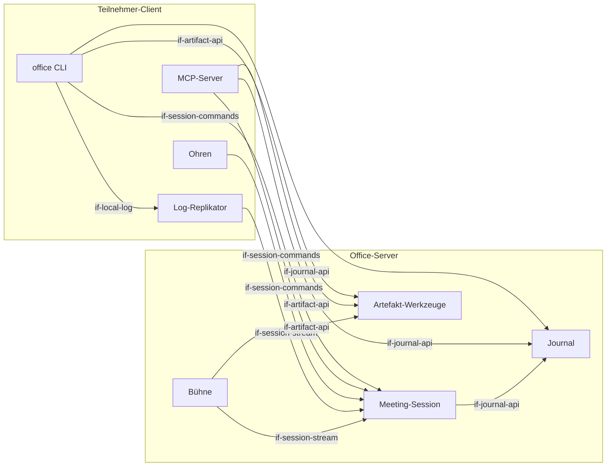

# Bausteinsicht

Das System zerfällt auf oberster Ebene in zwei Teile: den **Office-Server**, der Sessions,
Journal, Artefakte und die Bühne verwaltet, und den **Teilnehmer-Client**, der auf dem Rechner
jedes Teilnehmers läuft (Mensch oder Agent).

## Überblick

```arc42
:::diagram
id: bb-overview
view: building-block
notation: mermaid
aliases: bb_server=bb-office-server, bb_session=bb-session-service, bb_journal=bb-journal, bb_artifacts=bb-artifact-service, bb_stage=bb-stage, bb_client=bb-participant-client, bb_cli=bb-cli, bb_mcp=bb-mcp, bb_replicator=bb-replicator, bb_ears=bb-ears
:::
```



## Office-Server

Der zentrale, headless Teil. Er hält den Zustand des Teams und der laufenden Meetings, stellt
deterministische Werkzeuge bereit und rendert die Bühne. Er enthält kein LLM.

```arc42
:::building-block
id: bb-office-server
title: Office-Server
implements: concept-event-log, concept-participant-model
:::
```

### Meeting-Session

Verwaltet Sessions und deren Teilnehmer. Nimmt Utterances der Ohren und Aktionen der Teilnehmer
entgegen und schreibt alles in ein Event-Log pro Session, in das nur angehängt wird. Das Log
wird ab einem Cursor an Abonnenten repliziert. Zusammengeführt wird nur nach Zeit, denn wer
spricht, steht durch das Teilnehmer-Modell schon fest.

```arc42
:::building-block
id: bb-session-service
title: Meeting-Session
parent: bb-office-server
implements: concept-event-log, concept-participant-model
requires: if-journal-api
:::
```

#### Session-Kommandos

Synchrone Aufrufe mit sofortiger Rückmeldung: `join`, `leave`, `utterance.submit`,
`utterance.retract`, `pause`, `hand.raise`, `minutes.update`, `stage.show`. Jeder erfolgreiche
Aufruf erzeugt ein Event im Log.

```arc42
:::interface
id: if-session-commands
title: Session-Kommandos
provider: bb-session-service
protocol: HTTPS/JSON (OPEN: konkretes Protokoll)
:::
```

#### Session-Stream

Liefert das Event-Log einer Session ab einem Cursor, danach live. Grundlage für die lokale
Replikation und für die Bühne.

```arc42
:::interface
id: if-session-stream
title: Session-Stream (Replikation ab Cursor)
provider: bb-session-service
protocol: WebSocket (OPEN: alternativ SSE)
:::
```

### Journal

Das Gedächtnis des Teams: Entscheidungen, Aufgaben, Minutes, Notizen, jeweils mit Herkunft
(wer, Mensch oder Agent, in wessen Auftrag). Am Ende einer Session werden die bestätigten
Minutes hier abgelegt.

```arc42
:::building-block
id: bb-journal
title: Journal (System of Record)
parent: bb-office-server
implements: concept-event-log
:::
```

#### Journal-API

Lesen und Anhängen von Journal-Einträgen. OPEN: Abonnement als Datei analog zum Session-Log
(`journal.listen`).

```arc42
:::interface
id: if-journal-api
title: Journal-API
provider: bb-journal
protocol: HTTPS/JSON
:::
```

### Artefakt-Werkzeuge

Zustandslose, deterministische Werkzeuge ohne Streaming: Folien aus einer strukturierten
Beschreibung rendern, Business-Pläne rechnerisch prüfen (Konsistenz, Unit Economics,
Vollständigkeit). Artefakte haben IDs (z. B. `slides/42`), über die die Bühne sie anzeigt.

```arc42
:::building-block
id: bb-artifact-service
title: Artefakt-Werkzeuge
parent: bb-office-server
:::
```

#### Artefakt-API

Erzeugen, Rendern, Prüfen und Abrufen von Artefakten.

```arc42
:::interface
id: if-artifact-api
title: Artefakt-API
provider: bb-artifact-service
protocol: HTTPS/JSON
:::
```

### Bühne

Eine Webseite pro Session, die im Meeting per Screenshare gezeigt wird. Sie zeigt laufende
Minutes, Wortmeldungen, Artefakte und wer erfasst bzw. pausiert ist. Sie ist eine reine
Sicht auf das Session-Log und hat keine eigene Logik.

```arc42
:::building-block
id: bb-stage
title: Bühne
parent: bb-office-server
requires: if-session-stream, if-artifact-api
implements: concept-transparency
:::
```

#### Bühnen-Ansicht

Browser-Ansicht einer Session, die per Link aufgerufen wird.

```arc42
:::interface
id: if-stage-web
title: Bühnen-Ansicht
provider: bb-stage
protocol: HTTPS (Browser)
:::
```

## Teilnehmer-Client

Läuft lokal bei jedem Teilnehmer und ist für Menschen und Agenten identisch. Er bündelt CLI,
MCP-Server, Log-Replikator und optional die Ohren.

```arc42
:::building-block
id: bb-participant-client
title: Teilnehmer-Client
implements: concept-participant-model, concept-read-file-write-tools
:::
```

### office CLI

Der primäre Zugang für Menschen und Agenten mit Shell. `office meeting join <session> [--mic]`
startet die Replikation und gibt den Log-Pfad aus. Mit `--mic` zeigt das Terminal die eigenen
Utterances mit Status (partial → final → gesendet / zurückgezogen) und bietet Tasten zum
Pausieren und Zurückziehen. Weitere Kommandos betreffen Artefakte, Bühne und Journal.

```arc42
:::building-block
id: bb-cli
title: office CLI
parent: bb-participant-client
requires: if-session-commands, if-artifact-api, if-journal-api, if-local-log
implements: concept-read-file-write-tools
:::
```

#### CLI

Shell-Kommandos mit maschinenlesbarer Ausgabe (OPEN: `--json`-Konvention).

```arc42
:::interface
id: if-cli
title: office CLI
provider: bb-cli
protocol: Shell / stdout
:::
```

### MCP-Server

Lokaler MCP-Server (stdio) mit denselben Funktionen wie die CLI. `meeting.join` startet die
Replikation und liefert den Pfad zur Log-Datei. Die Lebensdauer der Replikation ist an den
MCP-Prozess gekoppelt.

```arc42
:::building-block
id: bb-mcp
title: MCP-Server
parent: bb-participant-client
requires: if-session-commands, if-artifact-api, if-journal-api
implements: concept-read-file-write-tools
:::
```

#### MCP-Tools

Tools wie `meeting.join`, `meeting.leave`, `hand.raise`, `minutes.update`, `stage.show`,
`slides.render`, `plan.validate`, `journal.append`.

```arc42
:::interface
id: if-mcp
title: MCP-Tools
provider: bb-mcp
protocol: MCP (stdio)
:::
```

### Log-Replikator

Ein lokaler Prozess, der eine Verbindung zum Session-Stream hält und jedes Event als Zeile an
eine Datei anhängt (`/tmp/office/<session>.jsonl`, Rechte `0600`). Nach einem Abbruch setzt er
ab der letzten Zeile wieder auf. Bei `session.ended` schreibt er die Schlusszeile und beendet sich.
Stirbt sein Elternprozess, beendet er sich ebenfalls.

```arc42
:::building-block
id: bb-replicator
title: Log-Replikator
parent: bb-participant-client
requires: if-session-stream
implements: concept-event-log, concept-read-file-write-tools
:::
```

#### Lokales Session-Log

JSONL-Datei, in die nur angehängt wird, eine Zeile pro Event. Wird mit `tail -f`, `grep`
und `jq` gelesen.

```arc42
:::interface
id: if-local-log
title: Lokales Session-Log
provider: bb-replicator
protocol: JSONL-Datei (append-only)
:::
```

### Ohren

Nur bei Menschen mit `--mic`. Pipeline: Mikrofon → VAD → Whisper (lokal) → Utterances an die
Session. Im ersten Schritt nur mit Headset, ohne Stimmabdruck und ohne Echounterdrückung.
Rohaudio verlässt das Gerät nicht.

```arc42
:::building-block
id: bb-ears
title: Ohren
parent: bb-participant-client
technology: VAD (z. B. Silero) / faster-whisper oder whisper.cpp (OPEN)
requires: if-session-commands
implements: concept-edge-transcription
:::
```

#### Audio-Eingang

Lokales Audiogerät des Teilnehmers (Headset).

```arc42
:::interface
id: if-audio-in
title: Audio-Eingang
provider: bb-ears
protocol: lokales Audiogerät
:::
```
