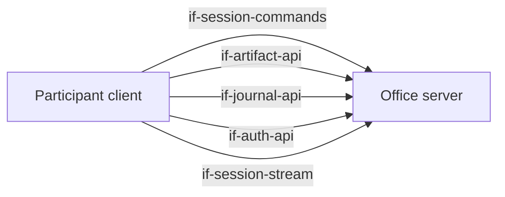
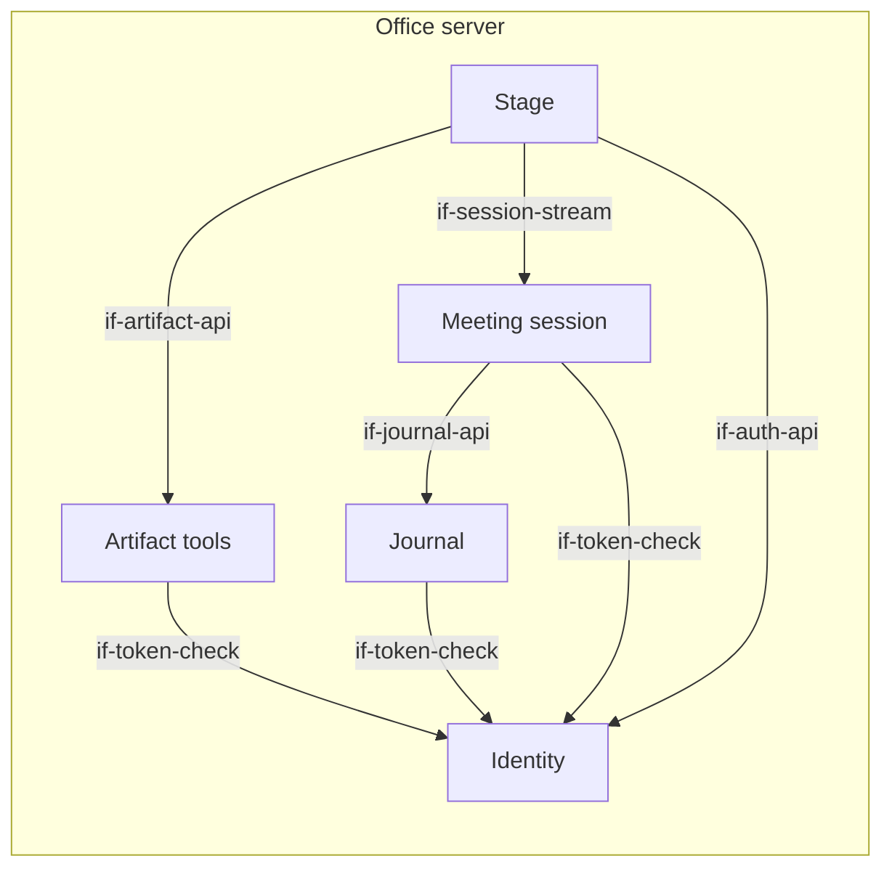
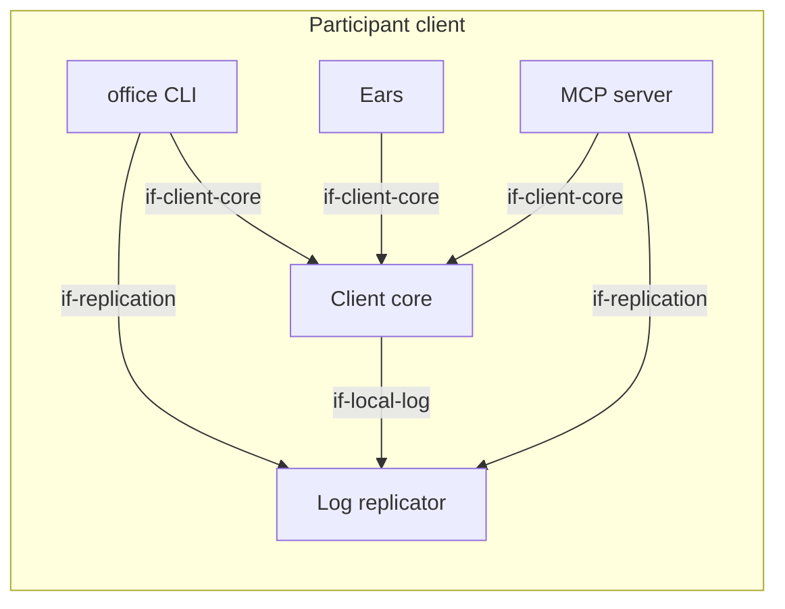

# Building Block View

The diagram shows every dependency between building blocks: an arrow is an interface that a
block lists in `requires`, pointing to the provider. The architecture test enforces exactly these
dependencies in the code (`concept-module-boundaries`). Interfaces that only external actors use
(CLI, MCP, stage view, audio input) are in chapter 3.

At the top level the system has two parts. The **office server** manages sessions, the journal,
artifacts and the stage. The **participant client** runs on the computer of every participant,
human or agent.

## Overview

```arc42
:::diagram
id: bb-overview
view: building-block
notation: mermaid
roots: bb-office-server, bb-participant-client
aliases: bb_office_server=bb-office-server, bb_participant_client=bb-participant-client
:::
```



## Office server

The central, headless part. It holds the state of the team and of running meetings, offers
deterministic tools and renders the stage. It contains no LLM.

```arc42
:::building-block
id: bb-office-server
title: Office server
technology: Go (monorepo)
implements: concept-event-log, concept-participant-model, concept-module-boundaries
path: server
:::
```

White box: the parts of the office server and how they use each other. An arrow to a part that
realizes an interface of the office server points to that part.

```arc42
:::diagram
id: bb-office-server-whitebox
view: building-block
notation: mermaid
roots: bb-office-server
aliases: bb_office_server=bb-office-server, bb_artifact_service=bb-artifact-service, bb_identity=bb-identity, bb_journal=bb-journal, bb_session_service=bb-session-service, bb_stage=bb-stage
:::
```



### Session commands

Synchronous calls that answer at once: `join`, `leave`, `utterance.submit`, `utterance.retract`,
`pause`, `hand.raise`, `minutes.update`, `stage.show`. Each successful call creates one event in the
log. Each call carries an ID created by the client, so a repeated call has no extra effect.

```arc42
:::ignore H020 Commands and stream are two contracts of one Connect service; they share its package :::
:::interface
id: if-session-commands
title: Session commands
provider: bb-office-server
x-realized-by: bb-session-service
protocol: Connect RPC, unary (dec-connect-rpc)
path: server/session/api
:::
```

### Session stream

Delivers the event log of a session from a cursor onwards, then live. This is the basis for local
replication and for the stage. After a drop, the subscriber reconnects with its last event ID.

```arc42
:::interface
id: if-session-stream
title: Session stream (replication from a cursor)
provider: bb-office-server
x-realized-by: bb-session-service
protocol: Connect RPC, server streaming (dec-connect-rpc)
path: server/session/api
:::
```

### Auth API

Challenge and response: the client asks for a challenge, signs it with its private key and gets a
short-lived access token that is bound to its key. Also: create a read-only stage link.

```arc42
:::interface
id: if-auth-api
title: Auth API
provider: bb-office-server
x-realized-by: bb-identity
protocol: Connect RPC, unary (dec-connect-rpc)
path: server/identity/api
:::
```

### Journal API

Read journal entries and append new ones. OPEN: subscribe to the journal as a file, like the
session log (`journal.listen`)?

```arc42
:::interface
id: if-journal-api
title: Journal API
provider: bb-office-server
x-realized-by: bb-journal
protocol: Connect RPC, unary (dec-connect-rpc)
path: server/journal/api
:::
```

### Artifact API

Create, render, check and fetch artifacts.

```arc42
:::interface
id: if-artifact-api
title: Artifact API
provider: bb-office-server
x-realized-by: bb-artifact-service
protocol: Connect RPC, unary (dec-connect-rpc)
path: server/artifacts/api
:::
```

### Stage view

A browser view of one session, opened by a link.

```arc42
:::interface
id: if-stage-web
title: Stage view
provider: bb-office-server
x-realized-by: bb-stage
protocol: HTTPS (browser)
path: server/stage
:::
```

### Meeting session

Manages sessions and their participants. Accepts utterances from the ears and actions from
participants, and writes everything to one append-only event log per session. Subscribers receive
the log from a cursor onwards. Events are merged by time only: the participant model already says
who spoke.

```arc42
:::building-block
id: bb-session-service
title: Meeting session
technology: Go / connect-go
parent: bb-office-server
implements: concept-event-log, concept-participant-model, concept-identity
requires: if-journal-api, if-token-check
path: server/session
:::
```

### Journal

The memory of the team: decisions, tasks, minutes and notes. Each entry records its origin: who,
human or agent. When a session ends, the confirmed minutes are stored here.

```arc42
:::building-block
id: bb-journal
title: Journal (system of record)
technology: Go (OPEN: persistence)
parent: bb-office-server
implements: concept-event-log
path: server/journal
requires: if-token-check
:::
```

### Artifact tools

Stateless, deterministic tools without streaming. They render slides from a structured description
and check business plans by calculation (consistency, unit economics, completeness). Artifacts have
IDs (for example `slides/42`). The stage uses these IDs to show them.

```arc42
:::building-block
id: bb-artifact-service
title: Artifact tools
technology: Go
parent: bb-office-server
path: server/artifacts
requires: if-token-check
:::
```

### Stage

One web page per session, shown in the meeting by screen share. It shows the running minutes,
raised hands, artifacts, and who is captured or paused. It is only a view of the session log and
has no logic of its own.

```arc42
:::building-block
id: bb-stage
title: Stage
technology: Go, rendered on the server / server-sent events
parent: bb-office-server
requires: if-session-stream, if-artifact-api, if-auth-api
implements: concept-transparency
path: server/stage
:::
```

### Identity

Knows all participants and their public keys. Each participant, human or agent, is its own actor
with its own Ed25519 key pair. The client creates the key pair locally and sends only the public
key. In the first stage, a new public key is registered by hand when we meet the person
(issue #2 describes a real enrollment flow). Identity issues short-lived access tokens and creates
read-only links for the stage.

```arc42
:::building-block
id: bb-identity
title: Identity
technology: Go
parent: bb-office-server
implements: concept-identity
path: server/identity
:::
```

#### Token check

Other server parts check access tokens here and learn which participant a token belongs to.

```arc42
:::interface
id: if-token-check
title: Token check
provider: bb-identity
protocol: In-process Go call
path: server/identity/tokencheck
:::
```

## Participant client

Runs locally on every participant's computer and is the same for humans and agents. It contains
the CLI, the MCP server, the log replicator and, optionally, the ears.

```arc42
:::building-block
id: bb-participant-client
title: Participant client
technology: Go (one binary)
implements: concept-participant-model, concept-read-file-write-tools, concept-module-boundaries
path: client
:::
```

White box: the parts of the participant client and how they use each other. An arrow to a part that
realizes an interface of the participant client points to that part.

```arc42
:::diagram
id: bb-participant-client-whitebox
view: building-block
notation: mermaid
roots: bb-participant-client
aliases: bb_participant_client=bb-participant-client, bb_cli=bb-cli, bb_client_core=bb-client-core, bb_ears=bb-ears, bb_mcp=bb-mcp, bb_replicator=bb-replicator
:::
```



### CLI

Shell commands with machine-readable output (OPEN: `--json` convention).

```arc42
:::interface
id: if-cli
title: office CLI
provider: bb-participant-client
x-realized-by: bb-cli
protocol: Shell / stdout
path: client/cli
:::
```

### MCP tools

Tools such as `meeting.join`, `meeting.leave`, `hand.raise`, `minutes.update`, `stage.show`,
`slides.render`, `plan.validate`, `journal.append`.

```arc42
:::interface
id: if-mcp
title: MCP tools
provider: bb-participant-client
x-realized-by: bb-mcp
protocol: MCP (stdio)
path: client/mcp
:::
```

### Local session log

An append-only JSONL file with one compact line per event. Every line carries the event type in
dotted form (for example `"type":"utterance.final"`) and the event ID as a JSON number, so that
`tail -f`, `grep` and `jq` work without conversion.

```arc42
:::interface
id: if-local-log
title: Local session log
provider: bb-participant-client
x-realized-by: bb-replicator
protocol: JSONL file (append-only)
path: client/replicator/locallog
:::
```

### Audio input

The participant's local audio device (headset).

```arc42
:::interface
id: if-audio-in
title: Audio input
provider: bb-participant-client
x-realized-by: bb-ears
protocol: Local audio device
path: client/ears
:::
```

### Client core

The shared core of the CLI, the MCP server and the ears ("one core, two adapters",
`dec-cli-and-mcp`). It holds the configuration of a participant, authenticates with Identity,
creates the command IDs and calls the interfaces of the office server. The adapters add only their
own way of talking to a human or an agent.

```arc42
:::building-block
id: bb-client-core
title: Client core
technology: Go
parent: bb-participant-client
path: client/core
requires: if-session-commands, if-auth-api, if-journal-api, if-artifact-api, if-local-log
:::
```

#### Client core API

The in-process interface of the client core for the adapters: configuration, authenticated
clients of the office server, command IDs and the commands of a participant.

```arc42
:::interface
id: if-client-core
title: Client core API
provider: bb-client-core
protocol: In-process Go call
path: client/core
:::
```

### office CLI

The main access for humans and for agents with a shell. `office meeting join <session> [--mic]`
starts the replication and prints the log path. With `--mic`, the terminal shows the user's own
utterances with their status (partial → final → sent / retracted). Keys let the user pause and
retract. Other commands cover artifacts, the stage and the journal.

```arc42
:::building-block
id: bb-cli
title: office CLI
technology: Go, single binary
parent: bb-participant-client
requires: if-client-core, if-replication, if-session-commands, if-artifact-api, if-journal-api, if-auth-api
implements: concept-read-file-write-tools
path: client/cli
:::
```

### MCP server

A local MCP server (stdio) with the same features as the CLI. `meeting.join` starts the
replication and returns the path to the log file. The replication lives as long as the MCP
process.

```arc42
:::building-block
id: bb-mcp
title: MCP server
technology: Go / official MCP Go SDK
parent: bb-participant-client
requires: if-client-core, if-replication, if-session-commands, if-artifact-api, if-journal-api, if-auth-api
implements: concept-read-file-write-tools
path: client/mcp
:::
```

### Log replicator

A local process. It keeps a connection to the session stream and appends every event as one line to
a file. There is one file per session and participant, in a private runtime directory of the user,
so several participants on one machine (for example a human and an agent) do not collide and no
other user can read the file. After a drop, it reconnects and continues after the last complete
line in the file. On `session.ended` it writes a final line and stops.
It also stops when its parent process dies.

```arc42
:::building-block
id: bb-replicator
title: Log replicator
technology: Go / connect-go
parent: bb-participant-client
requires: if-session-stream
implements: concept-event-log, concept-read-file-write-tools, concept-test-strategy
path: client/replicator
:::
```

#### Replication control

The in-process interface to start the replication of a session for a participant, to find a
running replicator and to stop it. The CLI runs the replicator as its own process; the MCP server
runs it inside its own process.

```arc42
:::interface
id: if-replication
title: Replication control
provider: bb-replicator
protocol: In-process Go call
path: client/replicator
:::
```

### Ears

Only for humans with `--mic`. Pipeline: microphone → VAD → Whisper (local) → utterances to the
session. The first stage needs a headset and has no voice print and no echo cancellation
(`con-headset-only`). Raw audio never leaves the device. During a network drop, the ears keep
transcribing and queue the utterances locally. They send them in order once the connection is back.

```arc42
:::building-block
id: bb-ears
title: Ears
parent: bb-participant-client
technology: Go / whisper.cpp, including its voice activity detection
requires: if-client-core, if-session-commands
implements: concept-edge-transcription, concept-test-strategy
path: client/ears
:::
```

