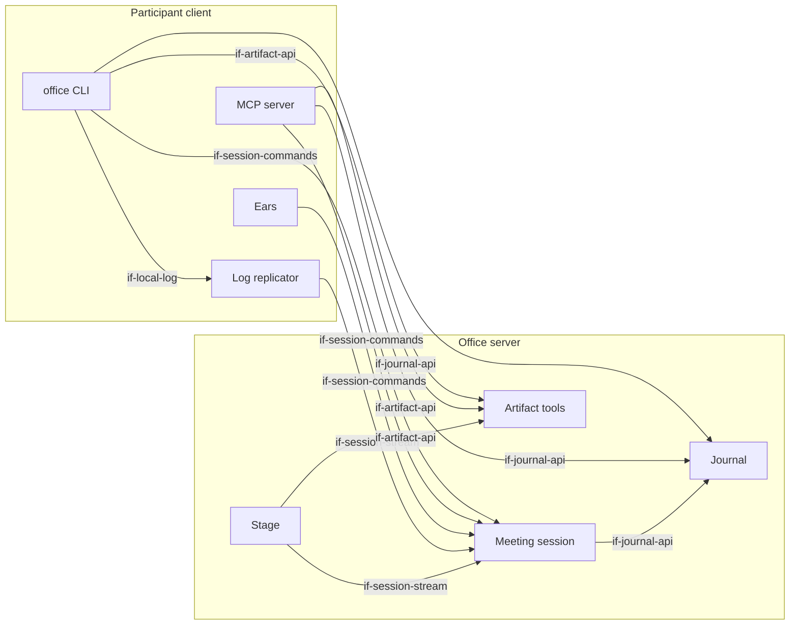

# Building Block View

At the top level the system has two parts. The **office server** manages sessions, the journal,
artifacts and the stage. The **participant client** runs on the computer of every participant,
human or agent.

## Overview

```arc42
:::diagram
id: bb-overview
view: building-block
notation: mermaid
aliases: bb_server=bb-office-server, bb_session=bb-session-service, bb_journal=bb-journal, bb_artifacts=bb-artifact-service, bb_stage=bb-stage, bb_client=bb-participant-client, bb_cli=bb-cli, bb_mcp=bb-mcp, bb_replicator=bb-replicator, bb_ears=bb-ears
:::
```



## Office server

The central, headless part. It holds the state of the team and of running meetings, offers
deterministic tools and renders the stage. It contains no LLM.

```arc42
:::building-block
id: bb-office-server
title: Office server
implements: concept-event-log, concept-participant-model
:::
```

### Meeting session

Manages sessions and their participants. Accepts utterances from the ears and actions from
participants, and writes everything to one append-only event log per session. Subscribers receive
the log from a cursor onwards. Events are merged by time only: the participant model already says
who spoke.

```arc42
:::building-block
id: bb-session-service
title: Meeting session
parent: bb-office-server
implements: concept-event-log, concept-participant-model
requires: if-journal-api
:::
```

#### Session commands

Synchronous calls that answer at once: `join`, `leave`, `utterance.submit`, `utterance.retract`,
`pause`, `hand.raise`, `minutes.update`, `stage.show`. Each successful call creates one event in the
log. Each call carries an ID created by the client, so a repeated call has no extra effect.

```arc42
:::interface
id: if-session-commands
title: Session commands
provider: bb-session-service
protocol: Connect RPC, unary (proposed, dec-connect-rpc)
:::
```

#### Session stream

Delivers the event log of a session from a cursor onwards, then live. This is the basis for local
replication and for the stage. After a drop, the subscriber reconnects with its last event ID.

```arc42
:::interface
id: if-session-stream
title: Session stream (replication from a cursor)
provider: bb-session-service
protocol: Connect RPC, server streaming (proposed, dec-connect-rpc)
:::
```

### Journal

The memory of the team: decisions, tasks, minutes and notes. Each entry records its origin: who,
human or agent, and on whose behalf. When a session ends, the confirmed minutes are stored here.

```arc42
:::building-block
id: bb-journal
title: Journal (system of record)
parent: bb-office-server
implements: concept-event-log
:::
```

#### Journal API

Read journal entries and append new ones. OPEN: subscribe to the journal as a file, like the
session log (`journal.listen`)?

```arc42
:::interface
id: if-journal-api
title: Journal API
provider: bb-journal
protocol: HTTPS/JSON
:::
```

### Artifact tools

Stateless, deterministic tools without streaming. They render slides from a structured description
and check business plans by calculation (consistency, unit economics, completeness). Artifacts have
IDs (for example `slides/42`). The stage uses these IDs to show them.

```arc42
:::building-block
id: bb-artifact-service
title: Artifact tools
parent: bb-office-server
:::
```

#### Artifact API

Create, render, check and fetch artifacts.

```arc42
:::interface
id: if-artifact-api
title: Artifact API
provider: bb-artifact-service
protocol: HTTPS/JSON
:::
```

### Stage

One web page per session, shown in the meeting by screen share. It shows the running minutes,
raised hands, artifacts, and who is captured or paused. It is only a view of the session log and
has no logic of its own.

```arc42
:::building-block
id: bb-stage
title: Stage
parent: bb-office-server
requires: if-session-stream, if-artifact-api
implements: concept-transparency
:::
```

#### Stage view

A browser view of one session, opened by a link.

```arc42
:::interface
id: if-stage-web
title: Stage view
provider: bb-stage
protocol: HTTPS (browser)
:::
```

## Participant client

Runs locally on every participant's computer and is the same for humans and agents. It contains
the CLI, the MCP server, the log replicator and, optionally, the ears.

```arc42
:::building-block
id: bb-participant-client
title: Participant client
implements: concept-participant-model, concept-read-file-write-tools
:::
```

### office CLI

The main access for humans and for agents with a shell. `office meeting join <session> [--mic]`
starts the replication and prints the log path. With `--mic`, the terminal shows the user's own
utterances with their status (partial → final → sent / retracted). Keys let the user pause and
retract. Other commands cover artifacts, the stage and the journal.

```arc42
:::building-block
id: bb-cli
title: office CLI
parent: bb-participant-client
requires: if-session-commands, if-artifact-api, if-journal-api, if-local-log
implements: concept-read-file-write-tools
:::
```

#### CLI

Shell commands with machine-readable output (OPEN: `--json` convention).

```arc42
:::interface
id: if-cli
title: office CLI
provider: bb-cli
protocol: Shell / stdout
:::
```

### MCP server

A local MCP server (stdio) with the same features as the CLI. `meeting.join` starts the
replication and returns the path to the log file. The replication lives as long as the MCP
process.

```arc42
:::building-block
id: bb-mcp
title: MCP server
parent: bb-participant-client
requires: if-session-commands, if-artifact-api, if-journal-api
implements: concept-read-file-write-tools
:::
```

#### MCP tools

Tools such as `meeting.join`, `meeting.leave`, `hand.raise`, `minutes.update`, `stage.show`,
`slides.render`, `plan.validate`, `journal.append`.

```arc42
:::interface
id: if-mcp
title: MCP tools
provider: bb-mcp
protocol: MCP (stdio)
:::
```

### Log replicator

A local process. It keeps a connection to the session stream and appends every event as one line to
a file (`/tmp/office/<session>.jsonl`, permissions `0600`). After a drop, it reconnects and
continues after the last line in the file. On `session.ended` it writes a final line and stops.
It also stops when its parent process dies.

```arc42
:::building-block
id: bb-replicator
title: Log replicator
parent: bb-participant-client
requires: if-session-stream
implements: concept-event-log, concept-read-file-write-tools
:::
```

#### Local session log

An append-only JSONL file with one line per event. Read it with `tail -f`, `grep` and `jq`.

```arc42
:::interface
id: if-local-log
title: Local session log
provider: bb-replicator
protocol: JSONL file (append-only)
:::
```

### Ears

Only for humans with `--mic`. Pipeline: microphone → VAD → Whisper (local) → utterances to the
session. The first stage needs a headset and has no voice print and no echo cancellation
(`con-headset-only`). Raw audio never leaves the device. During a network drop, the ears keep
transcribing and queue the utterances locally. They send them in order once the connection is back.

```arc42
:::building-block
id: bb-ears
title: Ears
parent: bb-participant-client
technology: VAD (for example Silero) / whisper.cpp via Go bindings (proposed, dec-languages)
requires: if-session-commands
implements: concept-edge-transcription
:::
```

#### Audio input

The participant's local audio device (headset).

```arc42
:::interface
id: if-audio-in
title: Audio input
provider: bb-ears
protocol: Local audio device
:::
```
