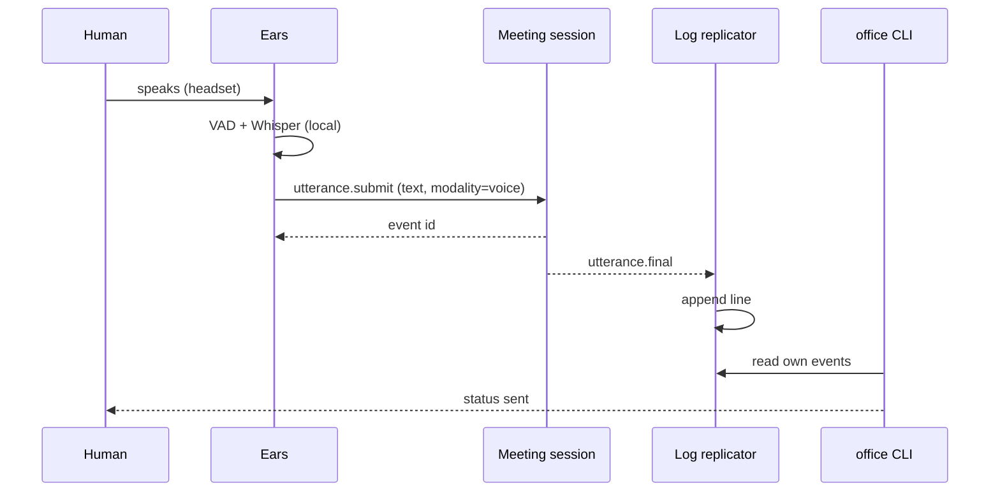
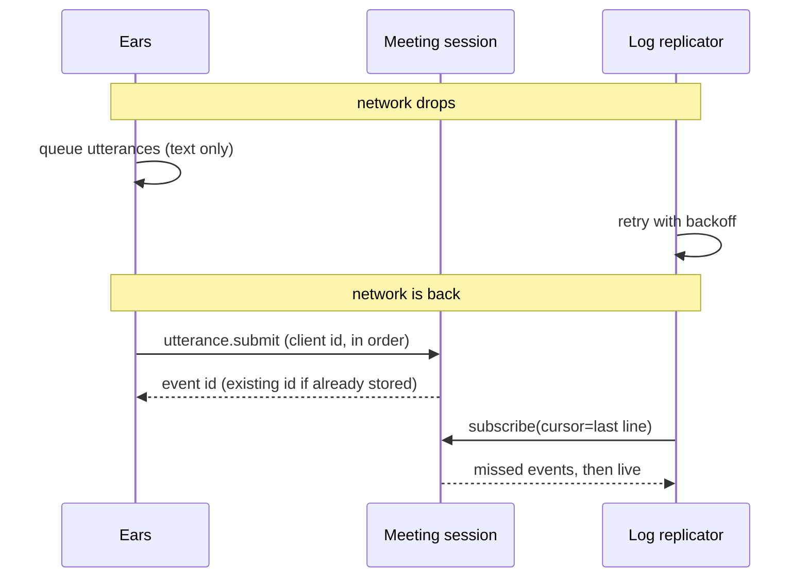
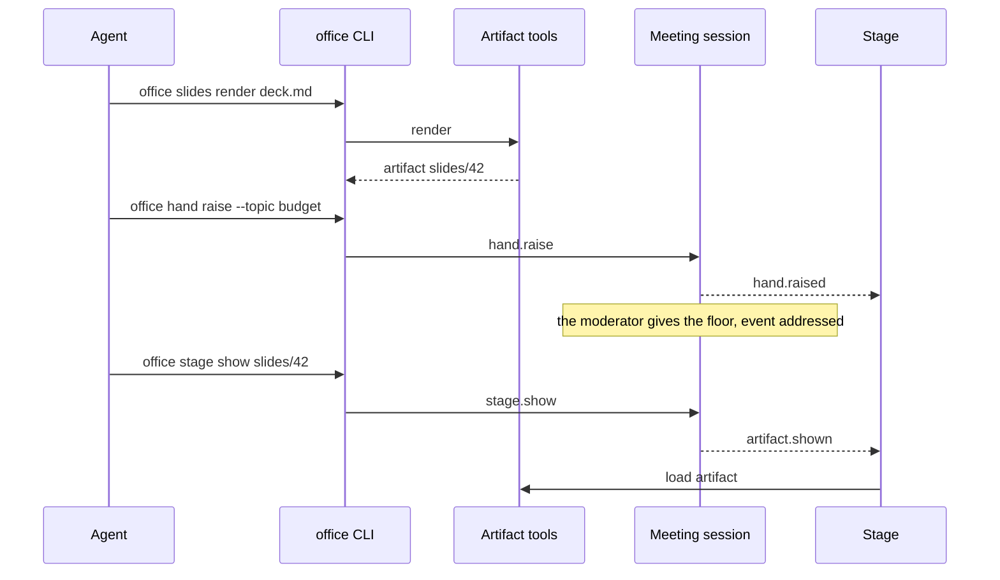

# Runtime View

## Agent joins a meeting

The agent calls `meeting.join`. The MCP server registers it as a participant, starts the log
replicator and returns the file path. The agent follows the file in the background. It filters for
the events that should wake it up, for example `turn.end` and `addressed`.

```arc42
:::runtime-scenario
id: rs-agent-joins
title: Agent joins a meeting
trigger: Agent calls meeting.join
involves: bb-mcp, bb-client-core, bb-session-service, bb-replicator, bb-participant-client, bb-office-server
:::
```

```arc42
:::diagram
id: seq-agent-joins
notation: mermaid-sequence
scenario: rs-agent-joins
aliases: actor_agent=actor-agent, bb_mcp=bb-mcp, bb_session=bb-session-service, bb_replicator=bb-replicator
:::
```


## Human speaks

A human joined with `--mic`. The ears detect the end of a sentence, Whisper transcribes it locally,
and the utterance is sent. The session appends it to the log. Every replicator writes it to its
local file. The speaker's terminal shows the status "sent".

```arc42
:::runtime-scenario
id: rs-human-speaks
title: Human speaks, agent receives the sentence
trigger: End of sentence (VAD pause) in the headset signal
involves: bb-ears, bb-client-core, bb-session-service, bb-replicator, bb-cli, bb-participant-client, bb-office-server
:::
```

```arc42
:::diagram
id: seq-human-speaks
notation: mermaid-sequence
scenario: rs-human-speaks
aliases: actor_human=actor-human, bb_ears=bb-ears, bb_session=bb-session-service, bb_replicator=bb-replicator, bb_cli=bb-cli
:::
```



## Network drop and resume

The network of a participant drops for a while. The ears keep transcribing and queue utterances
locally. The replicator loses the stream. When the network is back, the ears send the queued
utterances in order. Each one carries its client ID, so nothing is stored twice. The replicator
reconnects with the ID of its last line and receives everything it missed.

```arc42
:::runtime-scenario
id: rs-network-drop
title: Network drop and resume
trigger: Network connection of a participant is lost and comes back
involves: bb-ears, bb-session-service, bb-replicator, bb-participant-client, bb-office-server
:::
```

```arc42
:::diagram
id: seq-network-drop
notation: mermaid-sequence
scenario: rs-network-drop
aliases: bb_ears=bb-ears, bb_session=bb-session-service, bb_replicator=bb-replicator
:::
```



## Participant authenticates

Before its first call, a client (CLI, MCP server or ears) asks Identity for a challenge. It signs
the challenge with its private key and gets a short-lived access token. It sends the token with
every call. The session checks the token and knows the participant. Shortly before the token
expires, the client repeats the steps. This also happens after a network drop.

```arc42
:::runtime-scenario
id: rs-authenticate
title: Participant authenticates with its key
trigger: First call of a client, or the access token is about to expire
involves: bb-cli, bb-mcp, bb-ears, bb-client-core, bb-identity, bb-session-service, bb-participant-client, bb-office-server
:::
```

## Agent raises its hand and shows an artifact

The agent renders a slide through the CLI and raises its hand on the stage. When it gets the
floor, it shows the artifact. The stage reads the same events from the session stream.

```arc42
:::runtime-scenario
id: rs-agent-shows-artifact
title: Agent raises its hand and shows an artifact
trigger: Agent decides after turn.end to raise its hand
involves: bb-cli, bb-artifact-service, bb-session-service, bb-stage, bb-replicator, bb-participant-client, bb-office-server
:::
```

```arc42
:::diagram
id: seq-agent-shows-artifact
notation: mermaid-sequence
scenario: rs-agent-shows-artifact
aliases: actor_agent=actor-agent, bb_cli=bb-cli, bb_artifacts=bb-artifact-service, bb_session=bb-session-service, bb_stage=bb-stage
:::
```



## Human marks a sentence off the record

What is said stays said (`dec-off-the-record`). The human presses a key in the gateway terminal
to mark their own sentence off the record. The CLI sends `utterance.mark_off_the_record`. The
server checks that the caller is the speaker. The log gets a new event `utterance.off_the_record`
that points to the original utterance. Existing lines are never rewritten. From then on, the
interfaces deliver the utterance only as a placeholder without its text, the stage hides it, and
it does not go into minutes or the journal. Agents that already read it must respect the
mark.

```arc42
:::runtime-scenario
id: rs-off-the-record
title: Human marks a sentence off the record
trigger: A key in the gateway terminal
involves: bb-cli, bb-session-service, bb-replicator, bb-stage, bb-participant-client, bb-office-server
:::
```

## Session ends, minutes go to the journal

The moderator ends the session. The agent that keeps the minutes writes the final version. The
session stores the confirmed minutes in the journal and writes `session.ended` to the log. The
replicators stop.

```arc42
:::runtime-scenario
id: rs-session-ends
title: Session ends, minutes go to the journal
trigger: The moderator ends the session
involves: bb-mcp, bb-cli, bb-session-service, bb-journal, bb-replicator, bb-participant-client, bb-office-server
:::
```
