# Runtime View

## Agent joins a meeting

The agent calls `meeting.join`. The MCP server registers it as a participant, starts the log
replicator and returns the file path. The agent follows the file in the background. It filters for
the events that should wake it up, for example `turn.end` and `addressed`.

```arc42
:::runtime-scenario
id: rs-agent-joins
title: Agent joins a meeting
trigger: Agent calls meeting.join
involves: bb-mcp, bb-client-core, bb-session-service, bb-replicator, bb-participant-client, bb-office-hub
:::
```

```arc42
:::diagram
id: seq-agent-joins
notation: mermaid-sequence
scenario: rs-agent-joins
aliases: actor_agent=actor-agent, bb_mcp=bb-mcp, bb_session=bb-session-service, bb_replicator=bb-replicator
:::
```

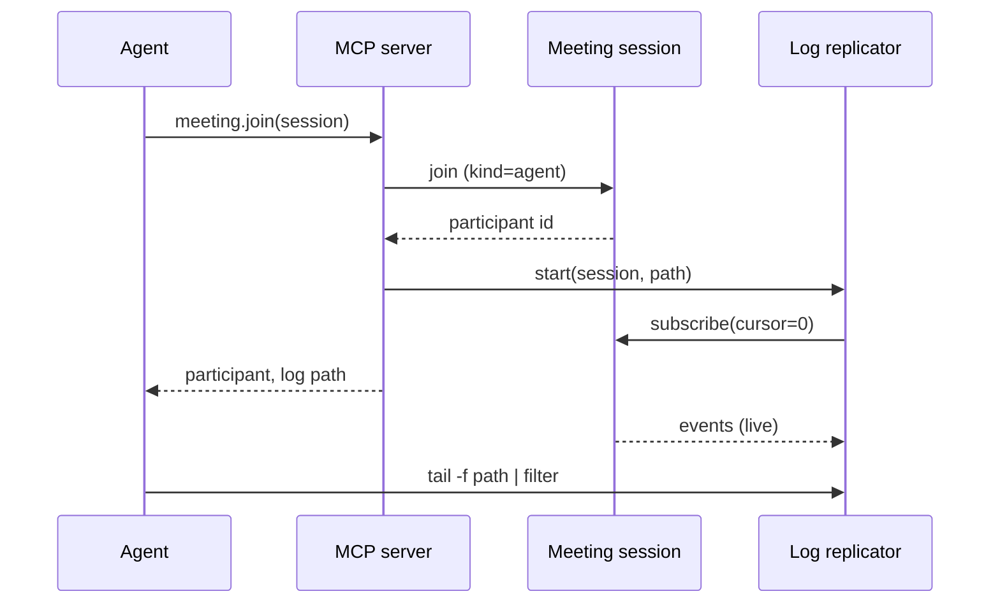

## Human speaks

A human joined with `--mic`. The ears detect the end of a sentence, Whisper transcribes it locally,
and the utterance is sent. The session appends it to the log. Every replicator writes it to its
local file. The speaker's terminal shows the status "sent". When the human stays silent for longer
after the last sentence, the ears submit `turn.end`. Agents that wait for the end of a turn wake up.

```arc42
:::runtime-scenario
id: rs-human-speaks
title: Human speaks, agent receives the sentence
trigger: End of sentence (VAD pause) in the headset signal
involves: bb-ears, bb-client-core, bb-session-service, bb-replicator, bb-cli, bb-participant-client, bb-office-hub
:::
```

```arc42
:::diagram
id: seq-human-speaks
notation: mermaid-sequence
scenario: rs-human-speaks
aliases: actor_human=actor-human, bb_ears=bb-ears, bb_session=bb-session-service, bb_replicator=bb-replicator, bb_cli=bb-cli
:::
```

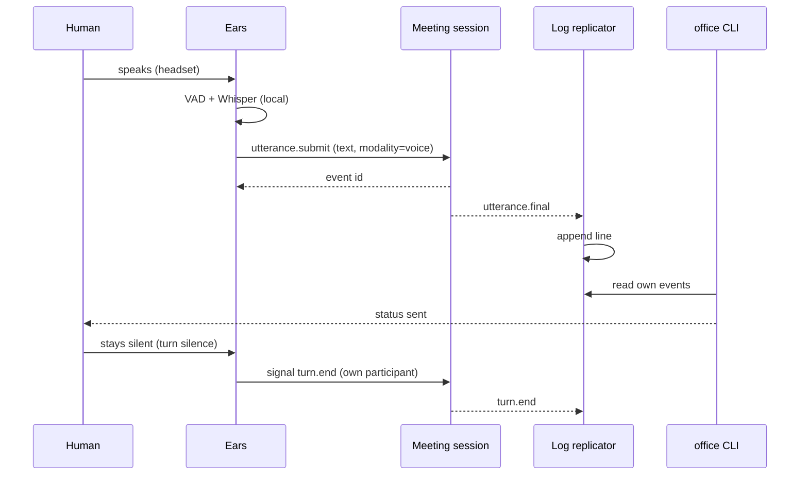

## Network drop and resume

The network of a participant drops for a while. The ears keep transcribing and queue utterances
locally. The replicator loses the stream. When the network is back, the ears send the queued
utterances in order. Each one carries its client ID, so nothing is stored twice. The replicator
reconnects with the ID of its last line and receives everything it missed.

```arc42
:::runtime-scenario
id: rs-network-drop
title: Network drop and resume
trigger: Network connection of a participant is lost and comes back
involves: bb-ears, bb-session-service, bb-replicator, bb-participant-client, bb-office-hub
:::
```

```arc42
:::diagram
id: seq-network-drop
notation: mermaid-sequence
scenario: rs-network-drop
aliases: bb_ears=bb-ears, bb_session=bb-session-service, bb_replicator=bb-replicator
:::
```

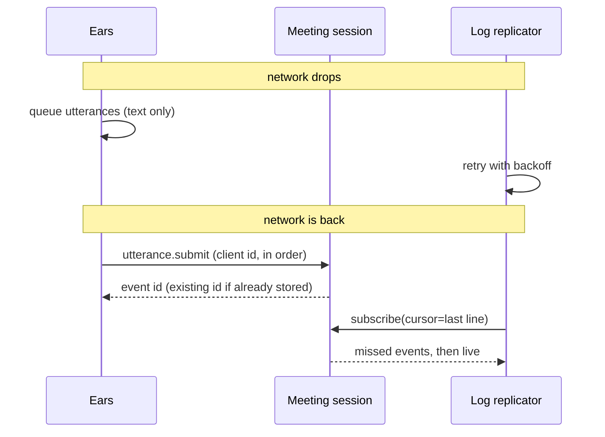

## Participant authenticates

Before its first call, a client (CLI, MCP server or ears) asks Identity for a challenge. It signs
the challenge with its private key and gets a short-lived access token. It sends the token with
every call. The session checks the token and knows the participant. Shortly before the token
expires, the client repeats the steps. This also happens after a network drop.

```arc42
:::runtime-scenario
id: rs-authenticate
title: Participant authenticates with its key
trigger: First call of a client, or the access token is about to expire
involves: bb-cli, bb-mcp, bb-ears, bb-client-core, bb-identity, bb-session-service, bb-participant-client, bb-office-hub
:::
```

## Agent raises its hand and shows an artifact

The agent renders a slide deck through the CLI and raises its hand on the stage. The slides part
stores the input and the rendered deck in the archive before it returns the ID. When the agent
gets the floor, it shows the deck by its ID. The stage reads the same events from the session
stream and loads the deck from the slides part inside the hub.

```arc42
:::runtime-scenario
id: rs-agent-shows-artifact
title: Agent raises its hand and shows an artifact
trigger: Agent decides after turn.end to raise its hand
involves: bb-cli, bb-slides, bb-archive, bb-session-service, bb-stage, bb-replicator, bb-participant-client, bb-office-hub
:::
```

```arc42
:::diagram
id: seq-agent-shows-artifact
notation: mermaid-sequence
scenario: rs-agent-shows-artifact
aliases: actor_agent=actor-agent, bb_cli=bb-cli, bb_slides=bb-slides, bb_archive=bb-archive, bb_session=bb-session-service, bb_stage=bb-stage
:::
```

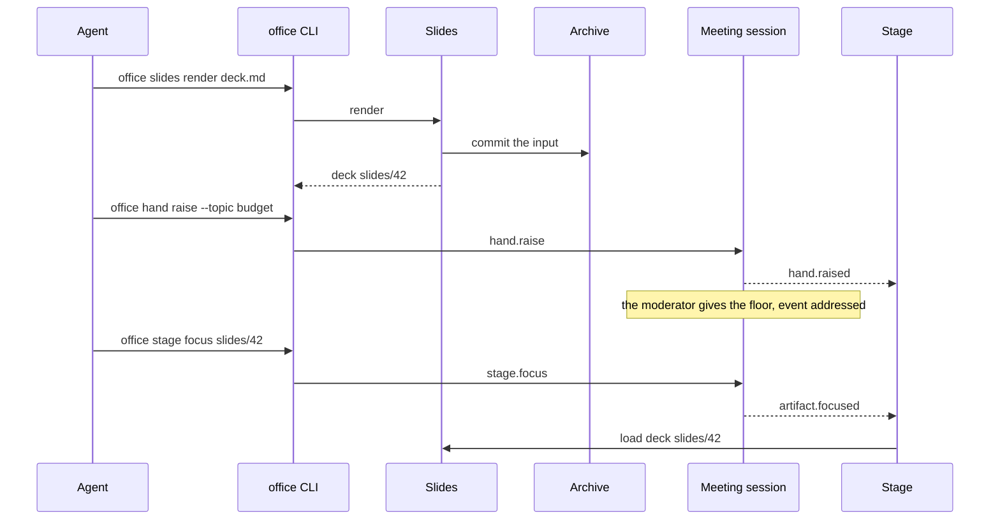

## Participant changes a document in a session

A participant reads a document from the archive, changes it and sends the change with the version
that they read and the ID of the session. The documents part writes one commit with the participant
as author and tells the meeting session, which appends `artifact.changed`. When another change
came first, the documents part refuses the change and gives the current version, and the participant
reads again.

```arc42
:::runtime-scenario
id: rs-document-change
title: Participant changes a document in a session
trigger: A participant sends a change of a document with the version they read
involves: bb-documents, bb-archive, bb-session-service, bb-stage, bb-office-hub
:::
```

```arc42
:::diagram
id: seq-document-change
notation: mermaid-sequence
scenario: rs-document-change
aliases: bb_documents=bb-documents, bb_archive=bb-archive, bb_session=bb-session-service, bb_stage=bb-stage
:::
```

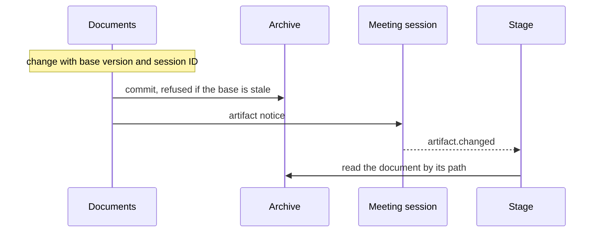

## Participant sets up a local directory

A participant starts `office sync init` in a directory. The sync part gets an access token with the
key of the participant and clones the branch main of the tenant through Git access. It writes the
author, the way to get a token and the check for the main directory into the own configuration of
the clone, and it remembers the directory.

```arc42
:::runtime-scenario
id: rs-sync-setup
title: Participant sets up a local directory
trigger: A participant runs the set-up of a directory
involves: bb-cli, bb-sync, bb-identity, bb-git-access, bb-archive, bb-participant-client, bb-office-hub
:::
```

```arc42
:::diagram
id: seq-sync-setup
notation: mermaid-sequence
scenario: rs-sync-setup
aliases: bb_cli=bb-cli, bb_sync=bb-sync, bb_identity=bb-identity, bb_git_access=bb-git-access, bb_archive=bb-archive
:::
```

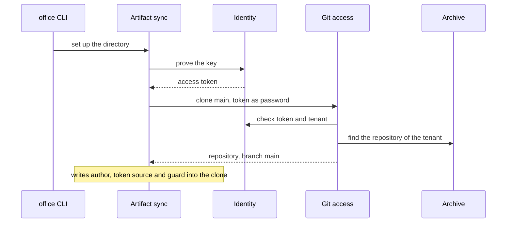

## A client process starts in a set-up directory

The sync part brings the main directory up to date, and then it follows the changes. It keeps no
position: after a start and after every reconnect it fetches first, so no change is missed. When
the main directory has commits of its own, the sync part stops and reports it.

```arc42
:::runtime-scenario
id: rs-sync-start
title: A client process starts in a set-up directory
trigger: A client process starts, or its connection to the hub comes back
involves: bb-sync, bb-identity, bb-git-access, bb-archive, bb-participant-client, bb-office-hub
:::
```

```arc42
:::diagram
id: seq-sync-start
notation: mermaid-sequence
scenario: rs-sync-start
aliases: bb_sync=bb-sync, bb_identity=bb-identity, bb_git_access=bb-git-access, bb_archive=bb-archive
:::
```

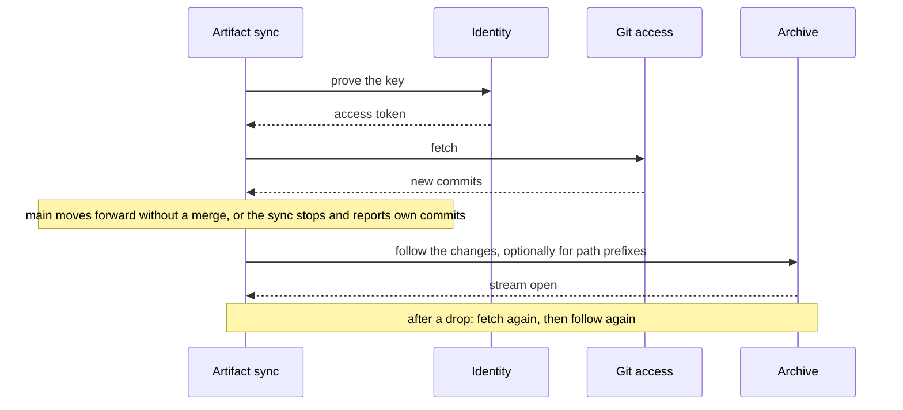

## A change reaches a local clone

A participant changes a document through the hub. The archive commits it, finds the artifacts that
changed and tells every client that follows the tenant. The sync part of another participant
fetches and moves its main directory forward. A change that came by a push gives the same event
(see the push scenario).

```arc42
:::runtime-scenario
id: rs-change-reaches-clone
title: A change reaches a local clone
trigger: A part of the hub commits a change of an artifact
involves: bb-documents, bb-archive, bb-sync, bb-git-access, bb-participant-client, bb-office-hub
:::
```

```arc42
:::diagram
id: seq-change-reaches-clone
notation: mermaid-sequence
scenario: rs-change-reaches-clone
aliases: bb_documents=bb-documents, bb_archive=bb-archive, bb_sync=bb-sync, bb_git_access=bb-git-access
:::
```

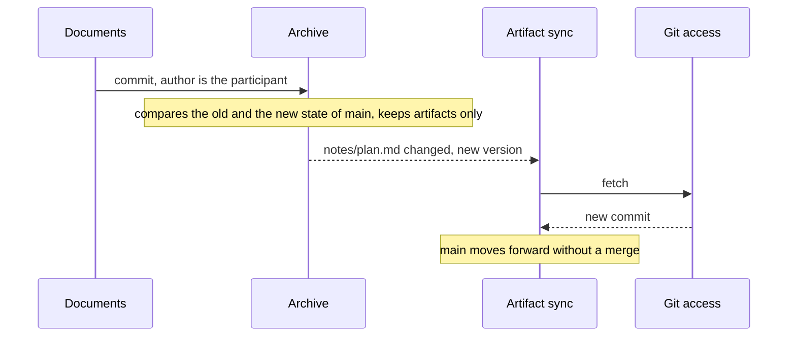

## Participant pushes a change with Git

A participant commits in a worktree and pushes the branch main with plain Git. Git access checks
the token and the tenant before Git reads the upload. Then Git runs the rules of Git access on the
new commits. The artifacts part passes the check of a changed file to the part of the hub that owns its
schema; the diagram shows the records part. For a file that the push changes or removes, Git
access also asks the artifacts part whether the old file is the stub of a staged artifact, and
refuses the push if it is. Git access also asks the artifacts part for the hints of each changed
file, such as a link of a document that leads nowhere in the state after the push, and shows them
to the participant; a hint never refuses the push. When an agent pushes, Git access also asks
the artifacts part whether the old or the new file is one that no agent may change, such as the
definition of a team agent, which Tenants owns, and refuses the push if it is
(`dec-team-agents`). When all of the rules hold, Git moves main in one step, and Git access tells the archive,
which tells the clients that follow the tenant. A push that breaks a rule is refused as a whole and
shows the reason. A push on an old base is refused by Git, and the participant fetches and merges
by hand first.

```arc42
:::runtime-scenario
id: rs-git-push
title: Participant pushes a change with Git
trigger: A participant pushes the branch main of the tenant repository
involves: bb-git-access, bb-identity, bb-artifacts, bb-records, bb-tasks, bb-slides, bb-documents, bb-tenants, bb-archive, bb-sync, bb-participant-client, bb-office-hub
:::
```

```arc42
:::diagram
id: seq-git-push
notation: mermaid-sequence
scenario: rs-git-push
aliases: actor_human=actor-human, bb_git_access=bb-git-access, bb_identity=bb-identity, bb_artifacts=bb-artifacts, bb_records=bb-records, bb_tenants=bb-tenants, bb_archive=bb-archive, bb_sync=bb-sync
:::
```

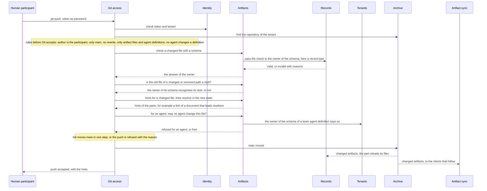

## A user opens the portal

A user asks for a link with the CLI. The identity part creates a code that works once and returns
the link. The user opens it in a browser. The portal swaps the code for an access token of the
key, keeps it in a cookie and shows the start page of the tenant that the link names. Every page
then asks the interfaces of the hub with this token: for example the meeting session for the
sessions that the user may see. A used, expired or unknown code gives an error page.

```arc42
:::runtime-scenario
id: rs-user-opens-portal
title: A user opens the portal
trigger: A user asks for a portal link
involves: bb-cli, bb-client-core, bb-identity, bb-portal, bb-session-service, bb-participant-client, bb-office-hub
:::
```

```arc42
:::diagram
id: seq-user-opens-portal
notation: mermaid-sequence
scenario: rs-user-opens-portal
aliases: actor_human=actor-human, bb_cli=bb-cli, bb_identity=bb-identity, bb_portal=bb-portal, bb_session_service=bb-session-service
:::
```

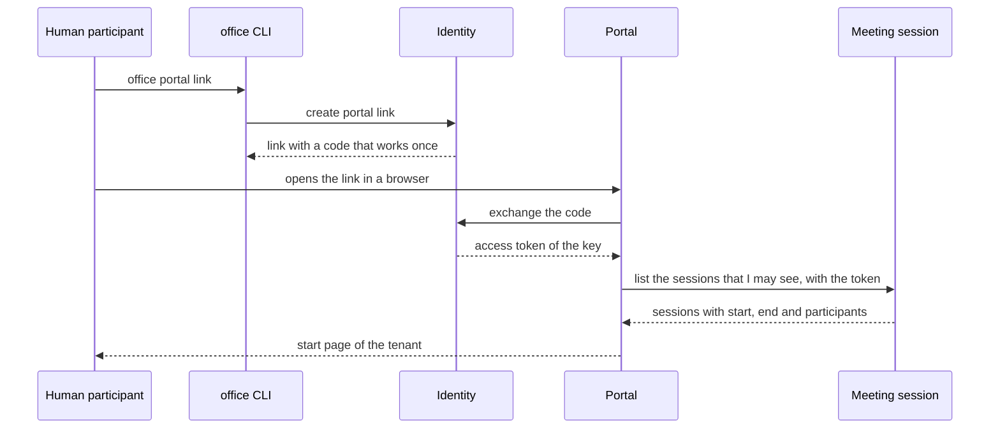

## A user reads a session in the portal

A user opens a session from the list on the page of a tenant. The portal reads the log of the
session from the session stream with the token of the user. The meeting session answers only who
may read the session (`concept-multi-tenancy`); for everybody else the session does not exist,
and the portal shows that. A sentence off the record comes as a placeholder and does not appear.
Then the portal asks the minutes, the decisions, the notes and the tasks for those of this
session, and renders everything on one page. A running session shows as it was when the page
was opened.

```arc42
:::runtime-scenario
id: rs-user-reads-session
title: A user reads a session in the portal
trigger: A user opens a session from the list of a tenant
involves: bb-portal, bb-session-service, bb-records, bb-tasks, bb-office-hub
:::
```

```arc42
:::diagram
id: seq-user-reads-session
notation: mermaid-sequence
scenario: rs-user-reads-session
aliases: actor_human=actor-human, bb_portal=bb-portal, bb_session_service=bb-session-service, bb_records=bb-records, bb_tasks=bb-tasks
:::
```

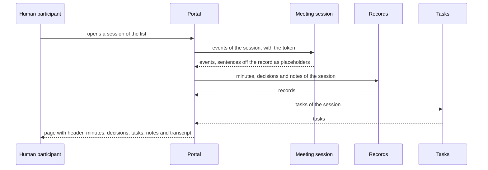

## A member searches the wiki in the portal

A member of a tenant types words into the search form of the wiki in the portal. The form works
without scripts: the browser asks the portal for the page of the search. The portal asks the wiki
part for the hits with the token of the user and the tenant of the page. The wiki part answers
only a member of the tenant; for everybody else the wiki of the tenant does not exist. The member
opens a hit. The portal asks the wiki part for the artifact with its links, backlinks, sources and
citations, and the archive for its text. It renders the text, and a link to another artifact of the
wiki leads to the page of that artifact in the portal.

```arc42
:::runtime-scenario
id: rs-member-searches-wiki
title: A member searches the wiki in the portal
trigger: A member sends the search form of the wiki
involves: bb-portal, bb-wiki, bb-archive, bb-office-hub
:::
```

```arc42
:::diagram
id: seq-member-searches-wiki
notation: mermaid-sequence
scenario: rs-member-searches-wiki
aliases: actor_human=actor-human, bb_portal=bb-portal, bb_wiki=bb-wiki, bb_archive=bb-archive
:::
```

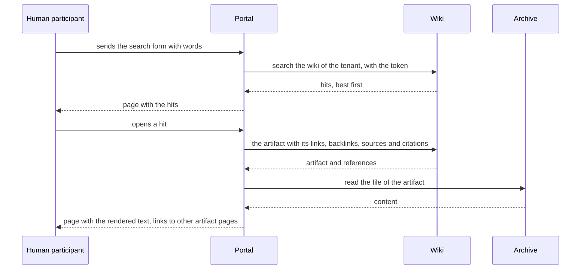

## Human marks a sentence off the record

What is said stays said (`dec-off-the-record`). The human presses a key in the gateway terminal
to mark their own sentence off the record. The CLI sends `utterance.mark_off_the_record`. The
hub checks that the caller is the speaker. The log gets a new event `utterance.off_the_record`
that points to the original utterance. Existing lines are never rewritten. From then on, the
interfaces deliver the utterance only as a placeholder without its text, the stage hides it, and
it does not go into minutes, decisions or notes. Agents that already read it must respect the
mark.

```arc42
:::runtime-scenario
id: rs-off-the-record
title: Human marks a sentence off the record
trigger: A key in the gateway terminal
involves: bb-cli, bb-session-service, bb-replicator, bb-stage, bb-participant-client, bb-office-hub
:::
```

## Session ends, the minutes are stored

The moderator ends the session. The agent that keeps the minutes writes the final version with
`minutes.update`. The meeting session stores the confirmed minutes through the minutes interface.
The records part writes them as one YAML file into the staging area of the session, and their stub
into the artifact repository, and commits both before it answers (`dec-yaml-git-storage`,
`concept-session-release`). It does not ask the meeting session back. Only then does the meeting
session write `session.ended` to the log. If storing fails, the session does not end, and the
moderator can repeat the command. The replicators stop. Afterwards every participant reads the
stored minutes through the minutes interface and may change them until the release.

```arc42
:::runtime-scenario
id: rs-session-ends
title: Session ends, the minutes are stored
trigger: The moderator ends the session
involves: bb-mcp, bb-cli, bb-session-service, bb-records, bb-archive, bb-replicator, bb-participant-client, bb-office-hub
:::
```

## Agent creates a task, a human finishes it

In a meeting, a human asks the agent to note a task for a colleague. The agent calls
`task.create` with a title, the assignee and the session. The tasks part checks the token, writes
the task as one YAML file into the archive and commits it before it answers with the reference of
the task (`dec-yaml-git-storage`). Later the assignee lists the open tasks assigned to them and
sets the status to done. The tasks part rewrites the file in a new commit, so the archive keeps
the history. Both commands carry an ID created by the client, so a repeat after a network drop
changes nothing.

```arc42
:::runtime-scenario
id: rs-task-lifecycle
title: Agent creates a task, a human finishes it
trigger: A human asks the agent in a meeting to note a task
involves: bb-mcp, bb-cli, bb-client-core, bb-tasks, bb-identity, bb-archive, bb-participant-client, bb-office-hub
:::
```

```arc42
:::diagram
id: seq-task-lifecycle
notation: mermaid-sequence
scenario: rs-task-lifecycle
aliases: bb_mcp=bb-mcp, bb_cli=bb-cli, bb_tasks=bb-tasks, bb_archive=bb-archive
:::
```

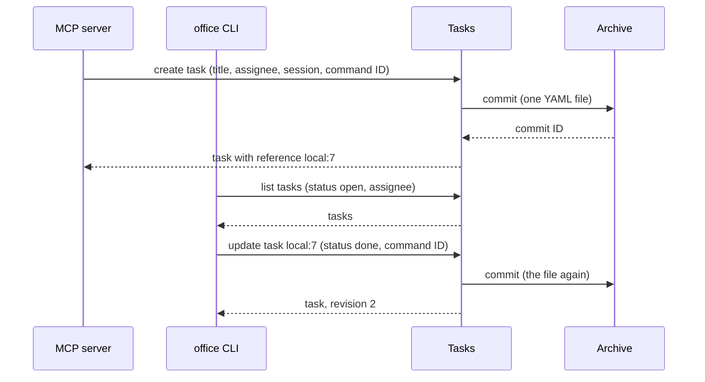

## A member runs a team agent

A tenant admin has created the team agent "minutes" and a member changed its definition with
Git. Anna, a member, starts the agent runner for a session. She is the agent launcher. The client
core reads the definition and the runner shows it. Anna confirms it, and the runner keeps which
version she confirmed. The client core signs the challenge with her own key, as for any call, and
asks Identity for a token as the team agent, with the confirmed version. Identity checks that she
is a member of the tenant and issues a short-lived token that names the agent, her as the agent
launcher and the version. The harness command, the working directory and the model credentials
come from her own computer. The runner then joins the session as the agent. If Ben already runs
the same team agent in this session, the meeting session refuses the join with "already joined",
and Anna's runner stops. Later Ben changes the definition. At her next start, Anna sees that the
definition has changed and has to confirm it again. A push of the agent itself that changes a
definition is refused.

```arc42
:::runtime-scenario
id: rs-team-agent-run
title: A member runs a team agent
trigger: A member starts the agent runner for a team agent of the tenant
involves: bb-agent-runner, bb-client-core, bb-identity, bb-session-service, bb-participant-client, bb-office-hub
:::
```

```arc42
:::diagram
id: seq-team-agent-run
notation: mermaid-sequence
scenario: rs-team-agent-run
aliases: bb_agent_runner=bb-agent-runner, bb_client_core=bb-client-core, bb_identity=bb-identity, bb_session_service=bb-session-service
:::
```

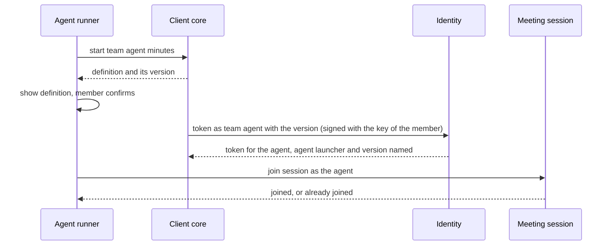

## Hub writes sessions to the archive

While sessions run, the meeting session writes every session that changed to the archive, at a
configurable interval and at once when a session ends (`dec-session-persistence`). It takes the
log as it is at that moment and signs the tree head over it. The archive writes the log and the
tree head and commits them as one commit; the push is mocked. Commands and the stream go on
during the commit. Events that arrive during a slow commit go into the next write. There is
never more than one write in progress (`qs-archive-no-backpressure`).

```arc42
:::runtime-scenario
id: rs-archive-session
title: Hub writes sessions to the archive
trigger: The write interval has passed, or a session has ended
involves: bb-session-service, bb-archive, bb-office-hub
:::
```

```arc42
:::diagram
id: seq-archive-session
notation: mermaid-sequence
scenario: rs-archive-session
aliases: bb_session=bb-session-service, bb_archive=bb-archive
:::
```

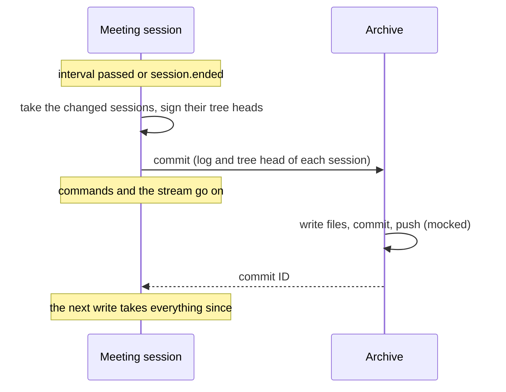

## Hub restarts and restores a session

The hub crashes while a session runs. Its last write to the archive has the session up to some
event; the events after it are lost on the hub, but the peers still have them. When the hub starts
again, the meeting session reads the stored log of every session that has not ended back from the
archive and checks it against its signed tree head (`dec-restore-from-peers`). An ended session
stays in the archive: the first call that needs it loads and checks it then
(`dec-session-eviction`). A session that has not ended takes no commands yet.
The replicators reconnect with their cursors. The hub does not know these cursors and answers that
they are beyond the end. Each replicator then asks the hub how many events it has and offers the
events after that, with the tree head the hub signed over its copy before the crash
(`dec-signed-head-in-stream`). The hub checks the signature, the root hash and the consistency
with its own log, and appends the missing events with their IDs. The first copy that fits wins;
later copies have no effect. The session takes commands again, the replicators follow the stream
from their cursors, and the IDs continue without a gap. A copy that does not verify or forks
fails, and the replicator stops instead of continuing it.

```arc42
:::runtime-scenario
id: rs-hub-restart
title: Hub restarts and restores a session from the archive and the peers
trigger: The hub starts again after a crash while a session runs
involves: bb-session-service, bb-archive, bb-replicator, bb-participant-client, bb-office-hub
:::
```

```arc42
:::diagram
id: seq-hub-restart
notation: mermaid-sequence
scenario: rs-hub-restart
aliases: bb_session=bb-session-service, bb_archive=bb-archive, bb_replicator=bb-replicator
:::
```

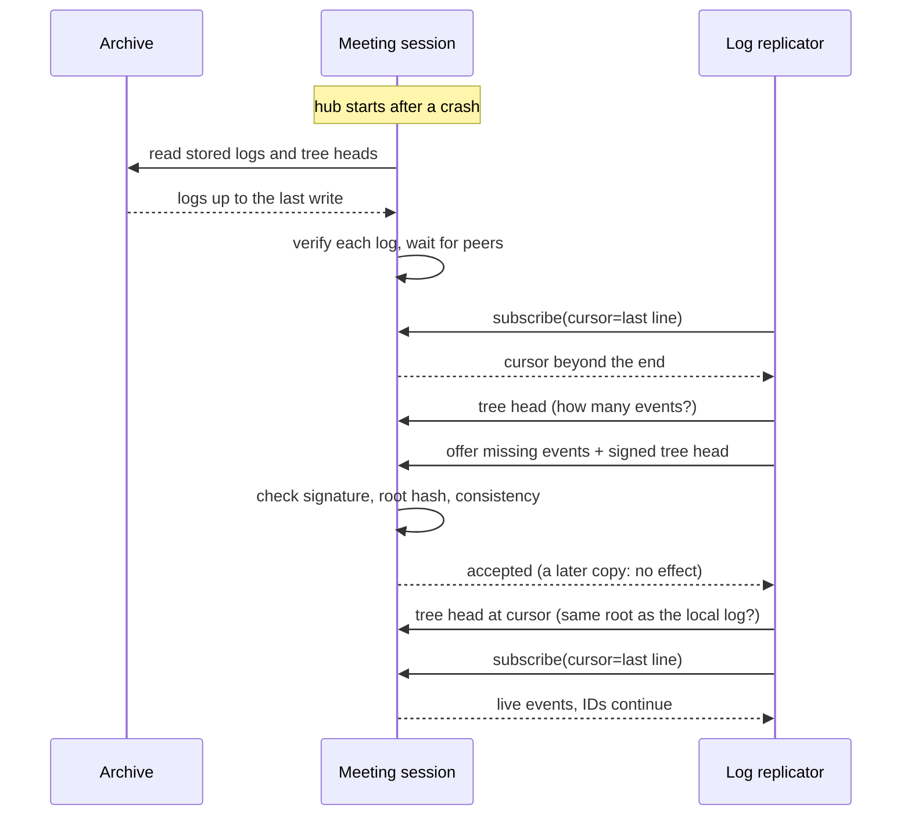

## Agent imports a conversation and writes its minutes

An agent has a conversation from another tool as a file in the import format
(`dec-import-format`). It calls `session.import` with the file. The client core reads the file
and sends the conversation in pages to the session import. The first page creates the session:
the meeting session writes an event that marks the session as imported, the imported
participants and the first utterances. Every further page adds utterances, and the last page
writes the end of the import. The client core returns the session ID and the signed tree head
over the imported log. The hub writes the session to the archive at its next interval, like
every other session. The agent then reads the events after a cursor, joins the session like a
live one, writes the minutes and records decisions and tasks with the session ID. When it ends
the session, the meeting session stores the minutes (`rs-session-ends`).

```arc42
:::runtime-scenario
id: rs-import-conversation
title: Agent imports a conversation and writes its minutes
trigger: An agent calls session.import with a conversation file
involves: bb-mcp, bb-cli, bb-client-core, bb-session-service, bb-records, bb-archive, bb-participant-client, bb-office-hub
:::
```

```arc42
:::diagram
id: seq-import-conversation
notation: mermaid-sequence
scenario: rs-import-conversation
aliases: actor_agent=actor-agent, bb_mcp=bb-mcp, bb_client_core=bb-client-core, bb_session=bb-session-service, bb_archive=bb-archive, bb_records=bb-records
:::
```

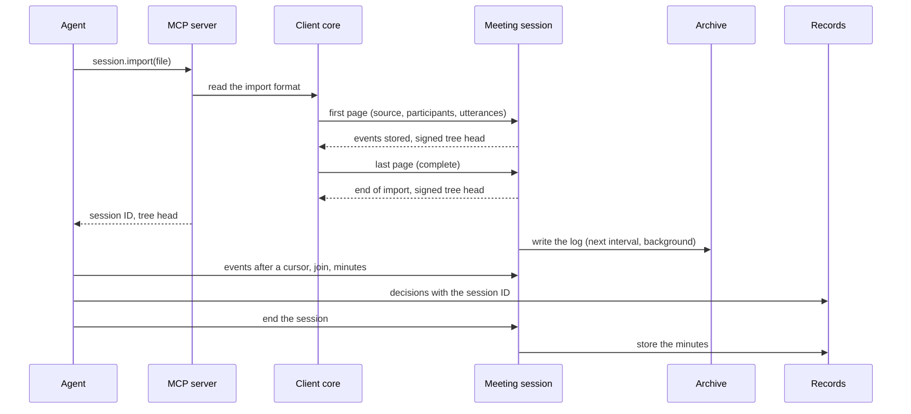

## The agent runner checks after each utterance whether to wake an agent

An agent takes part through the agent runner (`dec-agent-runner-acp`). The runner joined the
session with the key of the agent and follows its local log. It started the harness, opened one
ACP session with the office tools and sent a first prompt with the role.

A human talks. Each sentence reaches the local log as `utterance.final`. The wake strategy that
the user chose decides when to wake the agent (`dec-agent-runner-delivery`). With a model that
the user brings, the runner asks it after each utterance whether the agent should act now, for
example because the speaker addressed it or started a new topic (`dec-wake-check-per-utterance`,
`dec-byo-decision-model`). With `turn-end`, or when the model fails, the runner waits until the
speaker ends the turn. When the agent should act, the runner sends what others said since its
last delivery as one prompt, without the agent's own utterances and sentences off the record. The
agent decides how to act: it answers with `utterance_say` when the speaker asked it, raises its
hand instead of interrupting, or updates the minutes silently. If the agent is still busy, the
runner queues what comes and sends it together afterwards. When the session ends, the runner
sends a last prompt with what is left and stops the harness.

```arc42
:::runtime-scenario
id: rs-agent-runner-turn
title: The agent runner checks after each utterance whether to wake an agent
trigger: utterance.final of another participant in the local log of the agent
involves: bb-agent-runner, bb-client-core, bb-replicator, bb-mcp, bb-cli, bb-session-service, bb-participant-client, bb-office-hub
:::
```

```arc42
:::diagram
id: seq-agent-runner-turn
notation: mermaid-sequence
scenario: rs-agent-runner-turn
aliases: actor_human=actor-human, actor_agent=actor-agent, actor_forwarding_judge=actor-forwarding-judge, actor_decision_model=actor-decision-model, bb_cli=bb-cli, bb_session=bb-session-service, bb_replicator=bb-replicator, bb_agent_runner=bb-agent-runner, bb_mcp=bb-mcp
:::
```

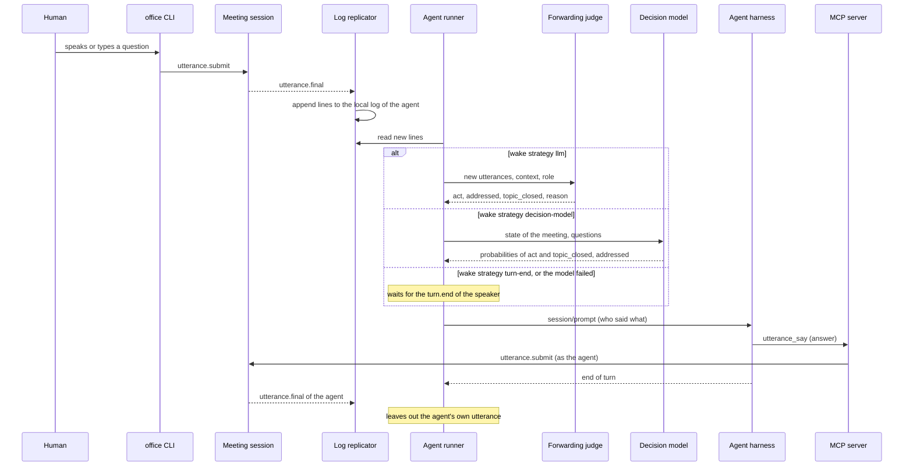

## System admin creates a tenant and the tenant admin adds a member

A system admin creates a tenant and names an active user as its first tenant admin. Tenants checks
the token (a system admin only) and asks Identity through the tenant roster. Identity applies the
change to a copy of its state, checks all rules and writes the tenant and the first membership as
one commit in the hub repository. Later, the tenant admin adds a user to the tenant. Identity
checks that the caller is a tenant admin of this tenant and that the change keeps all rules. A
user who is no member gets the same answer as for a tenant that does not exist.

```arc42
:::runtime-scenario
id: rs-tenant-setup
title: A system admin creates a tenant, the tenant admin adds a member
trigger: A system admin creates a tenant
involves: bb-office-hub, bb-tenants, bb-identity, bb-archive
:::
```
