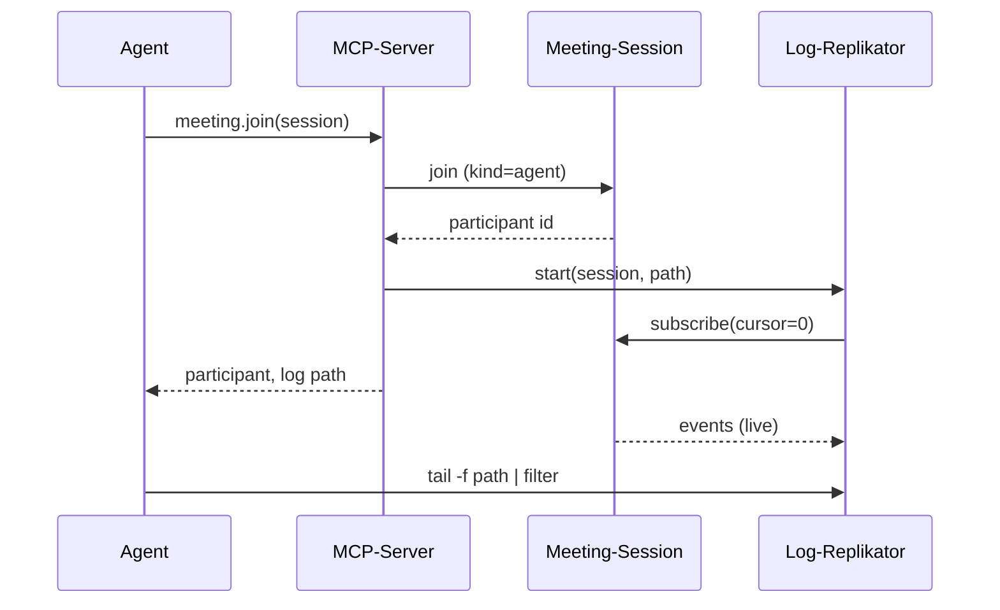
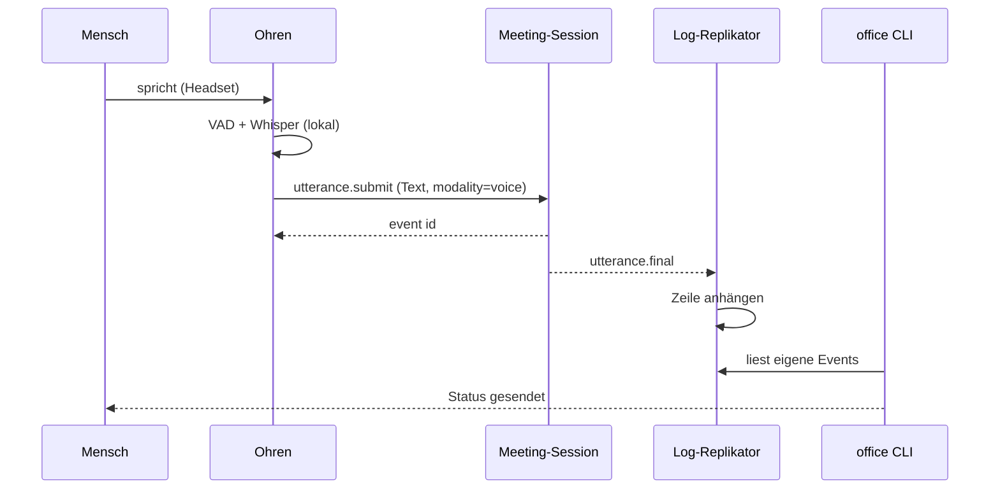
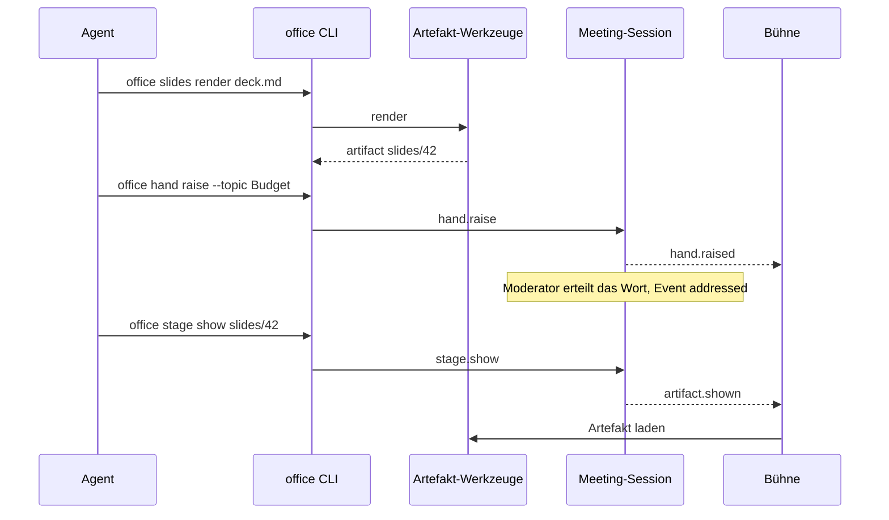

# Laufzeitsicht

## Agent tritt einem Meeting bei

Der Agent ruft `meeting.join` auf. Der MCP-Server meldet ihn als Teilnehmer an, startet den
Log-Replikator und gibt den Dateipfad zurück. Der Agent verfolgt die Datei im Hintergrund und
filtert auf die Events, bei denen er geweckt werden will (z. B. `turn.end`, `addressed`).

```arc42
:::runtime-scenario
id: rs-agent-joins
title: Agent tritt einem Meeting bei
trigger: Agent ruft meeting.join auf
involves: bb-mcp, bb-session-service, bb-replicator
:::
```

```arc42
:::diagram
id: seq-agent-joins
notation: mermaid-sequence
scenario: rs-agent-joins
aliases: actor_agent=actor-agent, bb_mcp=bb-mcp, bb_session=bb-session-service, bb_replicator=bb-replicator
:::
```



## Mensch spricht

Ein Mensch hat mit `--mic` beigetreten. Die Ohren erkennen ein Satzende, Whisper transkribiert
lokal, und die Utterance wird gesendet. Die Session hängt sie ans Log an. Alle Replikatoren
schreiben sie in ihre lokale Datei. Das Terminal des Sprechers zeigt den Status „gesendet“.

```arc42
:::runtime-scenario
id: rs-human-speaks
title: Mensch spricht, Agent erhält den Satz
trigger: Satzende (VAD-Pause) im Headset-Signal
involves: bb-ears, bb-session-service, bb-replicator, bb-cli
:::
```

```arc42
:::diagram
id: seq-human-speaks
notation: mermaid-sequence
scenario: rs-human-speaks
aliases: actor_human=actor-human, bb_ears=bb-ears, bb_session=bb-session-service, bb_replicator=bb-replicator, bb_cli=bb-cli
:::
```



## Agent meldet sich und zeigt ein Artefakt

Der Agent rendert über die CLI eine Folie, meldet sich auf der Bühne und zeigt das Artefakt,
sobald ihm das Wort erteilt wird. Die Bühne liest dieselben Events aus dem Session-Stream.

```arc42
:::runtime-scenario
id: rs-agent-shows-artifact
title: Agent meldet sich und zeigt ein Artefakt
trigger: Agent entscheidet nach turn.end, sich zu melden
involves: bb-cli, bb-artifact-service, bb-session-service, bb-stage, bb-replicator
:::
```

```arc42
:::diagram
id: seq-agent-shows-artifact
notation: mermaid-sequence
scenario: rs-agent-shows-artifact
aliases: actor_agent=actor-agent, bb_cli=bb-cli, bb_artifacts=bb-artifact-service, bb_session=bb-session-service, bb_stage=bb-stage
:::
```



## Mensch zieht einen Satz zurück

Der Mensch drückt `r` im Gateway-Terminal. Die CLI sendet `utterance.retract`. Das Log erhält ein
neues Event `utterance.retracted` mit Referenz auf die ursprüngliche Utterance. Bestehende Zeilen
werden nie umgeschrieben. Agenten und Bühne müssen das Event berücksichtigen.

```arc42
:::runtime-scenario
id: rs-retract
title: Mensch zieht einen Satz zurück
trigger: Taste r im Gateway-Terminal
involves: bb-cli, bb-session-service, bb-replicator, bb-stage
:::
```

## Session endet, Minutes ins Journal

Die Moderation beendet die Session. Der protokollierende Agent schreibt die finalen Minutes.
Die Session legt die bestätigten Minutes im Journal ab, schreibt `session.ended` ins Log, und
die Replikatoren beenden sich.

```arc42
:::runtime-scenario
id: rs-session-ends
title: Session endet, Minutes werden ins Journal übernommen
trigger: Moderation beendet die Session
involves: bb-mcp, bb-cli, bb-session-service, bb-journal, bb-replicator
:::
```
