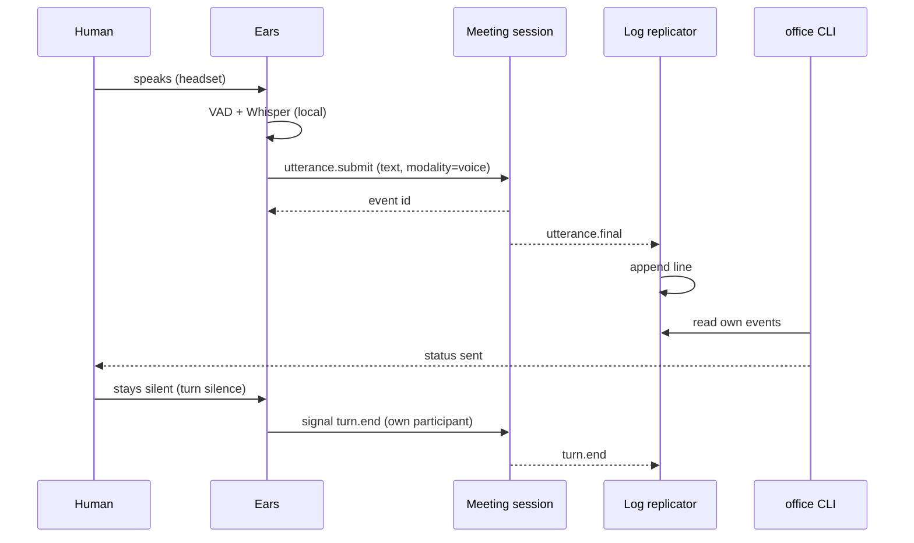
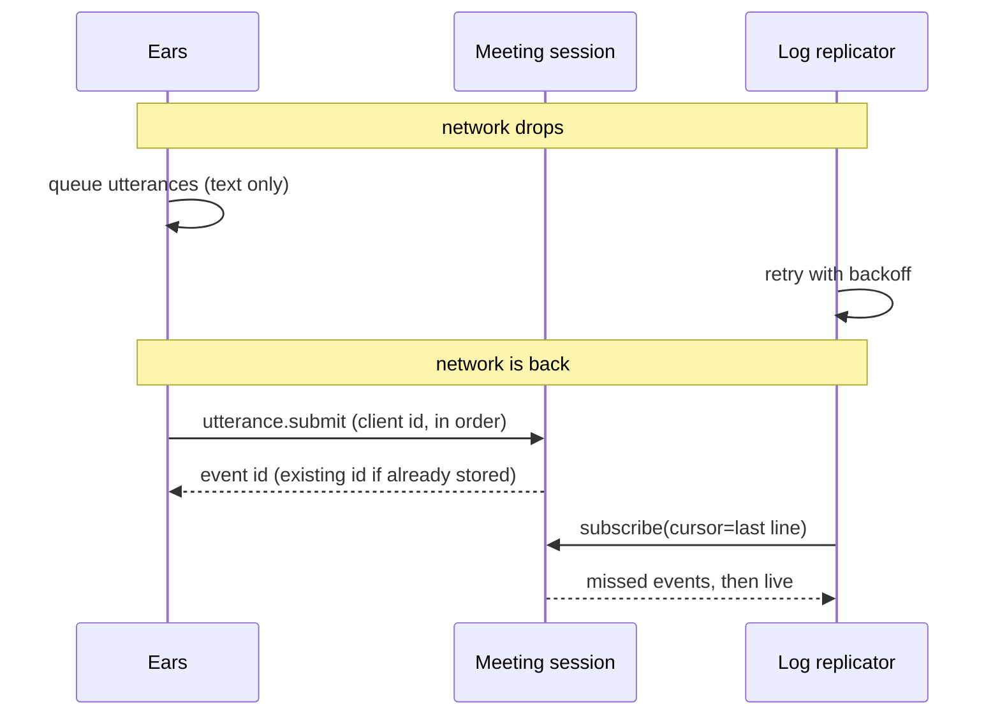
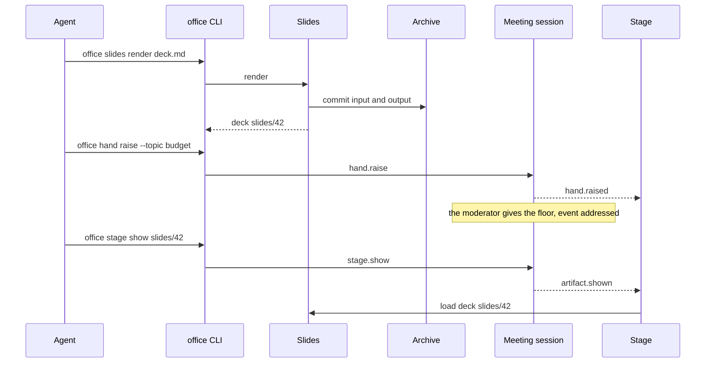
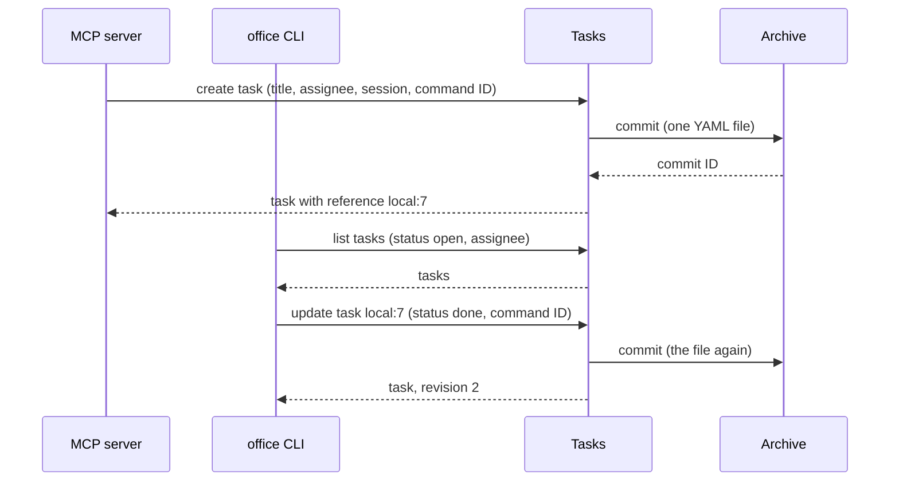
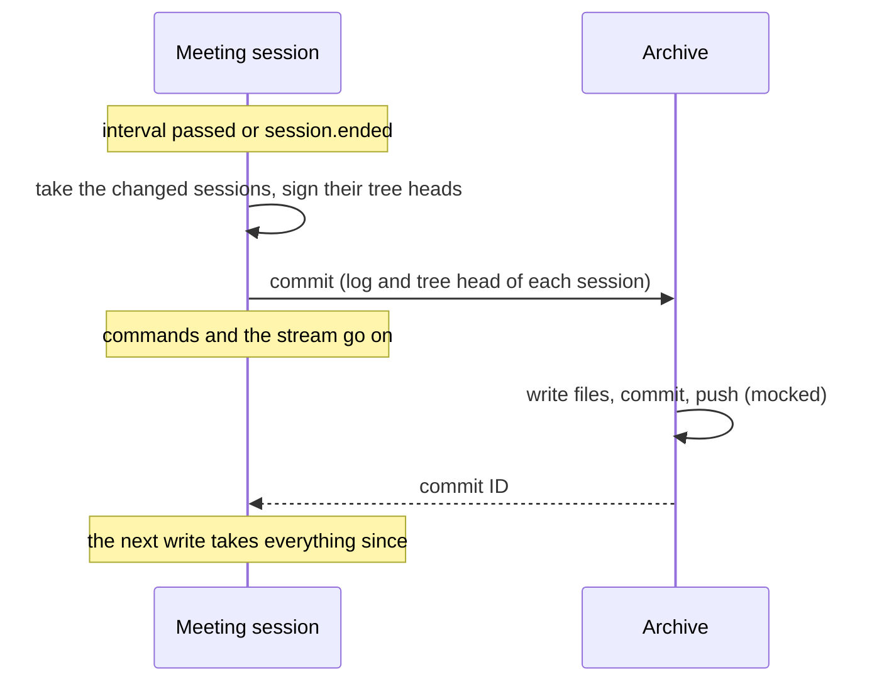
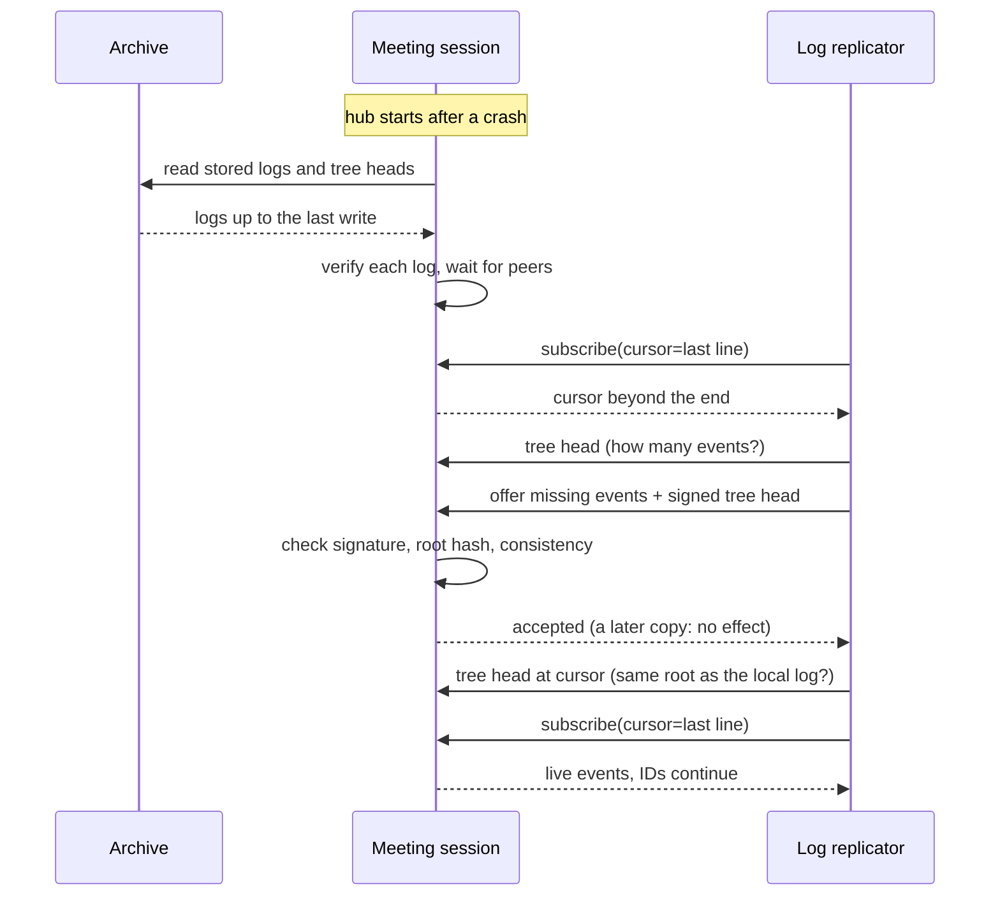
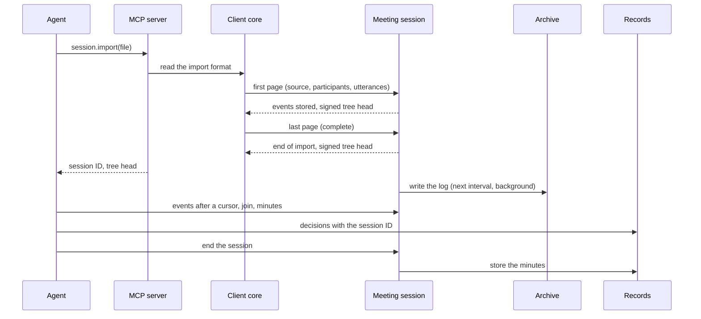
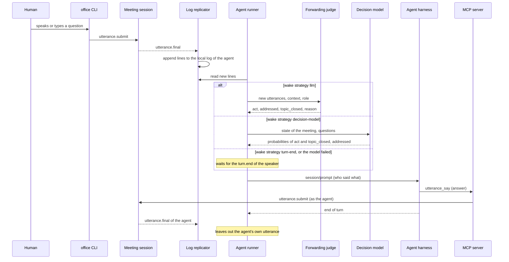

# Runtime View

## Agent joins a meeting

The agent calls `meeting.join`. The MCP server registers it as a participant, starts the log
replicator and returns the file path. The agent follows the file in the background. It filters for
the events that should wake it up, for example `turn.end` and `addressed`.

```arc42
:::runtime-scenario
id: rs-agent-joins
title: Agent joins a meeting
trigger: Agent calls meeting.join
involves: bb-mcp, bb-client-core, bb-session-service, bb-replicator, bb-participant-client, bb-office-hub
:::
```

```arc42
:::diagram
id: seq-agent-joins
notation: mermaid-sequence
scenario: rs-agent-joins
aliases: actor_agent=actor-agent, bb_mcp=bb-mcp, bb_session=bb-session-service, bb_replicator=bb-replicator
:::
```


## Human speaks

A human joined with `--mic`. The ears detect the end of a sentence, Whisper transcribes it locally,
and the utterance is sent. The session appends it to the log. Every replicator writes it to its
local file. The speaker's terminal shows the status "sent". When the human stays silent for longer
after the last sentence, the ears submit `turn.end`. Agents that wait for the end of a turn wake up.

```arc42
:::runtime-scenario
id: rs-human-speaks
title: Human speaks, agent receives the sentence
trigger: End of sentence (VAD pause) in the headset signal
involves: bb-ears, bb-client-core, bb-session-service, bb-replicator, bb-cli, bb-participant-client, bb-office-hub
:::
```

```arc42
:::diagram
id: seq-human-speaks
notation: mermaid-sequence
scenario: rs-human-speaks
aliases: actor_human=actor-human, bb_ears=bb-ears, bb_session=bb-session-service, bb_replicator=bb-replicator, bb_cli=bb-cli
:::
```



## Network drop and resume

The network of a participant drops for a while. The ears keep transcribing and queue utterances
locally. The replicator loses the stream. When the network is back, the ears send the queued
utterances in order. Each one carries its client ID, so nothing is stored twice. The replicator
reconnects with the ID of its last line and receives everything it missed.

```arc42
:::runtime-scenario
id: rs-network-drop
title: Network drop and resume
trigger: Network connection of a participant is lost and comes back
involves: bb-ears, bb-session-service, bb-replicator, bb-participant-client, bb-office-hub
:::
```

```arc42
:::diagram
id: seq-network-drop
notation: mermaid-sequence
scenario: rs-network-drop
aliases: bb_ears=bb-ears, bb_session=bb-session-service, bb_replicator=bb-replicator
:::
```



## Participant authenticates

Before its first call, a client (CLI, MCP server or ears) asks Identity for a challenge. It signs
the challenge with its private key and gets a short-lived access token. It sends the token with
every call. The session checks the token and knows the participant. Shortly before the token
expires, the client repeats the steps. This also happens after a network drop.

```arc42
:::runtime-scenario
id: rs-authenticate
title: Participant authenticates with its key
trigger: First call of a client, or the access token is about to expire
involves: bb-cli, bb-mcp, bb-ears, bb-client-core, bb-identity, bb-session-service, bb-participant-client, bb-office-hub
:::
```

## Agent raises its hand and shows an artifact

The agent renders a slide deck through the CLI and raises its hand on the stage. The slides part
stores the input and the rendered deck in the archive before it returns the ID. When the agent
gets the floor, it shows the deck by its ID. The stage reads the same events from the session
stream and loads the deck from the slides part inside the hub.

```arc42
:::runtime-scenario
id: rs-agent-shows-artifact
title: Agent raises its hand and shows an artifact
trigger: Agent decides after turn.end to raise its hand
involves: bb-cli, bb-slides, bb-archive, bb-session-service, bb-stage, bb-replicator, bb-participant-client, bb-office-hub
:::
```

```arc42
:::diagram
id: seq-agent-shows-artifact
notation: mermaid-sequence
scenario: rs-agent-shows-artifact
aliases: actor_agent=actor-agent, bb_cli=bb-cli, bb_slides=bb-slides, bb_archive=bb-archive, bb_session=bb-session-service, bb_stage=bb-stage
:::
```



## Human marks a sentence off the record

What is said stays said (`dec-off-the-record`). The human presses a key in the gateway terminal
to mark their own sentence off the record. The CLI sends `utterance.mark_off_the_record`. The
hub checks that the caller is the speaker. The log gets a new event `utterance.off_the_record`
that points to the original utterance. Existing lines are never rewritten. From then on, the
interfaces deliver the utterance only as a placeholder without its text, the stage hides it, and
it does not go into minutes, decisions or notes. Agents that already read it must respect the
mark.

```arc42
:::runtime-scenario
id: rs-off-the-record
title: Human marks a sentence off the record
trigger: A key in the gateway terminal
involves: bb-cli, bb-session-service, bb-replicator, bb-stage, bb-participant-client, bb-office-hub
:::
```

## Session ends, the minutes are stored

The moderator ends the session. The agent that keeps the minutes writes the final version with
`minutes.update`. The meeting session stores the confirmed minutes through the minutes interface.
The records part writes them as one YAML file into the archive and commits it before it answers
(`dec-yaml-git-storage`). Only then does the meeting session write `session.ended` to the log. If
storing fails, the session does not end, and the moderator can repeat the command. The
replicators stop. Afterwards every participant reads the stored minutes through the minutes
interface.

```arc42
:::runtime-scenario
id: rs-session-ends
title: Session ends, the minutes are stored
trigger: The moderator ends the session
involves: bb-mcp, bb-cli, bb-session-service, bb-records, bb-archive, bb-replicator, bb-participant-client, bb-office-hub
:::
```

## Agent creates a task, a human finishes it

In a meeting, a human asks the agent to note a task for a colleague. The agent calls
`task.create` with a title, the assignee and the session. The tasks part checks the token, writes
the task as one YAML file into the archive and commits it before it answers with the reference of
the task (`dec-yaml-git-storage`). Later the assignee lists the open tasks assigned to them and
sets the status to done. The tasks part rewrites the file in a new commit, so the archive keeps
the history. Both commands carry an ID created by the client, so a repeat after a network drop
changes nothing.

```arc42
:::runtime-scenario
id: rs-task-lifecycle
title: Agent creates a task, a human finishes it
trigger: A human asks the agent in a meeting to note a task
involves: bb-mcp, bb-cli, bb-client-core, bb-tasks, bb-identity, bb-archive, bb-participant-client, bb-office-hub
:::
```

```arc42
:::diagram
id: seq-task-lifecycle
notation: mermaid-sequence
scenario: rs-task-lifecycle
aliases: bb_mcp=bb-mcp, bb_cli=bb-cli, bb_tasks=bb-tasks, bb_archive=bb-archive
:::
```



## Hub writes sessions to the archive

While sessions run, the meeting session writes every session that changed to the archive, at a
configurable interval and at once when a session ends (`dec-session-persistence`). It takes the
log as it is at that moment and signs the tree head over it. The archive writes the log and the
tree head and commits them as one commit; the push is mocked. Commands and the stream go on
during the commit. Events that arrive during a slow commit go into the next write. There is
never more than one write in progress (`qs-archive-no-backpressure`).

```arc42
:::runtime-scenario
id: rs-archive-session
title: Hub writes sessions to the archive
trigger: The write interval has passed, or a session has ended
involves: bb-session-service, bb-archive, bb-office-hub
:::
```

```arc42
:::diagram
id: seq-archive-session
notation: mermaid-sequence
scenario: rs-archive-session
aliases: bb_session=bb-session-service, bb_archive=bb-archive
:::
```



## Hub restarts and restores a session

The hub crashes while a session runs. Its last write to the archive has the session up to some
event; the events after it are lost on the hub, but the peers still have them. When the hub starts
again, the meeting session reads the stored log of every session that has not ended back from the
archive and checks it against its signed tree head (`dec-restore-from-peers`). An ended session
stays in the archive: the first call that needs it loads and checks it then
(`dec-session-eviction`). A session that has not ended takes no commands yet.
The replicators reconnect with their cursors. The hub does not know these cursors and answers that
they are beyond the end. Each replicator then asks the hub how many events it has and offers the
events after that, with the tree head the hub signed over its copy before the crash
(`dec-signed-head-in-stream`). The hub checks the signature, the root hash and the consistency
with its own log, and appends the missing events with their IDs. The first copy that fits wins;
later copies have no effect. The session takes commands again, the replicators follow the stream
from their cursors, and the IDs continue without a gap. A copy that does not verify or forks
fails, and the replicator stops instead of continuing it.

```arc42
:::runtime-scenario
id: rs-hub-restart
title: Hub restarts and restores a session from the archive and the peers
trigger: The hub starts again after a crash while a session runs
involves: bb-session-service, bb-archive, bb-replicator, bb-participant-client, bb-office-hub
:::
```

```arc42
:::diagram
id: seq-hub-restart
notation: mermaid-sequence
scenario: rs-hub-restart
aliases: bb_session=bb-session-service, bb_archive=bb-archive, bb_replicator=bb-replicator
:::
```



## Agent imports a conversation and writes its minutes

An agent has a conversation from another tool as a file in the import format
(`dec-import-format`). It calls `session.import` with the file. The client core reads the file
and sends the conversation in pages to the session import. The first page creates the session:
the meeting session writes an event that marks the session as imported, the imported
participants and the first utterances. Every further page adds utterances, and the last page
writes the end of the import. The client core returns the session ID and the signed tree head
over the imported log. The hub writes the session to the archive at its next interval, like
every other session. The agent then reads the events after a cursor, joins the session like a
live one, writes the minutes and records decisions and tasks with the session ID. When it ends
the session, the meeting session stores the minutes (`rs-session-ends`).

```arc42
:::runtime-scenario
id: rs-import-conversation
title: Agent imports a conversation and writes its minutes
trigger: An agent calls session.import with a conversation file
involves: bb-mcp, bb-cli, bb-client-core, bb-session-service, bb-records, bb-archive, bb-participant-client, bb-office-hub
:::
```

```arc42
:::diagram
id: seq-import-conversation
notation: mermaid-sequence
scenario: rs-import-conversation
aliases: actor_agent=actor-agent, bb_mcp=bb-mcp, bb_client_core=bb-client-core, bb_session=bb-session-service, bb_archive=bb-archive, bb_records=bb-records
:::
```



## The agent runner checks after each utterance whether to wake an agent

An agent takes part through the agent runner (`dec-agent-runner-acp`). The runner joined the
session with the key of the agent and follows its local log. It started the harness, opened one
ACP session with the office tools and sent a first prompt with the role.

A human talks. Each sentence reaches the local log as `utterance.final`. The wake strategy that
the user chose decides when to wake the agent (`dec-agent-runner-delivery`). With `llm` or
`decision-model`, the runner checks after each utterance (`dec-wake-check-per-utterance`): it
asks the forwarding judge or the decision model whether the agent should act now, for example
because
the speaker addressed it, started a new topic within a monologue or talks about something that
concerns the role of the agent (`dec-byo-decision-model`). If so, the runner collects what others said since its last
delivery, leaves out the agent's own utterances and sentences off the record, and sends it as one
prompt. The agent decides how to act: it answers with `utterance_say` when the speaker asked it,
raises its hand instead of interrupting, or updates the minutes silently. Its actions reach every
local log, also that of the runner, which leaves them out of the next prompt. If the agent is
still busy, the runner queues what comes and sends it together afterwards. If the model is
still busy with a check, the next check judges all new utterances together
(`dec-agent-runner-delivery`). If a check fails, the utterances wait until the speaker ends the
turn; after three failures within five minutes, the runner works as `turn-end` and asks the
model again once after each change of speaker, until it answers. With `turn-end`, the runner wakes the agent only when the speaker ends the turn. When the
session ends, the runner sends a last prompt with what is left
and stops the harness.

```arc42
:::runtime-scenario
id: rs-agent-runner-turn
title: The agent runner checks after each utterance whether to wake an agent
trigger: utterance.final of another participant in the local log of the agent
involves: bb-agent-runner, bb-client-core, bb-replicator, bb-mcp, bb-cli, bb-session-service, bb-participant-client, bb-office-hub
:::
```

```arc42
:::diagram
id: seq-agent-runner-turn
notation: mermaid-sequence
scenario: rs-agent-runner-turn
aliases: actor_human=actor-human, actor_agent=actor-agent, actor_forwarding_judge=actor-forwarding-judge, actor_decision_model=actor-decision-model, bb_cli=bb-cli, bb_session=bb-session-service, bb_replicator=bb-replicator, bb_agent_runner=bb-agent-runner, bb_mcp=bb-mcp
:::
```



## System admin creates a tenant and the tenant admin adds a member

A system admin creates a tenant and names an active user as its first tenant admin. Tenants checks
the token (a system admin only) and asks Identity through the tenant roster. Identity applies the
change to a copy of its state, checks all rules and writes the tenant and the first membership as
one commit in the hub repository. Later, the tenant admin adds a user to the tenant. Identity
checks that the caller is a tenant admin of this tenant and that the change keeps all rules. A
user who is no member gets the same answer as for a tenant that does not exist.

```arc42
:::runtime-scenario
id: rs-tenant-setup
title: A system admin creates a tenant, the tenant admin adds a member
trigger: A system admin creates a tenant
involves: bb-office-hub, bb-tenants, bb-identity, bb-archive
:::
```
