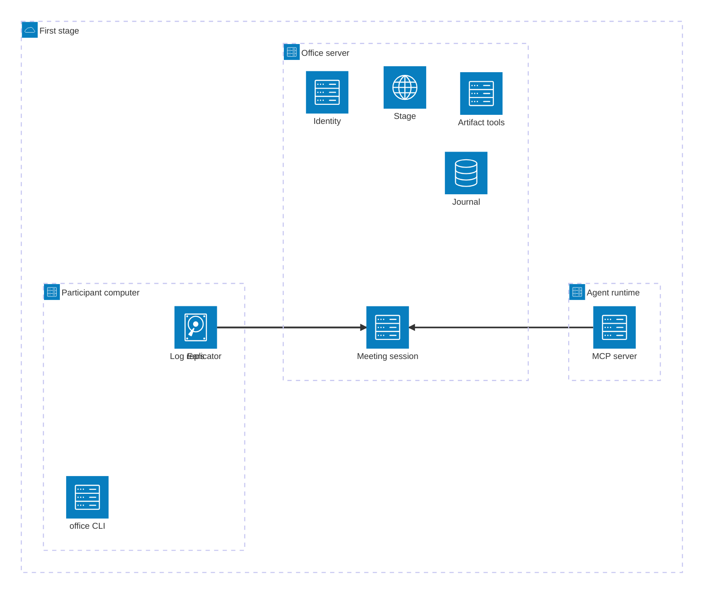

# Deployment View

## Deployment overview

The first stage has one environment. It contains one office server, the computers of the human
participants and the runtimes of the agents. An agent and its participant client must share a
file system. The CLI and the log replicator run on both client nodes. The diagram shows them only
once (see the `hosts` of each node). OPEN: is the server self-hosted or in the cloud?

```arc42
:::diagram
id: deployment-overview
view: deployment
notation: mermaid-architecture
:::
```



## First stage

The environment in which the system first runs in our own team.

```arc42
:::deployment-node
id: env-mvp
title: First stage
type: environment
:::
```

## Participant computer

The laptop of a human with a headset. It runs the CLI, the log replicator and the ears with local
Whisper. OPEN: minimum hardware for real-time Whisper (CPU or GPU, model size).

```arc42
:::deployment-node
id: dn-participant-laptop
title: Participant computer
type: device
parent: env-mvp
hosts: bb-cli, bb-client-core, bb-replicator, bb-ears
:::
```

## Agent runtime

The computer or container in which the agent runs, for example Claude Code on a laptop or in a
cloud session. It runs the MCP server, the CLI and the log replicator in the same file system as
the agent.

```arc42
:::deployment-node
id: dn-agent-runtime
title: Agent runtime
type: container
parent: env-mvp
hosts: bb-mcp, bb-cli, bb-client-core, bb-replicator
:::
```

## Office server

One server or container with the meeting session, the journal, the artifact tools and the stage.
OPEN: persistence (database, Git-based storage or both).

```arc42
:::deployment-node
id: dn-office-host
title: Office server
type: server
parent: env-mvp
hosts: bb-session-service, bb-journal, bb-artifact-service, bb-stage, bb-identity
:::
```
